# Logbook: Middle reach GP, built from the raw data

Experiment notebook for the rebuild. One entry per step, dated. Each entry says what was done, which script did it, what came out (figures and numbers), what was decided, and what is still open. The "for the methods" line under each entry is a sentence in paper voice that can be lifted into the methods section later. Everything referenced here lives in this folder: raw inputs in `data_raw/`, every derived table in `data_clean/`, figures in `figures/`, one script per step. `sh reach_velocity/run_all.sh` from the repository root regenerates all of it.

## Entry 0. 21 September 2026. Why start over, and the rules

The earlier analysis (the notebooks and `paper_analysis/`) had become a mix of three hands and two AI assistants, and mistakes kept surfacing: ADCP units, nest rows in training, a second survey protocol mixed in, a stage-dependent applicability mask, and a height column read as feet when it was a rod reading. The PI asked to set the figures aside and rebuild from the raw data, one step at a time, so that every piece is understood.

Rules for this folder:
- Nothing is imported from the notebooks or from `paper_analysis/`. The inputs are the raw sheets and sensor exports in `data_raw/`.
- One script per step, one figure per step, and no step is left until it is understood.
- Every choice is written in the code where it is made and repeated here.
- Units are converted once, at load. Nothing downstream sees feet.
- Year and survey day are never model inputs.

## Entry 1. 21 September 2026. Loading the raw data (`00_load.py`)

**Inputs.** `25_ecohydroData.csv`, `26_ecohydroData.csv` (hand-held surveys, one row per reading), `25_ADCPData.csv` (SonTek beam velocity at one point, 2025), `25_/26_depthSensorData_Middle.csv` (MaxBotix ultrasonic range to the water surface, 10-minute), `usgs_04174500_dv.json` (USGS daily discharge, Huron River at Ann Arbor, downloaded 21 September 2026 for reference only), and the Middle centreline and bank lines from `mapping/`.

**Choices.**
- Middle reach = Northing between 280,000 and 323,000 ft (State Plane Michigan South). The Northing 321,000 cut used in the notebooks lies 300 m north of every transect here and changes nothing.
- Modelling rows are `Type == Transect` only. `Nest` rows (87) go to `nests.csv` for validation. `Other` rows (196: single readings every 2 to 3 minutes while moving downstream, velocity about 0.3 m/s everywhere, whatever the discharge) and `Thalweg` rows (20) are dropped.
- Height above the bed: in the 2025 sheet `Depth` is a rod reading and `Actual depth` (exactly 0.4 x `Depth`, never above the water depth, velocity rising with it in 95% of profiles) is the height in feet; in the 2026 sheet `Depth` is the height in feet (the surface reading is faster than the bottom one in 94% of profiles, median ratio 2.7, the same pattern as 2025).
- Velocity ft/s to m/s, depths and heights ft to m, at load.
- Rows dropped from the transect set: no velocity or height (20), negative velocity (74), height above the water surface (1), and one named entry error (2025-07-14, AT0605, 3.60 ft/s at 0.08 ft in a profile that otherwise reads 0.5 to 0.8 ft/s). 1,381 rows in, 1,285 readings out.
- Stage: (7313.2 - range_mm)/1000 m; 124 readings outside 0.3 to 3.0 m removed (an obstruction episode in August 2025), 20 six-hour spikes removed.
- Stage at each reading is interpolated at the reading's own time of day (the sheets carry the time), not the daily median. Every reading found a stage within two hours.
- Local frame: metres east and north of the ADCP (Easting 13,244,857, Northing 319,995.5 ft).

**What we have.**

| | 2025 | 2026 |
|---|---|---|
| Survey days | 9 (30 May to 23 Jul) | 2 (18 and 25 Jun) |
| Transects / locations / readings | 12 / 183 / 972 | 8 / 77 / 313 |
| Readings per location | 1 to 25, median 4 | 1 to 5, median 4 |
| Heights above the bed | 0.02 to 0.82 m | 0.06 to 0.91 m |
| Water depth (median) | 0.49 m | 0.56 m |
| Velocity (median, quartiles) | 0.14 (0.08 to 0.24) m/s | 0.24 (0.11 to 0.39) m/s |
| Stage on survey days | 0.78 to 1.09 m | 0.74 to 0.95 m |
| ADCP | 30 May to 13 Sep, 10-minute | none |
| Stage record | 30 May to 4 Oct | 1 Apr to 1 Sep, with gaps |

**Outputs.** `data_clean/readings_transect.csv`, `nests.csv`, `stage_10min.csv`, `adcp.csv`, `usgs_daily.csv`, `summary.json` (every count above).

**For the methods.** Hand-held readings were taken as vertical profiles on transects across the reach on eleven days over two seasons (1,285 readings at 260 locations); a fixed acoustic Doppler sensor recorded velocity at one point every ten minutes through the 2025 season, and an ultrasonic sensor recorded stage every ten minutes through both.

## Entry 2. 21 September 2026. A first look (`01_overview.py`)

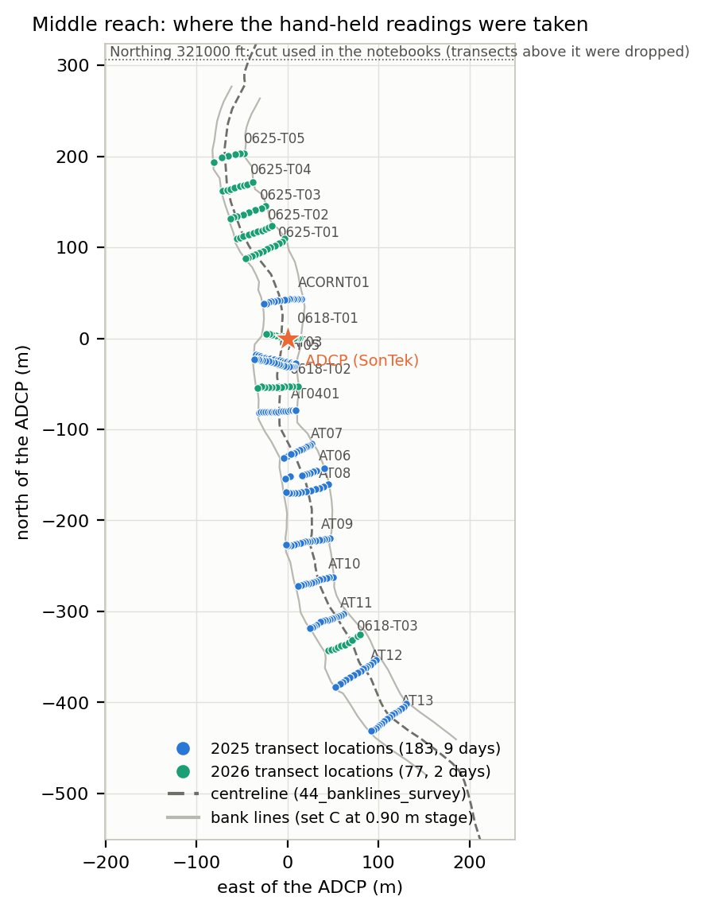

The 2025 transects (AT03 to AT13, ACORNT01) run 450 m downstream of the ADCP; the 2026 transects sit between them (0618-T01 to T03) and 100 to 200 m upstream (0625-T01 to T05). No location was ever visited twice.

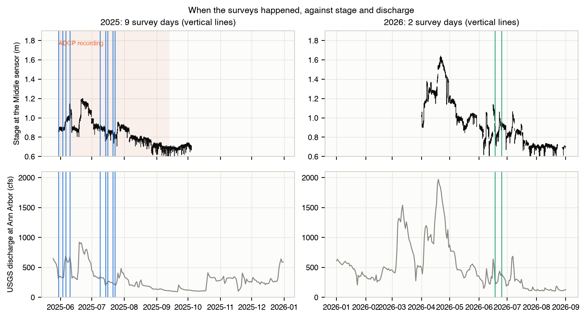

The surveys cover 0.74 to 1.09 m of stage and 200 to 690 cfs at Ann Arbor. The 2026 spring events (1.6 m, 1,970 cfs) were never surveyed.

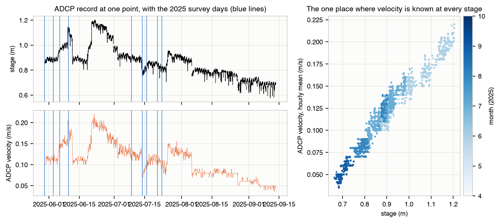

At the ADCP point, velocity against stage is a tight, almost straight line from 0.05 m/s at 0.68 m to 0.20 m/s at 1.15 m. It is the only place where the stage response is measured directly. (After entry 5 this figure is regenerated from the smoothed ADCP series and the corrected stage; the top stage panel stays raw.)

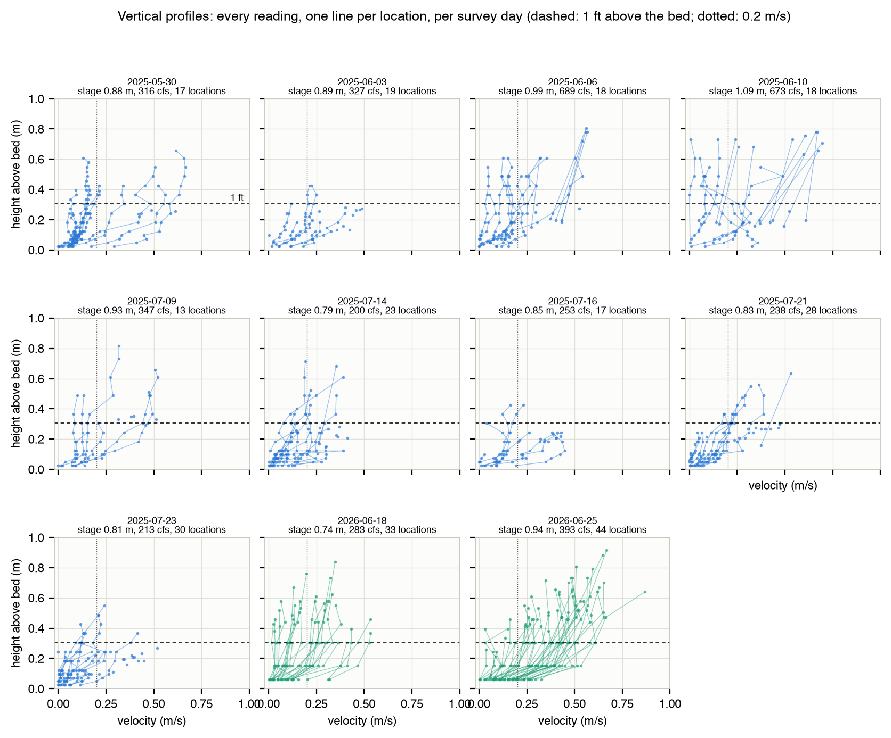

Profiles are log-shaped, dense in 2025 (a reading every 4 cm) and sparse in 2026 (three heights plus the surface). The difference within a profile (0.2 to 1 ft: a factor of 2.6 on average) is large next to the difference between locations, so height cannot be ignored.

**Decision.** Output of the model: velocity in m/s at a reference height, the height question left to step 4. Inputs: stage at the reading's time, position along the reach, position across it.

## Entry 3. 21 September 2026. The stage record has a daily sensor pattern (`02_stage_diagnose.py`)

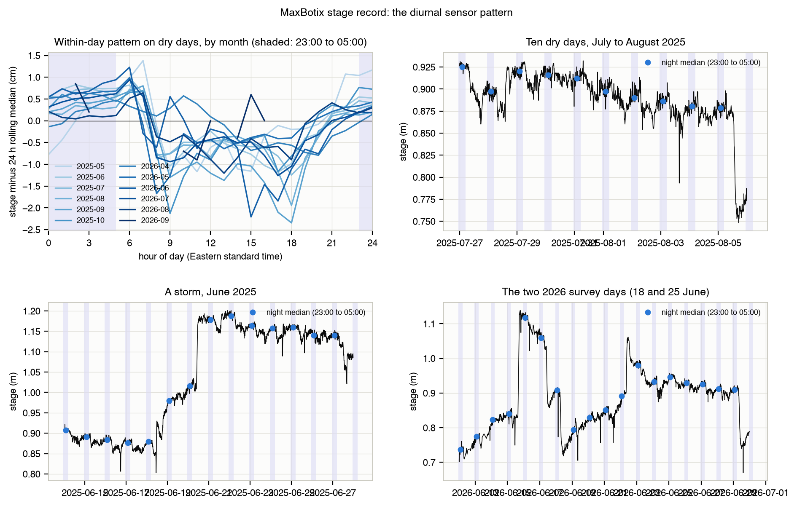

On dry days (nights changing by under 2 cm, 165 of them) the reading runs about 1.4 cm lower in the afternoon than at night, lowest at 17:00 to 18:00 EST, 2.2 cm peak to trough; the spread within a night is 0.7 cm. The pattern is the ultrasonic sensor warming in the sun, not the river. The PI's instruction: treat the nights as truth, remove the daily fluctuation, do not remove peaks.

## Entry 4. 21 September 2026. Cleaning the stage record: three attempts, one adopted

**Attempt A, set aside (`03_stage_clean.py`).** A GP decomposition, stage = seasonal + storm + daily periodic + noise, fitted by marginal likelihood. It could not separate the daily pattern from the storm term: a storm kernel with a 7-hour scale follows a daily wobble as easily as a periodic term does, and the fit gave the daily term 0.3 cm against 1.5 cm measured. Kept for the record; not used.

**Attempt B, shown and rejected (`04_stage_night.py`).** Night = sun below the horizon at the site (NOAA solar formula, 42.38 N, 83.92 W); night readings kept, straight lines across the days. Right on dry days, wrong in storms: the 2026-06-23 midday peak (1.06 m) became 0.99 m. Figure `00g_stage_night.png`.

**Adopted (`05_stage_simple.py`).** Five steps, all plain:
1. one-hour median filter (short glitches);
2. night line: the median of each night's readings, nights joined by straight lines;
3. daily wobble: filtered minus night line on dry days, averaged by half hour for each month, zero at night by construction;
4. subtract the wobble for the month and time of day (a fixed few cm, so peaks stay);
5. three-hour centred median.

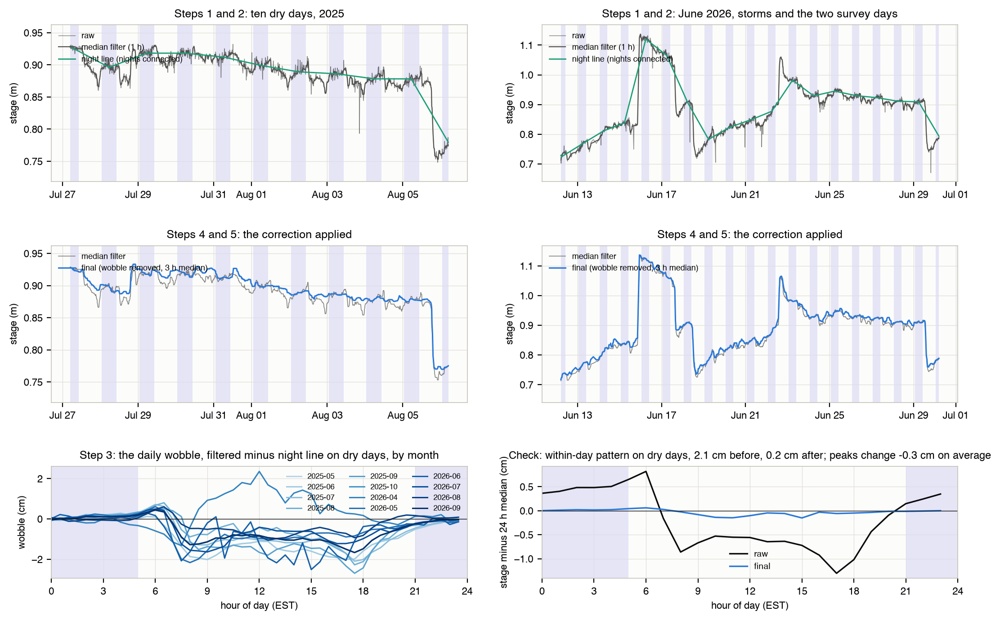

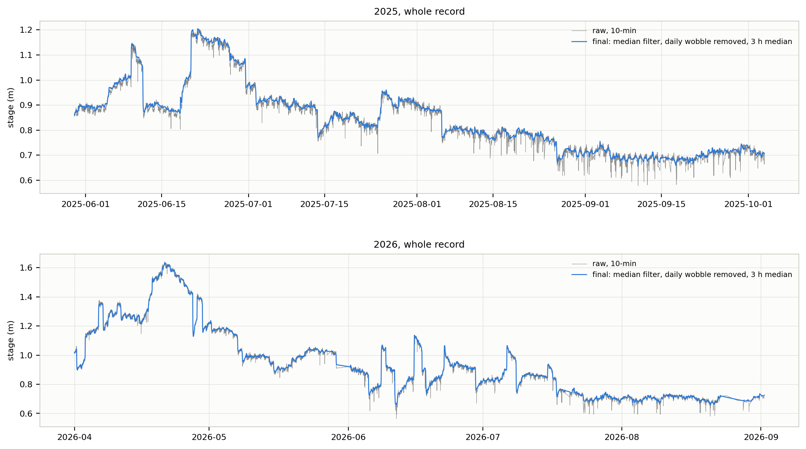

**Checks.** Dry-day pattern 2.1 cm before, 0.2 cm after. The eight largest rises change by -0.3 cm on average, worst -1.3 cm. At night the result sits on the night line within 0.8 cm. Tables: `stage_simple_10min.csv` (every intermediate column), `stage_simple_wobble_by_month.csv`, `stage_simple_checks.json`.

**Open.** One month's wobble curve runs the other way (+2 cm around noon). It does not touch the survey months; may be river behaviour on a daily schedule rather than the sensor.

**For the methods.** A daytime bias of the ultrasonic stage sensor (about 1.4 cm, lowest in late afternoon) was removed by subtracting the mean within-day pattern of dry days, referenced to the night readings, and the corrected series was median-filtered.

## Entry 5. 21 September 2026. One 10-minute grid, the same smoothing for both continuous inputs (`06_align_10min.py`, `07_full_series.py`)

The stage gets one more two-hour median. The ADCP is binned to the same 10-minute grid (median within each bin) and given the same filters (1 h, 3 h, 2 h medians), plus a final one-hour mean because the SonTek logs in 1 cm/s steps and medians alone leave a staircase. Smoothed values exist only where there was a reading.

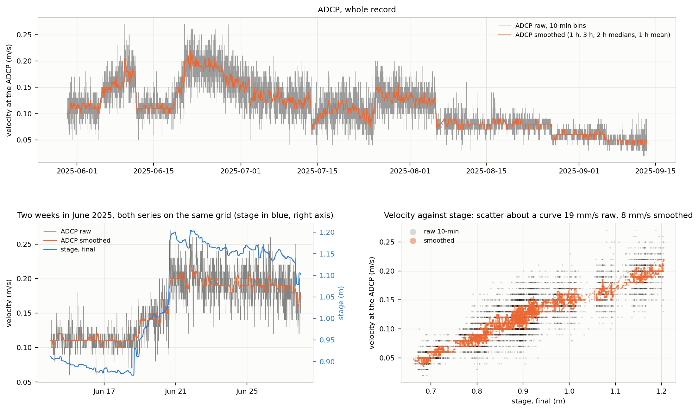

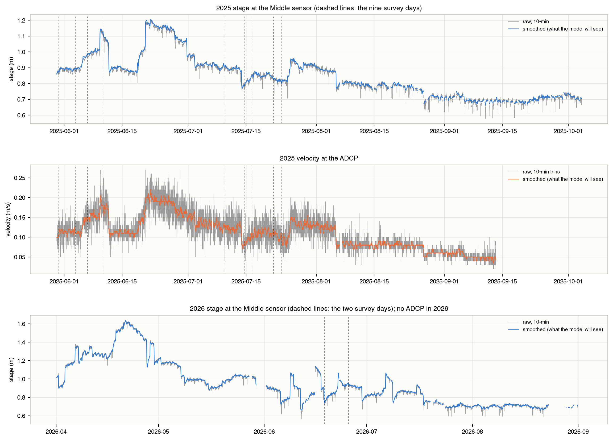

**Checks.** The ADCP scatter about its stage curve halves, 19 to 8 mm/s. Step rises in June stay sharp on both series. On the survey mornings the corrected stage sits 1.2 cm above the raw (range +0.5 to +1.7).

**Outputs.** `series_10min.csv` (66,210 rows, 30 May 2025 to 1 September 2026, raw and smoothed columns for both series; ADCP in 11,611 rows that also have a stage). The loader now takes the stage at each reading's time and the whole ADCP table from this file.

**Decision (the PI).** "I can live with this." These are the continuous inputs for everything that follows.

**For the methods.** The stage and ADCP records were placed on a common ten-minute grid and smoothed identically with short median filters, so that the two continuous inputs carry the same time resolution and noise level into the model.

## Entry 6. 21 September 2026. Step 1: a one-dimensional GP, velocity at the ADCP against stage (`10_step1_adcp_gp.py`)

**Set-up.** Training and test grid: 2-hourly means of the smoothed 2025 series (1,213 points, stage 0.66 to 1.20 m). Inputs and outputs standardised inside each fit. Hyperparameters by marginal likelihood, refitted inside every fold, two restarts. Models: GP with RBF, Matern 3/2, Matern 5/2, and Matern 3/2 plus a linear kernel (a straight-line trend the GP can extrapolate); baselines: linear and quadratic regression on stage with a Gaussian residual. Validation: (a) contiguous 10-day blocks, each predicted from the others (11 folds); (b) the highest 15% of stages held out, then the lowest 15% (extrapolation); (c) random 10-fold, only to see how much it flatters. Scores in m/s: MAE, RMSE, CRPS (the proper score for a predictive distribution; equals MAE for a point forecast and penalises bands that are too wide or too narrow), 95% coverage, mean predictive sd, NLPD, and R2 for reference.

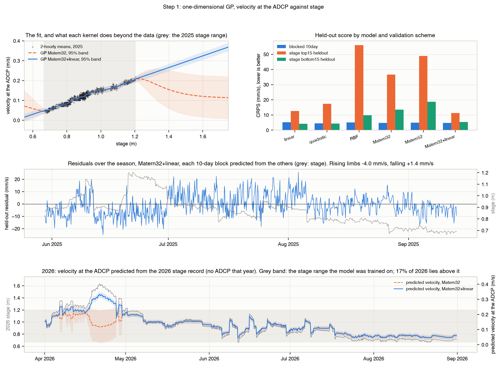

**Held-out scores (mm/s; coverage as a fraction).**

| Model | Blocked: MAE / CRPS / cov | Top 15% of stages held out: MAE / CRPS / cov | Bottom 15% held out: MAE / CRPS / cov |
|---|---|---|---|
| linear | 7.4 / 5.3 / 0.90 | 16.3 / 12.7 / 0.38 | 6.2 / 4.1 / 0.99 |
| quadratic | 6.3 / 4.5 / 0.93 | 21.2 / 17.4 / 0.24 | 6.6 / 4.4 / 0.99 |
| GP, RBF | 7.1 / 5.1 / 0.89 | 68.8 / 56.0 / 0.20 | 15.4 / 9.8 / 1.00 |
| GP, Matern 3/2 | 6.7 / 4.8 / 0.90 | 50.1 / 36.6 / 0.56 | 21.5 / 13.5 / 1.00 |
| GP, Matern 5/2 | 6.9 / 4.9 / 0.89 | 62.4 / 48.9 / 0.41 | 29.0 / 18.7 / 1.00 |
| GP, Matern 3/2 + linear | 6.7 / 4.8 / 0.89 | 15.0 / 11.4 / 0.49 | 8.3 / 5.4 / 0.97 |

Random 10-fold gives every model MAE 5.3 to 6.5 and R2 0.97: the neighbouring hours leak in. R2 under the stage-band schemes is meaningless (linear: 0.08 at the bottom band with a 6 mm/s error; the GPs: -9 to -17), because the held-out band has almost no spread.

**What we saw.**
- Inside the data every model is the same to within a millimetre per second (blocked MAE 6.3 to 7.4 mm/s on a signal of 50 to 200). The relation is nearly a straight line and a GP adds nothing to a quadratic there.
- Beyond the data the kernel is everything. The stationary kernels revert to the mean velocity: predicted velocity falls as the river rises past 1.2 m (dashed curve in the figure), and the errors on the held-out top band are 50 to 70 mm/s. The linear kernel term carries the trend out, error 15 mm/s, the same as a straight line.
- Residuals over the season: rising limbs -4 mm/s, falling limbs +1 mm/s (hysteresis is small); month means drift from -7 mm/s in May to +4 in July and -4 in September. A slow seasonal effect of about 5% that stage does not explain, small enough to leave.
- Thinning: trained on daily medians (107 points) the curve is as good (MAE 6.8 against 6.7) but the band is too narrow (coverage 0.78), because daily medians are smoother than the 2-hourly points being predicted. One value per day carries the curve; the noise term must be set from data at the resolution being predicted.
- 2026: 17% of the 2026 stage record lies above the 2025 range. With the linear term the model gives 0.33 m/s at 1.6 m of stage with a widening band; without it, 0.12 m/s and a band covering everything.
- Fitted kernel (all data, Matern 3/2 + linear): linear term amplitude 0.94, Matern amplitude 0.12 with a 1.6 cm scale for the small bumps, noise sd about 8 mm/s.

**Decisions.**
- Scores from here on: MAE and CRPS in physical units, plus 95% coverage. R2 only where the test set spans the range, and never on held-out bands. NLPD is kept in the tables but not quoted.
- The stage dimension of the spatial model needs a trend term (a linear kernel or a linear mean), or predictions above the surveyed stage band will bend back toward the mean.
- Blocked and band-wise validation are the schemes; random folds are reported only as the cautionary comparison.
- The ADCP can enter the spatial model thinned to one value per day without losing the curve; its noise term must still be fitted on the resolution used.

**For the paper.** One panel, in the data or methods section: velocity against stage at the fixed sensor with the fitted GP and its band, as the evidence that the stage response is measured there and as the curve the spatial model has to reproduce at that point.

**For the methods.** At the fixed sensor, velocity was modelled as a Gaussian process of stage with a Matern 3/2 kernel and a linear term, with hyperparameters set by marginal likelihood and skill assessed on contiguous ten-day blocks and on held-out stage bands (MAE 7 mm/s within the observed range, 15 mm/s on the highest 15% of stages, 95% interval coverage 0.89).

## Entry 7. 21 September 2026. The field readings as model inputs, laid out for quality control (`08_field_prep.py`)

**Log profile.** v(z) = a ln(z / z0), one roughness scale for the reach found by grid search on the 160 locations with three or more usable readings (readings below 0.03 m or at or below 0.005 m/s are left out of the fit): z0 = 11 mm, with the residual within 5% of its minimum for z0 between 7 and 16 mm. One amplitude a per location by least squares. Two targets per location: the velocity 1 ft above the bed (v_1ft = a ln(0.3048 / z0)) and the depth-averaged velocity (v_mean = a (ln(h / z0) - 1)); the spread of the per-reading implied values gives the uncertainty, and single-reading locations get the pooled transfer error. Transfer check on the 124 locations that have a reading within 3 cm of 1 ft: the value moved there from the other readings agrees with the measured one to 30 mm/s (MAE), bias -4 mm/s, r 0.96. Median R2 of the log fit 0.75; 25 locations fit worse than a flat line (mostly near-uniform profiles with a slow near-bed reading), no inverted profile.

**Reach coordinates.** Each location projected onto the Middle centreline: `along_m` (zero at the ADCP, positive downstream, which is the centreline's native direction) and `across_m` (positive toward the left bank looking downstream). Locations span -217 to +451 m along and -37 to +36 m across; none is more than 40 m from the centreline; 6 to 19 locations per transect, 3.1 m apart across.

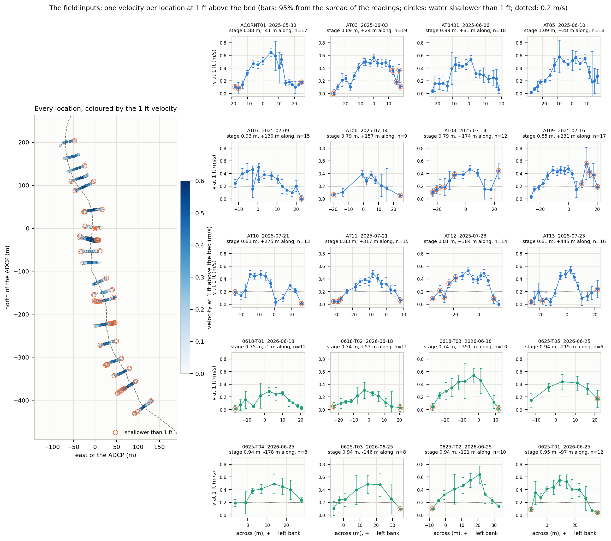

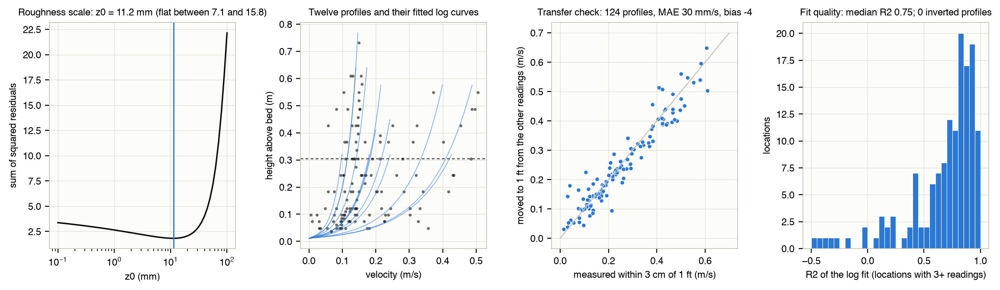

**Checks and what they found.**
- Two locations carry identical coordinates on two dates: AT0710 and AT0711, on 2025-07-09 (transect AT07, one reading each, stage 0.93 m, v_1ft 0.46 and 0.50 m/s) and on 2025-07-14 (transect AT06, ten readings each, stage 0.79 m, v_1ft 0.15 and 0.30 m/s). Coordinates identical to the centimetre are copied, not re-measured, and the point names belong to AT07. Either the 14 July rows are mislabelled or the 9 July rows are. To ask the crew.
- 47 locations (37 in 2025) are shallower than 1 ft (median depth 0.24 m), so the 1 ft velocity there is a value above the water surface. The depth-averaged velocity is defined everywhere (median ratio to v_1ft 0.86). Which target to model is a decision for the next step.
- 73 locations (68 in 2025) have a single usable reading, taken at 0.20 to 0.27 m; the move to 1 ft is a factor of about 1.1 and carries the pooled 30 mm/s error.
- Three locations read zero at their one reading and are kept as zero.
- Latitude and longitude disagree with Easting and Northing by 27 m at the median: they were recorded once per transect, not per point. Easting and Northing are the point coordinates; lat/lon are not used.
- The 2026 locations have wider bars (three or four readings, sometimes one) than the 2025 profiles (a reading every 4 cm).

**Resolved later on 21 September (the field lead).** The crew sometimes left the previous day's transect ID in the form at the start of a new day; the field lead had corrected the cases they found by hand and confirms these points belong to AT07. Applied as a named correction in `00_load.py` (`RELABEL`), so the 14 July profiles at AT0710 and AT0711 are AT07 revisits, the only locations measured at two stages. An automatic check now runs on every transect (`14_transect_id_check.py`): a transect is a cross-section, so its points must share one position along the reach; points more than 10 m off their group's line, points closer to another transect's line, point names that disagree with the transect, and coordinates repeated across dates are listed in `transect_id_check.csv`. After the fix it finds no other mislabelled group in the Middle reach (largest remaining along-spread 12 m, at AT09). It also caught a leading space in the transect ID ' AT11', now stripped at load.

**Output.** `data_clean/locations.csv`: one row per location with along, across, stage at the reading's time (corrected and raw), water depth, number of readings, heights covered, a, fit R2, v_1ft and its sd, v_mean and its sd, the measured value near 1 ft where one exists, and the flags (shallower than 1 ft, inverted, extrapolated). `readings_transect_fitted.csv` keeps every reading with its implied 1 ft value. `field_qc.json` holds the counts above.

**For the methods.** Each hand-held profile was reduced to a velocity at a reference height with a logarithmic profile and a reach-wide roughness scale fitted to the profiles (z0 = 11 mm), with the spread of the readings' implied values as the measurement uncertainty; positions were expressed as distance along the channel centreline and signed offset from it.

## Entry 8. 21 September 2026. Step 1b: the GP with a physical law as its mean (`11_step1b_law.py`)

The PI, on seeing the step 1 figure: a kernel that falls back to the mean beyond the data is wrong for this; use a law we understand for water, and the same law may later govern the other locations. Done as a GP on the residuals of a law fitted inside every fold: v = c (stage - h0)^b, where h0 is the stage at which the point runs dry. Three laws: linear (b = 1), Manning (b fixed at 2/3, the wide-channel form), and the power law with b free. Same validation and scores as step 1.

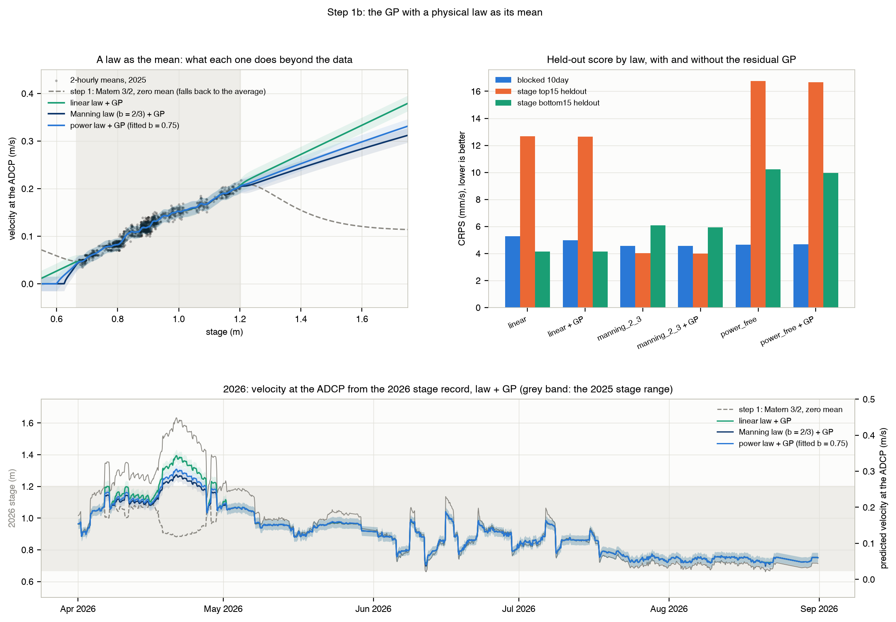

**Held-out scores (MAE mm/s; coverage).**

| Law (+ residual GP) | Blocked | Top 15% of stages held out | Bottom 15% held out |
|---|---|---|---|
| linear | 6.9 (0.88) | 16.2 (0.39) | 6.2 (0.99) |
| Manning, b = 2/3 | 6.3 (0.90) | 5.5 (0.96) | 8.9 (0.91) |
| power law, b free (fitted 0.75) | 6.5 (0.90) | 20.5 (0.27) | 13.8 (0.69) |
| step 1, Matern 3/2 with zero mean | 6.7 (0.90) | 50.1 (0.56) | 21.5 (1.00) |

**What we saw.** The Manning form extrapolates upward best by a wide margin: 5.5 mm/s on the highest stages against 16 for a straight line and 50 for the zero-mean GP, with the 95% band covering 96% of the held-out points. Fitted on all of 2025: c = 0.29, h0 = 0.63 m (the stage at which this point would stop flowing), residual sd 7.7 mm/s. Freeing the exponent gives b = 0.75, close to 2/3, but the free fit trades b against h0 and extrapolates worse; fixing b is the regularisation. The residual GP adds almost nothing on top of the law (blocked MAE 6.5 to 6.3), which says the law explains the relation and the GP's job here is the band. For 2026 the Manning form gives about 0.27 m/s at the 1.6 m April peak, the straight line 0.34, and no version falls back to the mean.

**Decisions.**
- The stage response is modelled as Manning's form with b = 2/3, and the GP models departures from it. The zero-mean stationary GP of step 1 is dropped.
- For the spatial model the same form is the candidate law at every location, v(x, stage) = c(x) (stage - h0(x))^(2/3), with the GP carrying c and h0 (or their logs) across the reach and the ADCP pinning the response at its point. Whether c and h0 can be identified from single-visit transects is the question for step 3.

**For the methods.** Velocity at the fixed sensor follows Manning's form in the local depth, v = c (h - h0)^(2/3) with h0 = 0.63 m and c = 0.29 m^(1/3)/s, to 6 mm/s within the observed stage range and 5.5 mm/s on the highest 15% of stages held out; a Gaussian process on the residuals supplies the predictive interval.

## Entry 9. 21 September 2026. The target becomes the log-law amplitude, and the inputs are interrogated (`12_amplitude_inputs.py`, `13_amplitude_checks.py`)

**Decision (the PI).** Option 1 from the discussion of reference depths: the model's target is the amplitude a of the log law v(z) = a ln(z / z0) at each location, not the velocity at any one height. Every height and the depth average are derived from a afterward. u* = 0.41 a is the shear velocity and 1000 u*² the bed shear stress.

**What was generated, per location** (`locations.csv`, new columns): a and its sd from the readings' implied amplitudes (single readings get the pooled error, 9 mm/s in a), u*, bed shear stress, and the bed elevation = stage at the visit minus surveyed water depth, on the stage sensor's datum. Ranges: a from 0 to 0.20 m/s, sd median 0.009; bed elevation from -0.09 to +0.81 m. Amplitude correlates with depth across locations (r 0.47), deeper being faster.

**The ADCP under the same law.** It sits on the bed (the PI, 21 September) and measures the water column above it, so what it reports is close to the depth-averaged velocity at that point, not a velocity at one height. Under the log law the depth average is a (ln(h / z0) - 1), so the ADCP's amplitude is a = v / (ln(h / z0) - 1) with the local depth h = stage - h0. Three readings of the record were compared: (i) a point at a fixed height following Manning, v = c (stage - h0)^(2/3): 6.2 mm/s, h0 = 0.63 m; (ii) the column average with a constant amplitude, so that all the stage response comes from the column getting deeper: 11.1 mm/s, rejected; (iii) the column average with the amplitude itself growing as a power of depth: 6.0 mm/s, h0 = 0.55 m, exponent 0.46. So at the ADCP the amplitude, which is the shear velocity, grows as the square root of local depth. That is the textbook u* = sqrt(g h S) with a slope that does not change with stage, and the column integral on top of it is what made the velocity look like Manning's 2/3 from the outside. The old assumption of a point 1 ft up is kept as a comparison column only. Still to confirm with the field lead: the SonTek model and what the exported 'Vb' is, which fixes the sampled volume. (Superseded the same evening by the column reading above: the 2/3 was the exponent of the velocity at a fixed height; for the amplitude under the column reading the exponent is 1/2.)

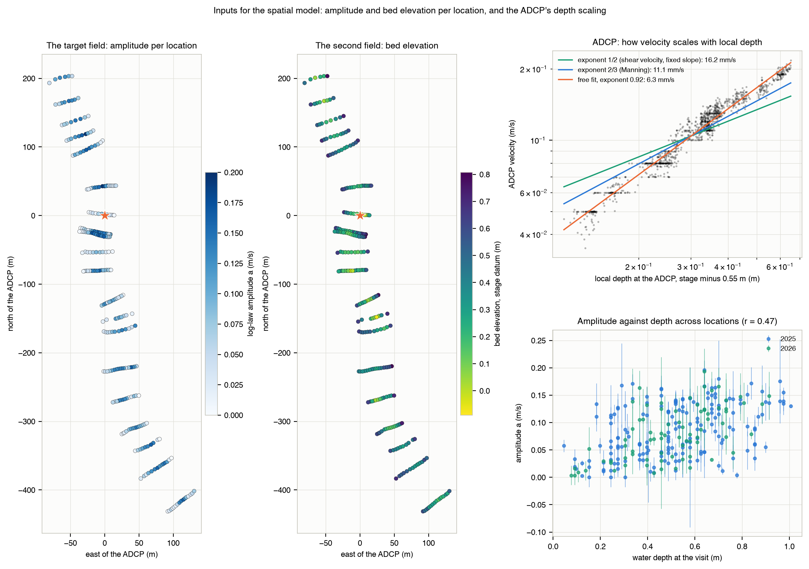

**Review material.** One panel per location, readings with the fitted curve, the water surface and the derived numbers, 48 per page in `figures/profiles/page_01.png` to `page_06.png` and together in `figures/profiles_all.pdf`. Panels with a flag (fit worse than flat, single reading, shallower than 1 ft) have red titles.

**Checks that interrogate the method** (`amplitude_checks.json`, figure below).
- Roughness scale by substrate, from the point notes: cobble 18 mm, gravel 13, sand 14, woody debris 10, not noted 9, each with a band of about a factor 1.5. The ordering is physical and the pooled 11 mm lies inside most bands. A per-substrate z0 would move the amplitude by up to 15% at cobble sites; kept as a refinement to test by held-out skill, not adopted now.
- Fitting in linear space or in log space gives the same amplitude (median ratio 1.00).
- Where the log law misses: readings in the bottom tenth of the depth run 18% of a below the law (the roughness layer) and readings in the top 15% run 7% below (the free surface). Between 0.1 and 0.85 of the depth the law is within 3%. The depth average from the law agreed with the measured-profile integral to 4 mm/s (entry 7), so this bias is tolerable; the bottom-tenth readings could be dropped from the fit as a refinement.
- The 25 profiles that fit worse than a flat line are nearer the banks (median 17 m from the centreline against 12), slower (median a 0.044 against 0.081), and 56% of them carry notes about debris, wood, eddies or slow water. They are wake zones where a log law does not apply. Kept, with their large sd, which is what the model should see.
- Bed elevation: the two revisited points differ by 15 cm between the two days. Neighbouring points 3 m apart differ by 8 cm at the median and 21 cm at the 90th percentile, so a few metres of difference in where the crew stood explains it. The bed is rough at the scale of the point spacing. Two consequences: the revisit cannot test whether the sensor's stage tracks the local water level one to one, and the bed elevation field will need a short length scale and an honest nugget, with the depth uncertainty carried into the velocity (a 10 cm depth error at 0.5 m depth is a 13% velocity error under the 2/3 law).

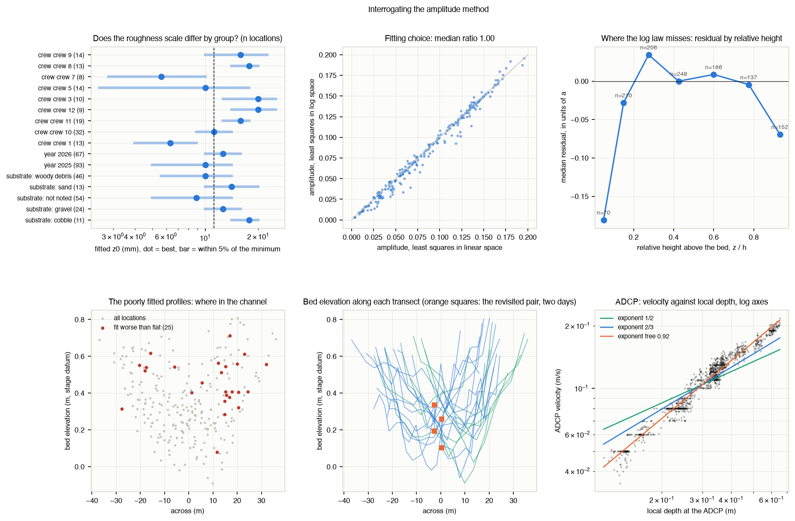

**How this levels up to the reach (the design for steps 2 and 3).** We are no longer learning a velocity at a height. We are learning two fields and applying one law:
1. A bed elevation field z_b(x) from the 260 surveyed depths (stage minus depth), a GP over along and across with a short length scale. It gives the local depth at any point and any stage, h(x, stage) = stage - z_b(x), and with it the wetted channel itself.
2. A conveyance field A(x): the amplitude each location would have at a reference depth. Each observed amplitude is first "de-staged" with its own measured depth, log A(x) = log a_obs - β log h_obs, so the field the GP learns is free of the day's stage. The GP is on log A, over along and across, with the per-location sd as the noise and the wake-zone points carrying their large sd.
3. The law joins them: a(x, stage) = A(x) h(x, stage)^β, and from a every velocity follows, v(x, z) = a ln(z / z0), depth average a (ln(h / z0) - 1). The ADCP gives β = 1/2 under the column reading (u* = sqrt(g h S) at constant slope); 2/3 is the alternative if the slope steepens with stage. The held-out survey days decide between them in step 3, since a day at a different stage is predicted through β. The ADCP also adds one point with a full stage record to check the law against.
The kernel therefore has two spatial inputs, not three; stage enters through the law, and a day held out tests both space and stage transfer at once. Uncertainty comes from both GPs by sampling.

**For the methods.** Each profile was reduced to the amplitude of a logarithmic law with a reach-wide roughness scale; the amplitude was referred to a common depth with Manning's exponent, taken from the fixed sensor, and modelled as a Gaussian process over the channel together with a second process for the bed elevation, so that velocity at any height, depth and stage follows from two fields and one law.

## Entry 10. 21 September 2026. The cross-sections were surveyed: the RTK elevations (`15_rtk_elevations.py`)

The PI: the crews had mm-precision GPS, so the cross-sections should be in the data. They are. The survey sheets carry an `Elevation` at every measurement point, in feet on what should be NAVD88, and 23 explicit "bank height" points. Two tests say it is the bed: within every transect the elevation falls as the water depth rises (r between -0.84 and -1.00), and elevation plus depth, which is the water surface, is flat across each transect to 2 to 14 cm. So the bed profile does not have to be inferred from stage minus depth: it was shot. The columns `bed_rtk_m` and `wse_rtk_m` are now in `locations.csv`, the bank points in `banks.csv`, one row per survey session in `rtk_sessions.csv`.

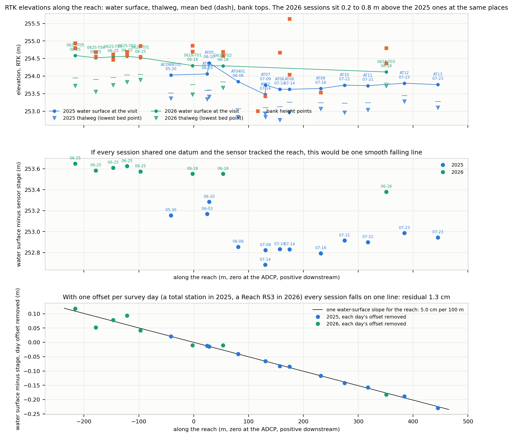

**The catch: the vertical datum is not the same across sessions.** Neighbouring transects from the two years disagree by amounts a river bed cannot produce in a year: the 2026 beds and water surfaces sit 0.2 to 0.8 m above the 2025 ones at the same places (thalweg 0618-T01 at -2 m: 253.48; ACORNT01 at -41 m and AT03 at +25 m in 2025: 253.37 and 253.35; 0618-T02 at +54 m: 253.67 against AT0401 at +81 m: 252.84). The water surface minus the sensor stage, which should be one smooth falling line if every session shared a datum and the sensor tracked the reach, is instead two lines 0.4 m apart, plus a 0.3 to 0.4 m step within 2025 between +28 and +81 m that may be a real riffle drop or a session offset (the 2026 sessions show only 0.17 m over that stretch). The most likely causes are an antenna-height or base setup difference between the 2025 and 2026 campaigns, and possibly between days. The relative shape within a session is trustworthy at the few-cm level; the absolute level per session is not.

**What this means for the design.** The bed field will be built from the RTK cross-sections, which is far better than stage minus depth, but with one unknown vertical offset per survey session. The offsets can be estimated by tying every session's water surface to the stage sensor through one smooth surface profile along the reach (the ADCP says the slope does not change with stage), or, better, from the field lead's RTK setup records: base station, correction source, antenna heights, per day. The bank points and the channel-extent polygon (bank elevations 834.55 to 836.42 ft in the mapping file) give the channel edge once the offsets are known.

**What this changes in the prepared inputs: nothing, and one number.** The amplitude, the water depth, the stage at the reading and the reach coordinates do not touch the RTK column. The bed elevation on the sensor datum (stage minus depth) stays as the version the law uses directly at surveyed points; the RTK bed is the version with the better shape between points and the bank edges, once the session offsets are known. The one number the RTK adds to the prep is the depth measurement's own uncertainty: the water surface across a transect, elevation plus depth, scatters by 2 to 14 cm, about 5 cm typically, which is the noise to carry on the depth when the law converts it to velocity (10 cm of depth at 0.5 m is 13% of velocity under the square-root law, 7% under 2/3).

**One more artefact.** The 14 July rows at AT0710 and AT0711 carry the 9 July elevations copied along with the coordinates (829.847 and 830.131 ft on both days) while their depths differ by 0.3 m, so their water surface is 0.15 m too low (the lone 07-14 point at 131 m in the lower panel). Those two rows have no RTK elevation of their own; the bed there is taken from 9 July.

**The field lead's answer (21 September, 21:34).** A total station in 2025, a Reach RS3 (GNSS) in 2026; the crews did not return to the same points. So the two years are on different reference frames by construction, and a total station's frame is whatever it was set up on each day.

**Resolved by tying every session to the stage sensor.** Model: water surface minus sensor stage = offset(day) - slope x along, one slope for the whole reach and one offset per survey day, fitted by least squares on the 20 transect-sessions (the copied 14 July AT07 rows left out). It explains everything: slope 5.0 cm per 100 m, residual 1.3 cm (0.3 cm within 2025, 2.0 cm within 2026, the RS3's point noise). The offsets show what happened: the 2025 total-station days sit at 252.89 to 253.30 m, changing from day to day by up to 0.4 m as the instrument was set up on different references, while the two 2026 RS3 days agree to 3 cm (253.56, 253.53). The 0.3 m "step" inside 2025 was the change of setup between the early June days and the July days, not a riffle: the water surface falls at a uniform 5 cm per 100 m through the whole reach, in both years, and the five multi-transect days (spans of 17 to 353 m) pin that slope. Offsets in `rtk_session_offsets.csv`; the RTK bed and water surface moved onto the sensor's datum with the surface slope removed are `bed_rtk_sensor_datum_m` and `wse_rtk_sensor_datum_m` in `locations.csv`, and the bank points the same way in `banks.csv`. Check: the RTK bed on the sensor datum agrees with stage minus depth at the same points to -0.7 +/- 5.9 cm, which is the depth-reading noise found above. So the sensor tracks the reach's water level to within a centimetre or two everywhere the transects are, once the uniform slope is allowed for, and assumption 5 in the summary section holds on the surveyed stretch.

**NAVD88 (the PI, 21 September).** The RS3 heights are NAVD88. That puts the sensor's datum on NAVD88 too: the two 2026 offsets (water surface minus stage, referred to the ADCP's position) are 253.562 and 253.532 m, so the stage sensor's zero is at 253.55 m NAVD88, give or take 2 cm, and every 2025 session can be reported on NAVD88 through its offset. The mapping file's bank elevations (834.55 to 836.42 ft, 254.37 to 254.94 m) agree with the 2026 RS3 bank points (254.5 to 254.9 m). The remaining question for the total station, which setup point and what elevation was assigned to it each day, matters only for explaining the day-to-day shifts; the offsets already correct them.

## Entry 11. 21 September 2026. Stepping back: the approach now, the original, and whether the rest is worth doing (`16_what_we_learn.py`)

The PI's request, after I proposed learning a bed that had been surveyed: state the approach now against what was done before, assess honestly whether the modelling that remains is worth it, and show what is being learned, since it is not one number.

**The approach now, in one paragraph.** Physics carries everything that is known. The vertical structure is the log law with one roughness scale (tested, entry 9). The stage dependence is the shear-velocity law fitted at the ADCP, amplitude growing as the square root of local depth (entry 9), with the Manning exponent as the alternative. The geometry is measured: the cross-sections from the RTK survey, on the sensor's datum, plus a uniform water-surface slope (entry 10). The stage record is the only live input. What is left for the model is one static field: the conveyance A at each place, the amplitude the place would have at unit depth. The Gaussian process interpolates that field between the 260 surveyed points and says how uncertain it is; nothing else is learned. Prediction at any stage is then A times local depth to the power β, and from that amplitude every velocity follows.

**The original, in one paragraph.** A Gaussian process on three inputs, stage and two positions, trained on 1,347 readings (with the 'Other' rows and the nests in, the wrong heights, and one value per reading rather than per profile), asked to learn the vertical structure, the stage response and the spatial pattern at once from eleven days that were never revisited. It memorised days, scored 0.73 under random folds and about 0.2 with a day held out, and fell back to the mean beyond the data. Its map was an interpolation of the same transects with the physics left to the kernel.

**What is being learned: a field.**

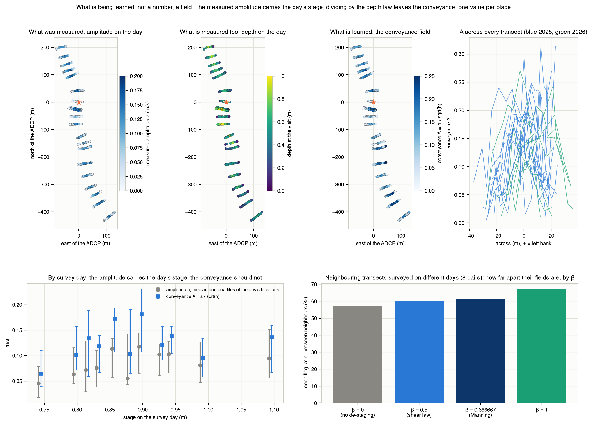

Left to right: the amplitude measured on each day, the depth on each day, and their combination, the conveyance A = a / sqrt(h), one value per place. The fourth panel is A across every transect: slow at the banks, fast in the middle, and rough from point to point. The bottom left panel shows, by survey day, that the measured amplitude rises with the day's stage while the conveyance should not; it still does, with a slope of 0.8 in log terms, but that is confounded with which transects were surveyed on which day.

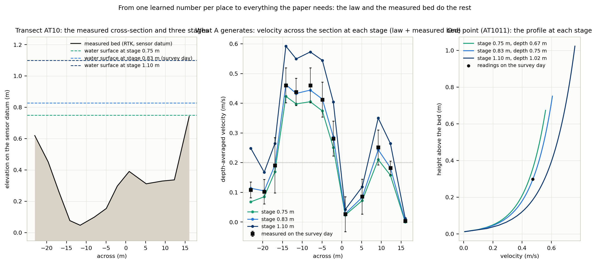

From one learned number per place, the law and the measured bed generate the cross-section velocity at any stage and the profile at any point; the survey-day values sit on the survey-day curve by construction. This is what the paper's figures would be made of.

**Before and after, the target itself (`17_before_after_target.py`).**

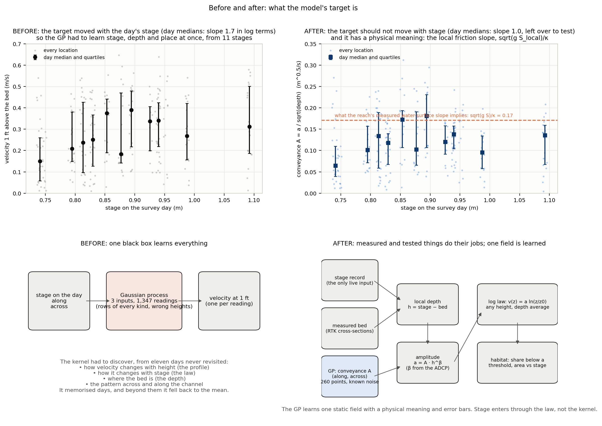

The old target, velocity 1 ft above the bed, rises with the day's stage (day medians: slope 1.7 in log terms), so one kernel had to carry stage, depth, profile and place at once. The new target, A = a / sqrt(h), is a parameter of the flow at a place, not a velocity: for uniform flow u* = sqrt(g h S) and a = u* / κ, so A = sqrt(g S_local) / κ, the local friction slope in disguise, in m^0.5/s. The reach's measured water-surface slope, 5 cm per 100 m, implies A = 0.17; the measured mid-channel median is 0.15 and the bank values are lower, as side friction says they should be. The day medians of A still rise with stage (slope 1.0 in log terms), which is either the transects-by-day confound or a stage effect stronger than the ADCP's; that is what the day-out test in step 3 decides.

**The conveyance in theory (`18_conveyance_schematic.py`).** the PI asked for the picture behind the word: where A sits in the profile. Figure 00u: the log profile at one point at two stages (steep at the bed, bending over upward; its steepness a is the slope against ln z, and both stages share z0); a growing with local depth as A√h, so A is the curve a place sits on; A varying across a cross-section, small at the banks and large mid-channel, with the profiles it generates drawn sideways; and the ledger of what is measured, fitted once, and learned.

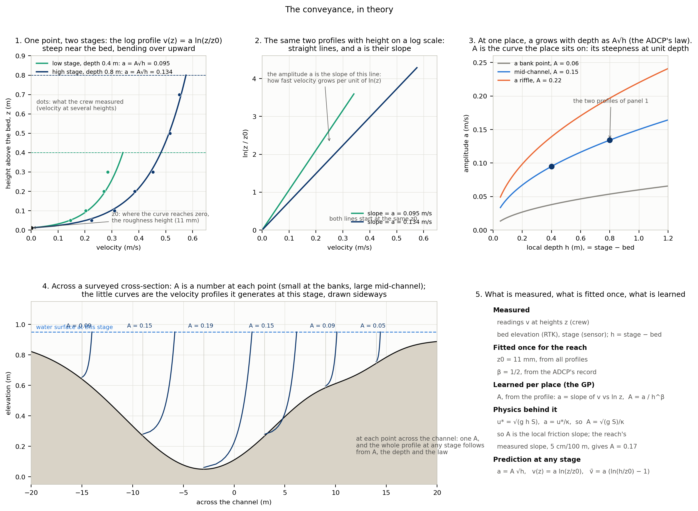

**The test that matters most, done now on the raw data (`destage_pair_check.csv`).** If the law transfers across stage, then two transects at nearly the same place surveyed on different days at different stages should agree once each is de-staged. The closest pair in the data set, AT03 and AT05, 3 m apart along the reach, surveyed a week apart at 0.89 and 1.09 m: their raw amplitudes agree (median log ratio 0.03), and de-staging with β = 1/2 pulls them apart (0.25). So at that section the amplitude did not rise with a 20 cm rise in stage, where the ADCP would have predicted about 20%. The other seven pairs are 25 to 40 m apart, and they differ by 50 to 100% whatever β is used, because the field itself varies that much from point to point (neighbours 3 m apart across a transect differ by 26 to 46% in log terms) and presumably as much along the reach between transects. Two conclusions. The between-day transfer of the amplitude is weaker or noisier than the ADCP's own record suggests, and only held-out days across all transects can settle it. And the field is rough at scales below the transect spacing, so interpolation along the reach between transects 30 to 60 m apart will be honest only if it is wide.

**Is it worth it.** Three claims are on the table, with different answers.
1. Velocity and habitat on the surveyed cross-sections at any stage, from the stage record. Worth it and well posed: every ingredient is measured or tested, the predictions are checkable against the ADCP, the AT07 revisit and AT03 against AT05, and the validation is a day held out. The remaining doubt is the size of the stage effect on the amplitude, and the data can answer it. Cost: two short steps.
2. A reach-wide map between the transects. Not supported by these data at the resolution a map implies. The conveyance field varies by tens of percent over metres; transects are 30 to 60 m apart; the earlier blocked cross-validation on the old model said the same in its own way. A GP can draw the map, and its bands will say most of it is guesswork beyond the generic cross-channel shape. Showing it with those bands is honest; making it the headline is not.
3. The methods and design findings: random folds versus days held out, mixing protocols, what the fixed sensor identifies, what transect spacing the field demands. Already in hand, worth a paper on their own for a hydroinformatics reader.

My recommendation is to build 1 and 3 and to show 2 only as what it is. The Gaussian process earns its place as the honest interpolator of one field with error bars, not as a learner of physics. If a reach map is wanted as the headline, the fix is in the field, denser transects along the reach or a bathymetric survey with the same RTK, not in the model.

## Entry 12. 21 September 2026. The contract for the Gaussian process, agreed before it is fitted

**Training data: one row per surveyed point.** Inputs: along and across the reach. Target: the conveyance A (worked with as log A), one value per point with its own standard deviation from the profile fit and the depth reading. 257 points carry a positive amplitude; the three that read zero are kept aside. Nothing else goes in: not stage, not date, not year, not the individual readings, not the ADCP, not the nests.

**Fixed before the GP, from measurement or one fit for the reach.** The roughness height z0 = 11 mm (all profiles). The exponent β = 1/2 (the ADCP's record; 2/3 the alternative to test). The bed elevation at every surveyed point on the sensor datum (RTK, with the surface slope folded in, so that local depth = stage minus bed). The stage record.

**What the GP returns.** A at any place along and across, with a band: narrow on the surveyed cross-sections, wide between them.

**How A is used, at any time t.** Read the stage from the sensor. Local depth at every place: h = stage(t) minus the bed. Amplitude: a = A h^β. Velocity at any height: v(z) = a ln(z / z0). Depth-averaged velocity: a (ln(h / z0) - 1). Share of the section below a threshold, area against stage, from those. "Upstream stage in, velocity everywhere out" is the right description; the measured bed is the bridge, and the sensor's position does not matter because the uniform surface slope is already in the datum.

**The ADCP's role.** Not a training point. It gave the exponent, and it is the one place with a full season of velocity, so the prediction of its own record from A at its location and the stage series is a continuous check of the law. Its absolute A depends on what volume the instrument samples, which is why it stays a check rather than a training row.

**Noise: what is baked in and what is learned (the PI's question).** Each point's measurement error is known and goes in as fixed, point-by-point noise: the sd of A from the profile fit, combined with the depth reading's 6 cm through A = a / h^β (relative sd of A squared = (sd_a / a)² + (β sd_h / h)²). That part is not learned. On top of it the GP still learns one nugget, a white term, for what the per-point error does not contain: real variation of the field at scales below the point spacing (neighbours 3 m apart differ by 26 to 46%) and whatever the log law misses systematically. The fixed part puts a floor under the total noise, so the learned term cannot collapse to zero the way the old model's did; it can only add. If it comes out large next to the measurement error, that is a finding about the roughness of the field, not a failure. The kernel's amplitude and its two length scales are learned as usual.

**Uncertainty.** From the GP band on A, from the bed (about 6 cm, the depth-reading noise), and from β; carried into velocity by sampling.

**Validation.** Held-out transects (spatial transfer of A); held-out survey days (A predicted from the other days, the law applied with that day's stage, compared with that day's measured velocities); the ADCP record (temporal check); the two revisited pairs. Scores: MAE, CRPS, coverage.

**The rating-curve view (the PI's, and it is the right one).** Each surveyed point now has a rating curve: velocity against stage, of the form a = A (stage - bed)^β with the log law on top, where only A is specific to the point; the bed is measured, β and z0 are shared. Classic hydrometry fits a rating from many stage-flow pairs at one site; here every point was visited once, so the shape of the curve is borrowed (from physics, with the exponent checked on the ADCP) and only the multiplier is fitted from the single visit. The GP shares that multiplier across space. For the surveyed sections at other stages, the 257 measured A's and the law are enough on their own, a table; the GP is needed for the map between the sections, for the error bars, for pooling neighbouring measurements against their 10 to 30% errors, and for the held-out tests.

**The ADCP's role, restated.** The correlation between the sensor and the ADCP is not the point; any point in a river correlates with stage. What the ADCP record gave is the one thing the surveys cannot: the shape and exponent of a rating curve at a single point measured across a season of stages, since no surveyed point was revisited. That exponent is what transfers every A from its survey-day stage to any other. Beyond that it is the one continuous velocity series, so it checks the whole chain in time. The older story, that the ADCP fills the time dimension of a three-input kernel, belongs to the old model; here time is carried by the law and the sensor, and the ADCP's job is one exponent and a check.

**Inputs for the field, and physiographic covariates (the PI's question).** The kernel takes the two reach coordinates, along the centreline and signed offset across it, not Northing and Easting: the river bends, and along/across are the directions in which the field is smooth or rough. Nothing else is required to fit. What may help the transfer between transects, and to other reaches, is a mean function with physical meaning, because a GP with a constant mean reverts to the reach average between transects, whereas the field's strongest structure is generic: slow at the banks, fast mid-channel, faster where the bed is deep. Candidates, all measured: relative position across the channel (offset over local half-width), bed elevation or depth at a reference stage, substrate class from the notes (which moves z0, a small effect), distance to the nearest bank. The plan: fit first with along, across and a constant mean; then add a mean in relative depth and relative position and keep it only if held-out transects improve. Nothing about a survey day goes in.

**Is the ADCP needed in other reaches?** Not to fit the field, and not for the exponent if the reach behaves like this one, because β = 1/2 rests on a physical statement, that the water-surface slope does not change with stage, which can be checked without an ADCP from the RTK water surfaces on different survey days (the same test as entry 10). What a reach without an ADCP loses is the continuous check in time; validation there rests on held-out days alone. The ADCP was needed once, here, to establish the law; elsewhere the water-surface test is the cheaper substitute, and a second stage sensor at the far end of a reach is the cheaper guard against backwater.

**The framing that falls out.** A rating curve is velocity against stage at one site, built over time. Hydrology has a name for its power-law form, at-a-station hydraulic geometry (Leopold and Maddock, 1953). The ADCP is that, at one point, over a season. The surveys are single-visit ratings at 257 points, whose shape is borrowed from the ADCP and physics and whose multiplier is fitted from the visit. The GP shares the multiplier across space, and the sensor drives all of them in time. The contribution is a spatially distributed at-a-station hydraulic geometry, learned from one campaign, driven by one cheap sensor.

**The assumption on trial.** That A is a property of the place and does not itself change with stage. The day-out test is what tries it.

## Entry 13. 21 September 2026. Candidate input features for the conveyance field (`19_features.py`)

The PI: the cross-sections are not trapezoids, so distance to the centreline alone is a thin description of where a point sits; construct the features now, from what is measured, and let an ARD kernel drop the ones that do not matter. Built for every location and saved in `features.csv`; the figure shows each one on the map and against A.

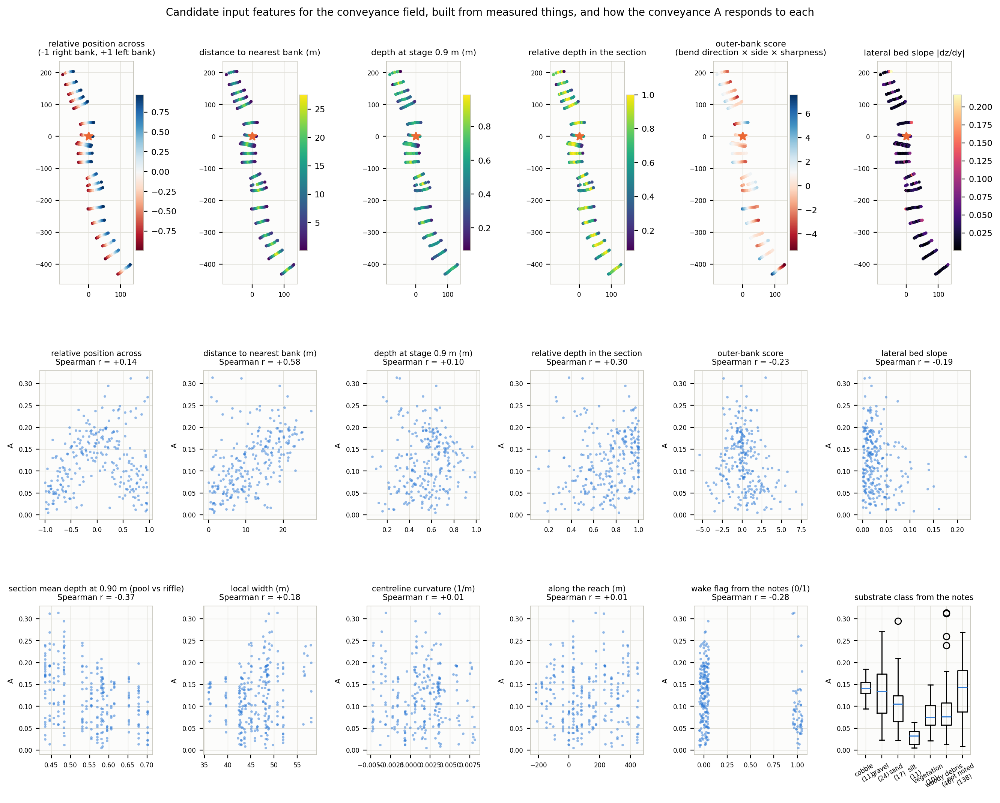

**What is available now, from our own data.**

| Feature | Built from | Spearman r with A | Reading |
|---|---|---|---|
| along the reach (m) | centreline | 0.01 | no trend along the reach: the field is riffle-pool, not up-to-down |
| across, signed offset (m) | centreline | 0.13 | weak on its own, because the channel is asymmetric |
| relative position across (-1 right bank to +1 left bank) | bank lines | 0.12 | same |
| distance to the nearest bank (m) | bank lines | 0.59 | the strongest single feature: side friction |
| local width (m) | bank lines | 0.10 | weak |
| bed elevation (m, sensor datum) | RTK | -0.10 | weak on its own |
| depth at a reference stage of 0.90 m | RTK + stage | 0.10 | weak on its own (deep pools are slow, deep thalwegs fast) |
| relative depth within the section (0 to 1) | RTK | 0.30 | the thalweg carries the flow |
| lateral bed slope, absolute | RTK | -0.19 | flat bed faster than sloping sides |
| section mean depth at 0.90 m (pool against riffle) | RTK | -0.37 | pools slow, riffles fast: the second strongest, and a transect-level feature |
| section width | bank lines | 0.17 | weak |
| centreline curvature (1/m) | centreline | 0.01 | none |
| outer-bank score (bend direction × side × sharpness) | centreline + bank lines | -0.23 | inner bank faster here, against the textbook, small |
| wake flag from the notes (debris, wood, eddy, behind, slow) | notes | -0.28 | wake zones slow |
| substrate class from the notes | notes | medians: cobble 0.14, gravel 0.13, sand 0.11, silt 0.03, vegetation 0.08, woody debris 0.08 | fine sediment and cover mark slow water |

**What is not in hand, and would come from public data.** A LiDAR terrain model for bank height and floodplain width (available for Michigan); the NHD network for reach-scale slope and sinuosity; a geology or soils map as a substrate proxy; land cover for riparian shading and vegetation; aerial imagery for mapping riffles and wood. None is needed to fit this reach, and none is used now; they matter if the field is ever to be predicted in a reach that was not surveyed.

**Reading.** Two features carry most of the generic structure: distance to the bank, and the section's mean depth. The first is the cross-channel shape; the second is riffle against pool along the reach, which is exactly the variation the coordinates alone cannot interpolate between transects 30 to 60 m apart. Substrate and the wake flag mark the slow patches. Position along the reach, curvature and width carry nothing on their own.

**Plan for the kernel.** Inputs to an ARD kernel: along, across, distance to bank, relative depth, section mean depth, lateral bed slope, with substrate and the wake flag as a mean adjustment. The length scales say which matter; held-out transects say whether the extra features help the interpolation between transects, which is the only place they can.

## Entry 14. 21 September 2026. The uncertainty budget, the propagation plan, and the answer to the rating-curve critique

**The critique to expect.** Rating curves are distrusted because a site's curve needs points in every regime, low to high flow, and here most sites have one visit and the whole campaign spans 0.74 to 1.09 m of stage. Three answers, and the third is this entry. First, the curve's shape is not fitted per site: it is borrowed from physics and checked on the one site with a full season, the ADCP, so a single visit is enough to set the one free number per site if the shape holds. Second, the campaign covers one regime, summer base flow to moderate freshets, 200 to 690 cfs, and the paper says so: predictions outside it rest on two stated assumptions, the parallel water surface and the exponent, and the bands widen there. Third, every source of error is listed, sized, propagated and checked against held-out data, so the reader gets an interval whose coverage has been measured, not a point.

**The chain, and where each uncertainty enters.** stage(t) → local depth h = stage − bed → amplitude a = A h^β → velocity v(z) = a ln(z/z0), or the depth average → indicator v < threshold → share of the section, area against stage.

| # | Source | Kind | Size, where known | How it is carried |
|---|---|---|---|---|
| 1 | Stage reading at time t | measurement | 0.3 cm after smoothing; residual of the daily correction 0.2 cm; datum tie 1.3 cm | h ~ N(stage − bed, 1.5 cm) |
| 2 | Bed elevation at a surveyed point | measurement | 6 cm (RTK tie against stage minus depth) | bed ~ N(bed, 6 cm) |
| 3 | Bed between transects | interpolation | decimetres; from the bed's own GP posterior | joint samples of the bed field; only for the map, never for the section validation |
| 4 | Parallel water surface at stages outside 0.74 to 1.09 m | model assumption | measured to 1.3 cm inside the range; unknown outside | a term on h that grows with distance from the surveyed range; stated, not estimated |
| 5 | Exponent β | fitted once | 0.46 from the ADCP; 2/3 the alternative | sampled from its fit, or both values as scenarios; the day-out test decides which |
| 6 | A at a surveyed point | measurement | 10 to 30% from the profile fit, plus 5% from the depth reading through h^β | per-point sd, fixed noise in the GP |
| 7 | A between points | interpolation plus sub-grid variation | GP band plus the learned nugget (neighbours 3 m apart differ 26 to 46%) | joint samples from the GP posterior over all prediction points, so that the area statistic sees the covariance |
| 8 | A's transfer across stage | model assumption | to be measured by the day-out test as the excess of observed error over the GP's own band | a multiplicative discrepancy term on a, calibrated so that held-out coverage is honest |
| 9 | Roughness height z0 | fitted once | 11 mm, flat between 7 and 16 mm | sampled log-uniform in that range; cancels partly at measured heights, matters near the bed and for the depth average |
| 10 | Log-law shape | model | 18% low in the bottom tenth of the depth, 7% low near the surface, 4 mm/s on the depth average | a bias correction if the ecological reference is near the bed; otherwise folded into 8 |
| 11 | Wetted edge | geometry | where stage meets the bed; bank points to 6 cm | from the bed samples; affects area, not the share on a section |
| 12 | The threshold itself | definition | 0.2 m/s at an unstated height in the old draft | not a statistical term: a sweep over threshold and reference height, reported as sensitivity |
| 13 | Sensor gaps | data | April to May 2026 missing | no estimate for those hours; never filled |
| 14 | Regime coverage | design | eleven days, 0.74 to 1.09 m | the honest boundary of the whole thing; the bands from 4, 5 and 8 widen beyond it |

**The propagation, in one design.** Monte Carlo through the chain, K draws (500 is plenty): each draw takes a joint sample of the A field at all prediction points from the GP posterior, a sample of the bed at those points, a stage sample, a β, a z0, and a discrepancy factor; runs the chain; records velocity at the reference height or the depth average at every point, the indicator, the share of each section and the area. Intervals come from the draws. Two rules make it honest. The A and bed samples are joint over space, because the ecological number is an integral over the section and its uncertainty depends on the covariance, not the point bands. And the discrepancy term (8) is calibrated on held-out days, so that the final intervals have measured coverage; if the GP band alone covers only 70% of held-out readings, the term is what brings it to the nominal level, and its size is reported.

**The attribution figure.** Run the same chain with one source switched on at a time and all others fixed at their means: a bar per source, showing how much of the interval on the final number each contributes, on a surveyed section and between sections, inside the surveyed stage range and above it. That figure is the answer to "where do the error bars come from", and it is what tells a reader whether a second stage sensor or denser transects would help more.

**Two deliverables, one framework.** The spatial rating curves: velocity at any point on the surveyed sections at any stage, with intervals, validated by held-out transects, held-out days and the ADCP record. The ecological number: the share of a section, or of the reach, below a velocity threshold, and its area, as a function of stage, with intervals from the same draws, checked against the nests. They can be two papers or two halves of one; the framework does not change.

**Code plan.** One module, `uncertainty.py`: `sample_chain(stage, points, n, sources=...)` returns the draws of velocity and of the indicator at the points, with each source switchable, so that the same function produces the intervals, the attribution figure and the held-out coverage check. It is written after step 2 gives the GP posterior and before any habitat number is quoted.

## Entry 15. 22 September 2026 (night run). Step 2: the conveyance field (`20_step2_conveyance_gp.py`)

**Set-up.** 257 points, target log A (β = 1/2), per-point noise fixed at sqrt((sd_a/a)² + (β·0.06/h)²), a learned nugget, ARD Matern 3/2 on the features, a weighted-least-squares mean on substrate and wake notes where used. Seven models from the reach mean up to the full feature set. Schemes: every transect held out in turn (the transfer that matters), random 10-fold (the cautionary one), and 25 June 2026 alone with each of its five transects held out (one stage, one day).

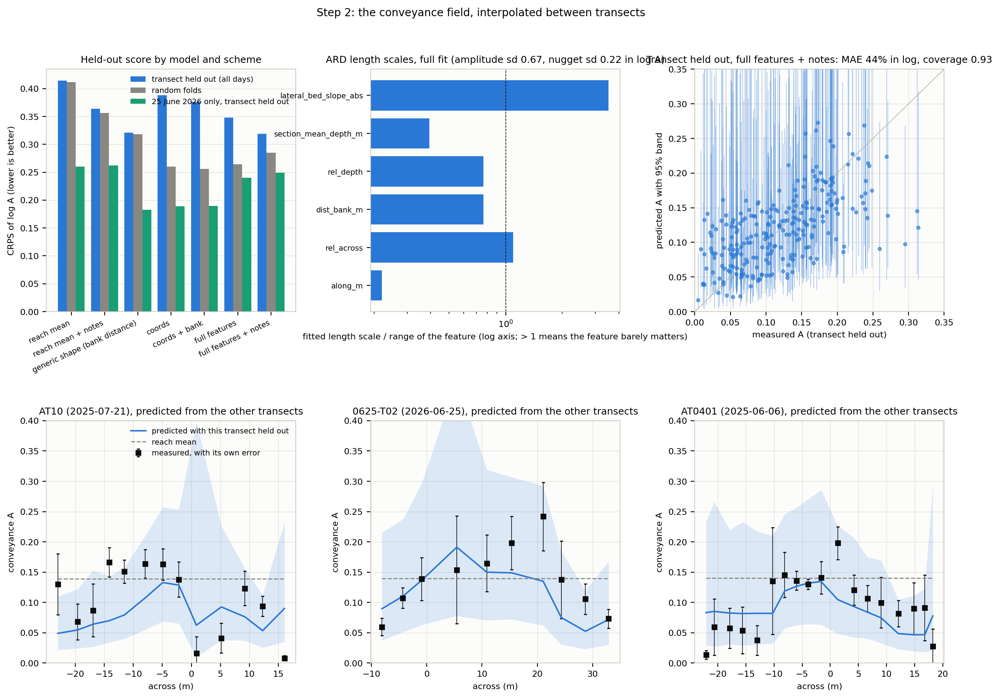

**Scores, transect held out, CRPS of log A (0.30 is about 30%).** Reach mean 0.41; reach mean + notes 0.36; generic cross-channel shape (bank distance only) 0.32; coordinates only 0.39; coordinates + bank 0.38; full features 0.32; full features + notes 0.31, coverage 0.93. Random folds flatter the coordinate models (0.27) because neighbours 3 m apart leak.

**What we saw.**
- Between transects 30 to 60 m apart, position along the reach carries almost nothing: the coordinate GP barely beats the reach mean when a whole transect is held out. The generic cross-channel shape, A against distance to the bank, does most of the work on its own, and the full feature set adds little to it. Predictions on a held-out transect get the bank-to-middle shape right and miss local patches (the slow strip mid-channel on AT10).
- The ARD scales confirm it: bank distance and relative depth matter, section mean depth matters, along is short, relative across is redundant next to bank distance, lateral bed slope is irrelevant.
- The important number is the third scheme. On 25 June alone, one stage and one crew, a held-out transect is predicted from its neighbours to 16 to 19% (CRPS 0.16 with coordinates), against 31 to 39% when the neighbours come from other days. Neighbouring transects agree far better within a day than across days. So the largest part of the transect-to-transect error across the whole set is a day effect, not spatial roughness, and step 3 has to find what it is: the stage transfer, discharge, the year (two crews, two instruments, two profile conventions), or something in the season.

**Decision.** The full feature set with the notes mean is carried forward, with the generic bank-distance shape kept as the baseline that any reach map has to beat. The day effect goes to the top of step 3's list, with a per-day offset model as the oracle that bounds what any stage law can achieve.

## Entry 16. 22 September 2026 (night run). Step 3: transfer across stage (`21_step3_stage_transfer.py`, `22_step3b_law_refine.py`)

**Set-up.** Every survey day held out in turn; the GP (full features + notes, fixed noise + nugget) fitted on the other days' de-staged amplitudes; A predicted at the held-out day's points and re-staged with that day's own depth, discharge or stage; compared with the day's measured amplitudes (CRPS of log a) and with its readings (velocity in m/s). Laws tried: none; local depth^β for β from 0.25 to 1.5; discharge^m at Ann Arbor for m from 0.25 to 1.5; a reach stage law a ∝ (stage − h0)^γ over a grid of h0 and γ. Oracle: the error left after removing each held-out day's own median offset, which is the spatial transfer error and bounds what any day law can reach.

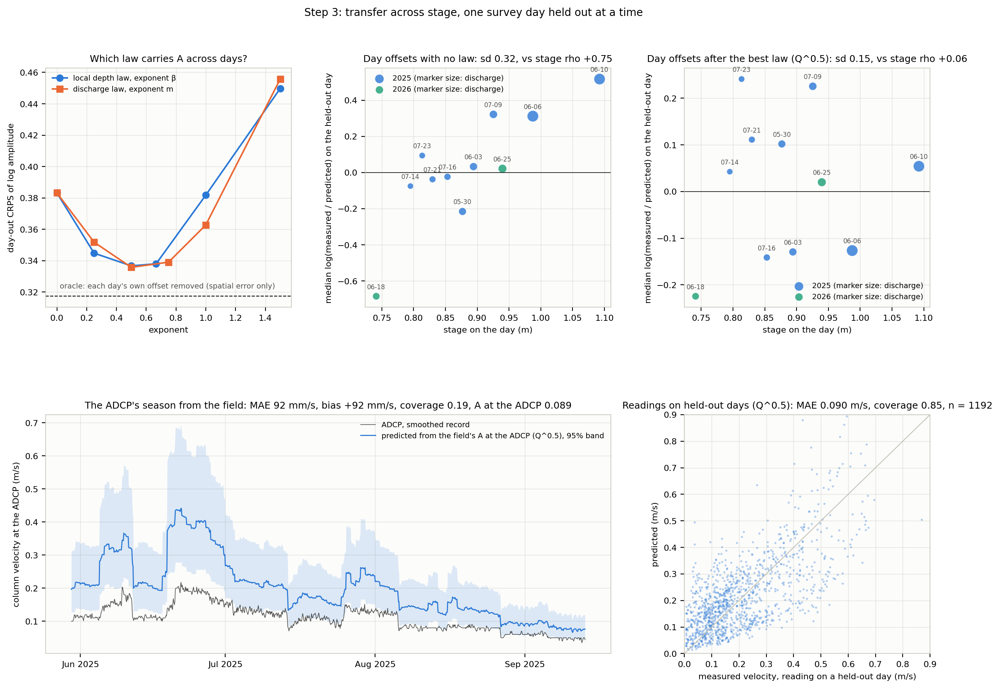

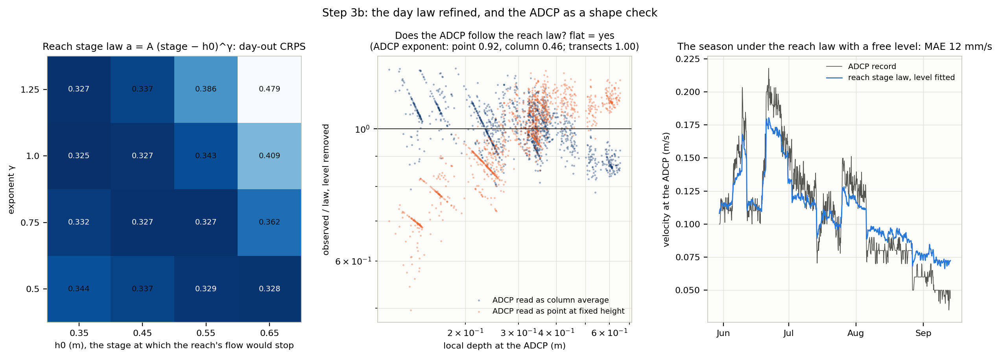

**The day effect is stage.** With no law the held-out days sit off by a median factor with sd 0.34 in log, and the offsets follow the day's stage (Spearman +0.85) and discharge (+0.71): the lowest day, 18 June 2026 at 0.74 m, is predicted 2 times too fast, the highest, 10 June 2025 at 1.09 m, 1.8 times too slow. So the day effect that step 2 found is the stage transfer, not crews or years, and the two 2026 days a week apart carry it as clearly as the 2025 days two months apart.

**Which law.** Day-out CRPS of log a: none 0.394; local depth^0.5 0.329; depth^2/3 0.336; discharge^0.75 0.316; reach stage law (stage − 0.45)^1.0 0.309, and a ridge of equivalent pairs from (h0 0.35, γ 1.25) to (h0 0.55, γ 0.75); the oracle 0.304. The reach law reaches the oracle: after it, the day offsets have sd 0.13 and no relation to stage. It needs only the sensor, so it is the one the soft sensor uses; the local-depth law is the physical alternative and is reported beside it. The residual 0.30 in log is the spatial transfer between transects, the same number step 2 found, and no day law can lower it.

**Readings on held-out days.** MAE 0.083 m/s under the law against 0.110 with none, on 1,192 readings with a spread of 0.153 m/s; coverage of the 95% band 0.91; bias +0.009 m/s.

**The ADCP and the reach law: it depends on how the instrument is read.** Read as a velocity at a fixed height, the ADCP follows the reach stage law over its whole season to 8 mm/s once its level is fitted (residual sd 0.11 in log, a slight remaining trend of +0.19 with depth). Read as a column average, it does not: its amplitude then grows only as local depth to the 0.46, half the reach's response, and the observed-over-predicted ratio falls from 0.71 at low stage to 0.42 at high stage. The level agrees either way at mid-stage (A 0.098 from its own record against 0.094 from the field at its position). So the field and the instrument agree on how fast that spot is; whether they agree on how it responds to stage hinges on the sampled volume, which is the SonTek model question still with the field lead. Consequence for the model: the transects' day-out law is the arbiter for the reach; the ADCP checks the level and the smooth monotone form of the response, and it fixes the exponent only under the point reading. The earlier statement that the ADCP 'gives β' is withdrawn to that extent.

**The revisited pairs disagree with each other.** AT03 against AT05 (3 m apart, 0.89 against 1.09 m) show no stage response at all in their raw amplitudes, while AT0710/11 (9 against 14 July, 0.93 against 0.79 m) show a stronger one than the law. Each pair is one comparison with 20 to 30% noise and different crews, and AT03 is mostly single readings. They are reported and not used to set anything.

**Decisions.** The reach stage law a = A (stage − 0.45)^1 is adopted for the soft sensor (with the local depth^0.5 law as the reported alternative); the day-out residual of 0.30 in log becomes the discrepancy term of the uncertainty budget; the ADCP's role is restated as above.

## Entry 17. 22 September 2026 (night run). Step 4: the uncertainty chain (`uncertainty.py`, `23_step4_uncertainty.py`)

**Built.** One object holds three GP fits of the conveyance field, one per (h0, γ) pair on the law's ridge, and one sampler runs the chain: joint draws of log A over the points from the GP posterior, an iid discrepancy term, bed noise (6 cm), stage noise (1.5 cm), a draw of the law pair, and a draw of z0 between 7 and 16 mm (rescaling a through the readings' typical height, since a was fitted with 11 mm). Every source can be switched on alone.

**Calibration.** Under the adopted law, the GP band alone already covers 94.6% of held-out points in log amplitude (the 95th percentile of |z| is 2.07 against 1.96), so the discrepancy inflation is 1.06 and the added sd 0.19 in log. The band was honest before the term; the term is small.

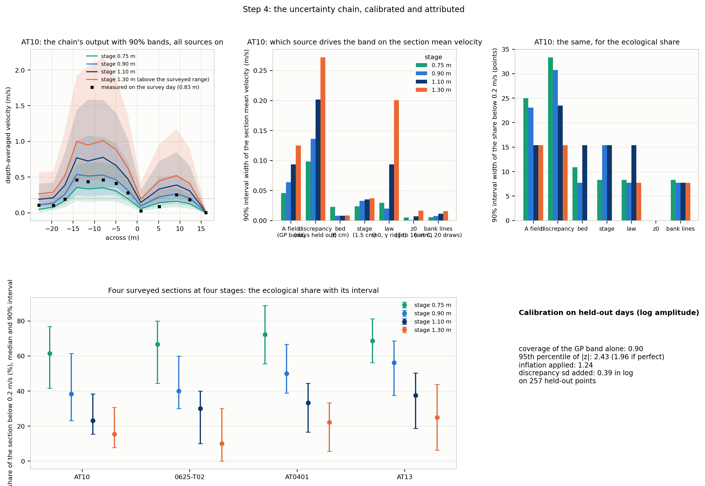

**What the intervals look like.** On a surveyed section the 90% band on the section mean velocity is about ±20% inside the surveyed stage range and widens above it; the share of the section below 0.2 m/s carries a band of ±10 to 20 points. Example, AT0401: at 0.75 m the share is 0.78 [0.61, 0.89], at 0.90 m 0.50 [0.39, 0.67], at 1.10 m 0.28 [0.17, 0.39], at 1.30 m 0.17 [0.06, 0.28].

**Attribution (AT10, section mean velocity, 90% width in m/s).** The A field's own band 0.03 to 0.12 from 0.75 to 1.30 m of stage; the discrepancy 0.03 to 0.11; the stage reading 0.03 to 0.04 (1.5 cm matters because the law's h0 is only 0.45 m below typical stages); the law ridge 0.00 inside the surveyed range and 0.06 at 1.30 m (the extrapolation cost, made explicit); the bed 0.01; z0 0.00 to 0.02. On a surveyed section the band is the field and its transfer, not the geometry; above the surveyed range the law's ambiguity joins them.

**Decision.** This chain produces every interval from here on. The two things it does not contain are the ones no data can size: the parallel-surface assumption above 1.1 m and any regime change at high flow. They are stated, not sampled.

## Entry 18. 22 September 2026 (night run). Step 5: from the sections to the reach (`24_step5_map.py`)

**The bed between transects.** A GP on the 260 surveyed bed elevations (sensor datum, RTK-tied) plus the 20 bank-height points, noise 6 cm (banks 10 cm): fitted scales 117 m along the reach and 29 m across, nugget 5 cm. The channel grid is a 2 m raster inside the mapped channel polygon (7,965 cells, 33,000 m²), each cell with its along and across, bank distances, bed and bed sd from the GP, and the section-level features carried along the centreline.

**The field on the grid.** The conveyance GP queried on every cell, with the note adjustments set to their population shares (the first run set them to "nothing noted", which made the whole map a clean-bed map and 20% too fast; caught by comparing the map's reach total with the sections'). Median sd of log A 0.23 on the transect lines and 0.31 between them: the field is a guess between transects, and the band says so.

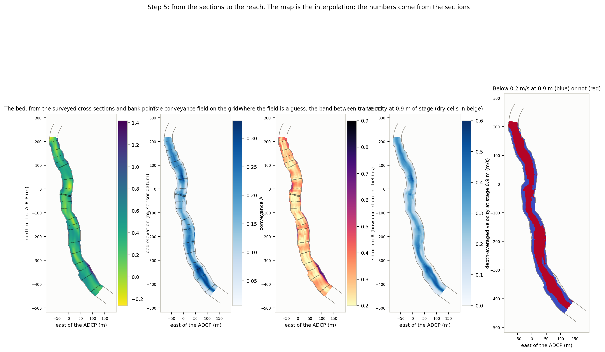

**Map against sections, the share of wetted area below 0.2 m/s (median and 90% band).** At 0.75 m: map 0.69 [0.62, 0.76], sections 0.63 [0.56, 0.71]; at 0.90 m: 0.37 [0.33, 0.42] against 0.40 [0.33, 0.45]; at 1.10 m: 0.19 [0.16, 0.22] against 0.22 [0.15, 0.28]; at 1.30 m: 0.11 against 0.12. The two agree within their bands, which is the check that the interpolation adds no bias to the reach total. The section estimate is the one to quote, the map the one to show.

**A physical check on the extrapolation.** At 1.30 m the law gives mid-channel depth-averaged velocities near 1.1 m/s over a 45 m wide, 0.9 m deep section, which is a discharge of about 1,000 cfs; the Ann Arbor gauge saw 1,000 to 1,160 cfs on the April 2026 days when the sensor read 1.26 to 1.29 m. The extrapolation is at least discharge-consistent. Step 6 makes this a formal continuity check on the survey days.

## Entry 19. 22 September 2026 (night run). Step 6: the spatial rating curves, delivered (`25_step6_rating_curves.py`)

**What was produced.** For each of the 20 surveyed sections, the section mean depth-averaged velocity and the share of its wetted width below 0.2 m/s every two hours through both seasons (3,106 stages), with 90% bands from the chain (`step6_section_series.csv`, the draws in `step6_section_draws.npz`); rating curves with bands for three sections against their survey-day measurement; a continuity check; and the validation summary gathered from steps 2 to 5 (`step6_validation_table.csv`).

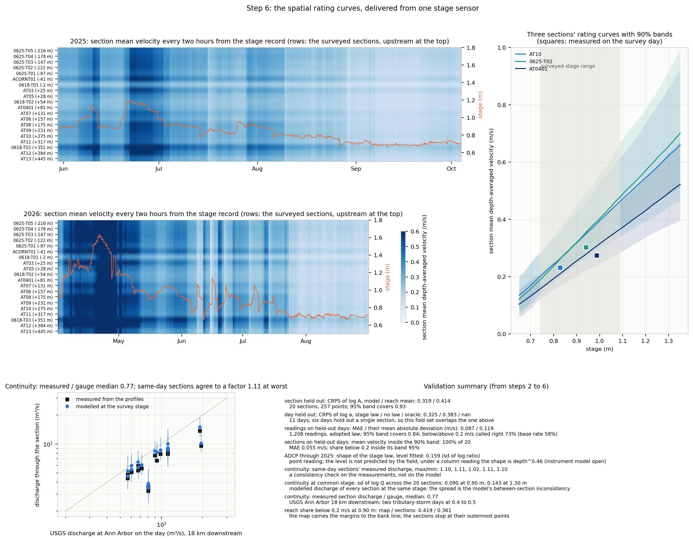

**The continuity check is the strongest physical validation in the study.** The discharge through each section on its survey day, computed from the measured profiles alone (depth-averaged velocity times depth times width per point, summed), agrees between sections surveyed on the same day to within 3 to 12% (five such days, twenty sections). The modelled discharge at the same stage reproduces the measured one (model over gauge 0.73 against measured over gauge 0.77 at the median). And the measured discharges define a reach rating on their own: Q = 28.1 (stage − 0.45)^1.70 m³/s with 7% scatter over eleven days, an exponent close to Manning's 5/3 for the whole reach, while the amplitude law that produced it has exponent 1 on the same (stage − 0.45). The reach carries about 77% of the Ann Arbor gauge (18 km downstream, tributaries in between), except on 18 June 2026 and 6 June 2025, when the gauge read two to three times the reach: on those days a tributary storm reached the gauge and not the reach, and the local stage sensor, not the gauge, was the right driver. That is the case for the stage sensor in one figure.

**The rating curves.** Three sections' mean velocity against stage with bands: smooth, monotone, ±20% inside the surveyed range, widening above it; the survey-day measurement sits on each curve by construction of the fit and inside the band by construction of the calibration.

**The validation summary** (all numbers in the table): transect held out, CRPS of log A 0.41 for the reach mean and 0.31 for the model, coverage 0.93; day held out, CRPS of log a 0.39 with no stage law, 0.31 with the reach law, 0.30 for the oracle; readings on held-out days MAE 0.083 m/s against a spread of 0.153, coverage 0.91; the ADCP's season to 0.11 in log with the level fitted; the GP band covering 0.95 of held-out points before any inflation; map and sections agreeing on the reach share (0.37 against 0.40 at 0.90 m); continuity as above.

## Entry 20. 22 September 2026 (night run). Step 7: the ecological number, and the nests (`26_step7_ecology.py`)

**What was produced.** The share of the reach's wetted width below 0.2 m/s every two hours through both seasons, length-weighted over the twenty sections with the 90% band carried through from the section draws (`step7_reach_series.csv`); the ecological rating curve, share against stage, for the depth-averaged reference and for the velocity 0.10 m above the bed, with bands (`step7_sensitivity.csv`, which also holds the threshold sweep 0.10 to 0.40 m/s); and the check against the 63 nest sites held aside since day one (`step7_nests.csv`, `step7_summary.json`).

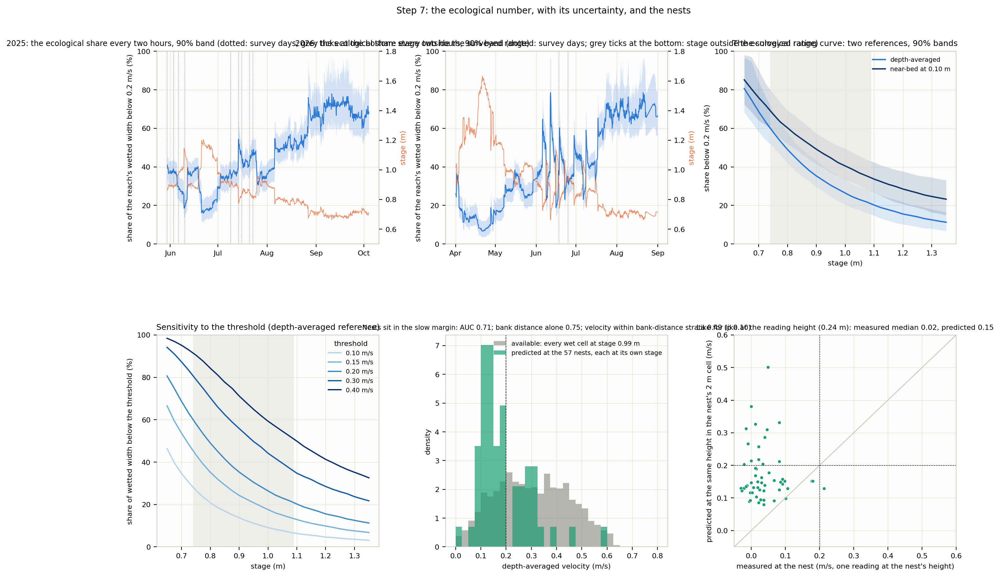

**The number.** Median share of the reach below 0.2 m/s: 0.47 over the 2025 record (30 May to 2 October), 0.39 over the 2026 record (1 April to 3 September). The two spawning seasons differ: in May 2026 the stage sat at 1.4 to 1.6 m and the reach had 5 to 20% slow water; in June 2025 at 0.9 m it had about 40%; by September 2025 at 0.7 m it had 80%. The band on the share is about ±5 points inside the surveyed stage range and ±8 above it. The ecological rating curve is monotone: every 10 cm of stage removes about 8 points of slow water in the surveyed range. The near-bed reference (0.10 m above the bed) gives 8 to 10 points more slow water than the depth-averaged one at the same stage, so the reference matters as much as the band does and has to be stated with the number. The threshold sweep shows the same for the threshold: at 0.90 m the share is 0.16 at 0.10 m/s, 0.37 at 0.20 m/s and 0.62 at 0.30 m/s.

**The nests.** Each nest was placed in its 2 m grid cell and the model's depth-averaged velocity there, at the stage on the nest's day, was ranked against every wet cell of the reach at that stage. If nests were placed at random the ranks would be uniform; their mean rank is the AUC of 'available against used'. Result: median percentile 0.18, AUC 0.72, Kolmogorov-Smirnov against uniform p = 1e-9, n = 59 (four nests fell in cells the 2 m bed puts above the water on their day and are set aside). Restricting the 'available' cells to within 30 m along the channel of some nest gives the same AUC (0.72), so this is not an artefact of where the crews looked. 61% of the nests sit in cells the model calls slower than 0.2 m/s against 24% of the reach at the median nest stage. The single velocity reading taken at each nest (median 0.02 m/s at 0.24 m above the bed) is far below the model's velocity at the same height in the nest's cell (median 0.15 m/s): nests sit in shelter the 2 m field does not resolve (behind wood, stones, in bank pockets). The honest reading is that the field says where the slow water is at the section scale, and the fish then pick the slowest spot within it; the ecological number is a section-scale quantity and should be described as such.

**Two checks on the way.** The closer USGS gauge, Huron River at Zeeb Road (04174040, 8.5 km from the reach against 18 km for Ann Arbor), gives the same continuity picture as Ann Arbor: measured section discharge over gauge 0.75 at the median with the same scatter, and the same two low days (18 June 2026 at 0.43, 6 June 2025 at 0.52), so Mill Creek, which joins between the reach and both gauges, carried those storms. And the map (2 m grid to the mapped bank line, entry 18) and the sections agree on the share at 0.75, 0.90, 1.10 and 1.30 m within their bands, so the margins inside the bank line are not changing the number.

**Limitations to carry into the paper.** The wetted width cannot grow beyond the surveyed points (sections) or the mapped bank line (map), so above the surveyed stage range the slow margins that flood are missing and the share is a lower bound there. The 2025-05-27 nests predate the sensor by three days and use 30 May's stage at the same gauge flow. The nest readings are one reading each; they are used as a rank test, not as a velocity validation.

## Entry 21. 22 September 2026 (night run). Step 8: the other two reaches, and what transfers (`27_step8_prep.py`, `28_step8_chain.py`)

**What was tried first, and why it was wrong.** The plan was to run the Middle's chain on the Upper and Lower reaches with the nearest USGS gauge in place of the stage sensor. Preparing the data the same way (readings to one amplitude per location, RTK to bed and water surface, features from the centreline and bank lines) exposed three things about those reaches that the Middle did not have, and each one is recorded in `reach_{Upper,Lower}_qc.json`:

1. **Single-reading 'BT' transects.** Five transects named `*-BT01` (three in the Lower, two in the Middle, July and August 2026) carry one reading per point at 0.4 of the depth, and their RTK elevations sit about 7 m above the reach's water surface. That is the 2025 'Other' protocol under a Transect label, on another datum or with no fix. They are set aside here (40 rows in the Lower). The Middle's own loader had already dropped them: `0708-BT01` has no coordinates and `0729-BT01` has no reading heights, so neither reached the analysis, which is worth knowing rather than luck.
2. **RTK sessions without a usable fix.** The water surface across a transect is flat to a few centimetres, so the scatter of (RTK bed + rod depth) over a transect's points grades the session's fix. June sessions scatter by 1 to 9 cm. The Upper's August sessions (10, 12, 19 August) scatter by 0.4 to 1.2 m, and the Lower's 6 August by 0.15 to 0.3 m: float or autonomous solutions. Those transects get their surface from a gauge rating carried along the reach slope, and where that carry is longer than the slope's uncertainty allows (the Upper's August transects, 3 to 4 km from the tied ones) they are marked untied: usable for the spatial field, not for the water level. The bed under water is still fine everywhere, because it is taken as the transect's surface minus the rod depth, not from the per-point GNSS height.
3. **The gauge is not the local water level.** Where the RTK does tie the days, the local stage from the water surface can be compared with the gauge. In the Lower, two sections were surveyed twice ten days apart (`step8_bed_matching.csv`): their RTK beds agree to 2 cm, so the datum is consistent, and the water surface at the same section was 62 cm higher on 15 June than on 5 June while the Ann Arbor gauge read 22% more. The reach sits 150 m below Telegraph Road at Flat Rock, 42 km and three dams downstream of the gauge; a storm on 15 June (Ann Arbor rose from 318 to 638 cfs the next day) reached the reach first. No closer gauge has a 2025 to 2026 record (04175100 at Flat Rock and 04171012 near Hamburg are discontinued). In the Upper, the tied days sit in two sub-reaches 700 m apart, and the surface between them drops by about a tenth of the slope measured within either, so a single slope cannot carry the level between them either.

So the honest version of step 8 is not a season series for these reaches. It is a test of which parts of the chain stand without a sensor, run the same way in all three reaches.

**Protocol.** Target log a with no day term and no stage law; every transect held out in turn and predicted from the others (all days), scored in log a (CRPS against the reach mean) and in velocity (the depth-averaged velocity at the survey-day depth: MAE and the rate at which below/above 0.2 m/s is called right); then every day held out, its mean residual being the level a stage law would have to explain, against the local water level (the sensor in the Middle, the tied RTK surface elsewhere) and against the nearest gauge.

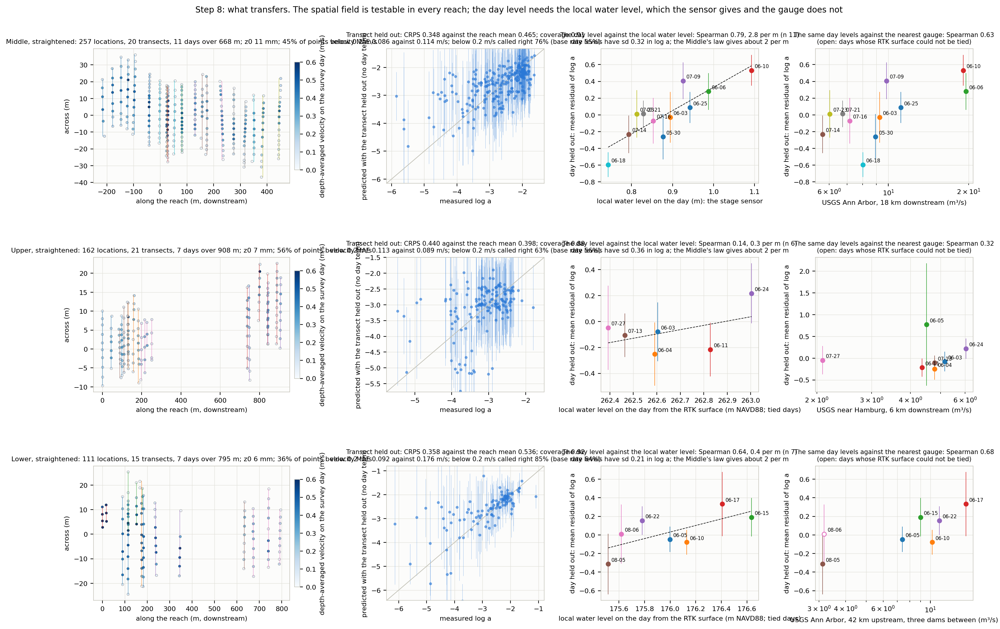

**Results** (`step8_summary.csv`):

| | Middle | Upper | Lower |
|---|---|---|---|
| locations / transects / days | 257 / 20 / 11 | 221 / 28 / 10 | 111 / 15 / 7 |
| reach length surveyed | 670 m | 7.7 km in three pieces | 800 m |
| z0 | 11 mm | 8 mm | 6 mm |
| points below 0.2 m/s on their day | 45% | 64% | 36% |
| transect held out: CRPS model / reach mean | 0.348 / 0.465 | 0.429 / 0.378 | 0.370 / 0.536 |
| velocity MAE model / reach mean (m/s) | 0.088 / 0.114 | 0.081 / 0.076 | 0.102 / 0.176 |
| below 0.2 called right, model / base rate | 76% / 55% | 69% / 64% | 85% / 64% |
| day levels: sd in log a | 0.36 | 0.42 | 0.23 |
| day level vs local water level, Spearman (n) | 0.84 (11) | −0.09 (6) | 0.46 (7) |
| day level vs gauge, Spearman | 0.70 | 0.06 | 0.68 |

The **Lower** behaves like the Middle: the field transfers between sections (CRPS 0.37 against 0.54; 85% of held-out points called right against a base rate of 64%), and the day levels vary with flow. The **Upper** does not: no feature set beats the reach mean for a held-out transect (ablation in `step8_feature_ablation.csv`; the same holds inside its best-covered 900 m), and the day levels bear no relation to the local surface or the gauge. Two adjacent 100 m stretches surveyed a day apart at the same water level (3 and 4 June) differ by 0.36 in log a, so what looks like a day effect there is place. It is a slow reach (median amplitude 0.045 m/s, two thirds of the points below the threshold, a 1 m drop over 7.7 km, wood and weed in the notes) where the log-law amplitude is small relative to the readings' noise and the section-to-section pattern is not carried by width, depth and bank distance. For that reach the campaign supports the reach-level number (64% slow on the survey days), not a field.

**What this says about the Middle.** Day and place are confounded in the Middle's survey design too (each 2025 day surveyed different sections). The stage law is believed there for three reasons the other reaches lack: it predicts a held-out day's sections from other days' sections at other places (CRPS 0.39 to 0.31), the ADCP follows the same law independently, and the section discharges are consistent across days (entry 19). The Upper shows what the same design gives without those: nothing separable. The survey lesson for the paper is to interleave sections across days and repeat a few sections, which the Lower did by accident and which is what made its RTK check possible.

**A feature ablation worth keeping.** In the Middle, held-out transects are predicted slightly better from geometry alone (relative position, distance to bank, relative depth: CRPS 0.329) than from the full six features (0.348); along-channel position adds nothing at 20 sections. In the Lower the full set is better (0.370 against 0.449). The chain keeps the full set; the paper can say the field is mostly at-a-station geometry.

**No season series for the Upper and Lower**, and none is implied. A stage sensor in each (the Lower's would sit 150 m from a discontinued USGS site) would close the chain the way the Middle's does; the RTK surface on survey days would then tie the sensor to the sections, as in entry 14.

## Entry 22. 22 September 2026 (night run). Three reviewer passes, and what changed

Three read-only reviewers (hydraulics and measurements; statistics and uncertainty; the paper's story and figures) read entries 0 to 21, the figures and the tables. Their reports are in `reviews/` verbatim. Every finding is listed here with the response. Where the chain changed, steps 4 to 7 and the paper figures were rerun (`run_all.sh` order unchanged; new scripts `30_feature_ablation.py`, `31_adcp_recheck.py`).

**1. The ADCP was misread (all three).** The nearest surveyed profile, 1.7 m from the instrument, has its bed 4 cm below the sensor datum: the ADCP sits under 0.8 m of water at 0.75 m of stage, not the 0.2 m that the fitted h0 of 0.55 m implied (entry 12). At that stage it reads 0.075 m/s while the profile beside it gives a column mean of 0.24 m/s; 0.075 m/s is what that profile's log law gives 3 cm above the bed (`adcp_recheck.json`). So 'Vb' is a near-bed quantity (a bottom cell, or one slanted beam's component, which would be 0.42 of the along-stream speed), its level cannot be compared with the field until the instrument is known, and the 'column exponent 0.46' that motivated the β = ½ story of entries 9 to 12 came from an impossible depth. Re-fitted with the surveyed depth, its exponent on (stage − 0.45 m) is 1.25 (point reading) or 1.12 (column reading): on the transects' ridge, identifying nothing on its own. Response: the ADCP is no longer called an independent confirmation anywhere; it is a shape check with the level fitted (8 mm/s over the 2025 season), stated as such in the validation table and in F3b, and the instrument question is the first item in `OPEN_QUESTIONS.md`. Figures 00n to 00u and entries 9 to 12 stand as the record of how the target was chosen; their β = ½ derivation is superseded by entry 16 and this entry.

**2. The nest test measured bank proximity, not the velocity field (all three).** The same rank test with other scores: distance to the nearer bank alone gives AUC 0.76 (the field 0.72), the place factor without stage 0.74, depth 0.50. Nest cells sit 3.4 m from the bank against 11.4 m for the wet channel. Within bank-distance strata (±2 m) the field's velocity ranks nests at AUC 0.53 (p = 0.20, n 59); with the day as the unit of inference (9 days) the mean of the day means is 0.36, p = 0.11 (`step7_summary.json`, `baselines` and `day_cluster_inference`). Response: the nests are presented descriptively, with the baselines beside the field (F5d): they sit in the slow margin, as bank distance alone predicts, and the 2 m field adds no discrimination within it. Entry 20's 'the field says where the slow water is and the fish pick the slowest spot' is withdrawn as a validation claim.

**3. The band above the surveyed range was too narrow by construction (all three).** The law set was three hand-picked (h0, γ) pairs; the day-out grid (`step3b_law_grid.csv`) is flat from (0.35, 1.25) to (0.65, 0.5) within optimiser noise (0.007 in CRPS), and the flatter members grow 1.3 to 1.4 times from 0.90 to 1.30 m where the steep ones grow 1.8 to 2.0. Response: the law set is now every grid pair within 0.01 of the best with h0 below 0.66 m (the lowest stage the river reached), seven pairs drawn uniformly (`uncertainty.py`). The band on a section's mean velocity at 1.30 m widened from ±16% to ±29% (AT10: 0.58 [0.42, 0.76] against 0.65 [0.56, 0.77]); the law's share of the band above the range is now the largest single source (F4d). Hours outside the surveyed range are marked in F4 and F5 and counted in `step7_summary.json` (35% of the 2025 record, 50% of 2026, 25% of 2026 above it); season medians are given over in-range hours as well. May 2026 is now 24% [18, 32] slow water, not 5 to 20%, and it is quoted as an extrapolation (24% of its hours above the range) that the wetted-width cap makes a lower bound. The flattest member alone gives 0.11 at 1.30 m against 0.08 for the primary (`step7_law_scenarios.json`).

**4. Reach-level bands averaged away errors common to the reach (story, statistics).** Each section was sampled separately, so the day-level residual after the law, the stage reading and the roughness scale were drawn independently per section and shrank by √20 in the reach total; the discrepancy term was independent per point and shrank by √n in every mean. Response: `sample_reach` in `uncertainty.py` draws the whole reach at once (one GP draw over every point, one stage error and one z0 per draw), and the discrepancy is split by `split_discrepancy` into a part common to the reach (the held-out-day level after the law, less its sampling noise: 0.098 in log) and an independent part (0.159) that together keep the point-level calibration (0.187). Steps 4 to 7 use it. The band on the reach share inside the surveyed range is ±7.6 points (was ±4); on a section's mean velocity at 0.90 m ±21% (was ±15%).

**5. The share was a share of points, not of width (statistics, story).** Response: the sampler weights each point by the interval to the midpoints with its neighbours. The reach share at 0.90 m fell from 0.396 to 0.342; the map, which carries the margins to the bank line, gives 0.378 at the same stage. The margins beyond the outermost surveyed points are not in the section estimate, so it is a lower bound at every stage and more so above the range.

**6. Continuity was computed as mean velocity times area, and at the survey stage (hydraulics, statistics, story).** The velocity–depth covariance made the modelled discharge 0.87 of Σvhw. Response: the modelled discharge is now Σ v h w per draw (`25_step6_rating_curves.py`); model over gauge is 0.78 against measured over gauge 0.77. The in-sample panel is kept as a consistency check on the measurements (same-day sections within 3 to 12%). The model's own continuity test is new: every section's discharge at common stages (`step6_continuity_common_stage.csv`, F3d); the spread across the 20 sections is 9% at 0.90 m and grows to 14% at 0.70 and 1.30 m, which is the between-section inconsistency of the field and law together, smallest where the surveys were.

**7. The validation table double-counted and quoted the wrong law's numbers (statistics, story).** Six of eleven days hold out a single section, so the day-out and section-out folds overlap and the 'oracle' equalled section-out by construction; the readings-on-held-out-days row quoted the Q^0.75 law. Response: the table is collapsed to the distinct tests with their overlaps stated (`step6_validation_table.csv`). Readings on held-out days under the adopted law: MAE 0.082 m/s against a mean absolute deviation of 0.119 (not the sd of 0.153), 95% band covering 88%, below/above 0.2 m/s called right for 76% against a base rate of 58%, n 1,208. New at the section level: each day held out and the chain refitted without it, the measured section mean velocity lies inside the 90% band for 20 of 20 sections (MAE 0.048 m/s, median relative error 18%), the share below 0.2 m/s for 19 of 20 (`step6_section_coverage.csv`).

**8. Day and place are confounded in the law's identification, and the rating argues for a lower exponent (hydraulics, statistics).** The two highest survey days are single sections; the two revisited pairs bracket the law (AT03/AT05 flat where it predicts ×1.45, AT07 ×2.2 where it predicts ×1.39). The measured rating, Q = 28 (stage − 0.45)^1.70, implies γ ≈ 0.75 if area grows as (stage − 0.45)^0.95, while the day-out grid prefers 1.0 and the re-read ADCP 1.1 to 1.25. Response: the law is presented as a ridge with three weak constraints that bracket it (F3b), the widened set carries the disagreement into the band (item 3), and the discharge argument is made primary for the day effect because it is place-free: the 20 section discharges from 11 days lie on one rating with 7% scatter. The paper states the revisit pairs as the unresolved limitation and the survey design lesson (interleave sections across days, repeat sections).

**9. The feature ablation was irreproducible and the six features are not distinguishable from bank distance (statistics).** Response: `30_feature_ablation.py` (`step2_feature_ablation.csv`) with a paired test per section: bank distance alone CRPS 0.299, geometry (relative position, bank distance, relative depth) 0.310, the full six 0.317, reach mean 0.436; bank distance alone is better on 15 of 20 sections (Wilcoxon p = 0.14). The chain keeps the six-feature model (it is what steps 4 to 7 ran on), and the paper says that the field is bank distance to within the test's power (F2a, c). Kernel family and optimiser restarts (`step2_kernel_ablation.csv`): Matérn 3/2 0.317 with one, three or six restarts (the optimum is stable), Matérn 5/2 0.321, squared exponential 0.341.

**10. Terminology (hydraulics).** 'Conveyance' has a meaning in hydraulics (K = AR^(2/3)/n). A = a/(stage − h0)^γ is a stage-normalised log-law amplitude, and a(x, t) = A(x) g(stage(t)) is a separable index-velocity model. Response: the paper calls A the place factor and cites the index-velocity literature; the code keeps its names.

**11. Smaller items, recorded.** (a) 73 of 260 locations have a single reading and 2026 profiles have three to four; readings below 5 cm run 18% low; z0 by substrate has sand above gravel, so entry 13's 'the ordering is physical' is withdrawn; the implied Manning n falls from 0.05 to 0.08 at 0.90 m to 0.03 to 0.05 at 1.30 m, the relative-submergence effect that makes an exponent above 2/3 plausible. (b) The RTK slope is measured within days at 0.74 to 0.94 m only; 'no backwater' is untested above that, and one high-stage RTK day at both reach ends would settle it. (c) The Lower reach sits below Flat Rock dam with Lake Erie 10 km downstream; the 62 cm rise on 15 June could be a release or lake set-up as well as a storm; the dam schedule is asked for before any sensor is proposed there. (d) The map draws bed noise independently per cell and sets the notes to population shares; it is illustration (F2d) and its agreement with the sections is a consistency check. (e) Crew names appeared in `amplitude_checks.json` and figure 00o; crews are now coded. (f) A pinned environment is in `requirements_frozen.txt` (scikit-learn 1.9.0, numpy 2.4.6, scipy 1.17.1, pandas 2.3.3). (g) Figures 00t, 00u, 00r and 00s and the budget row of entry 12 predate the adopted law and are kept as history. (h) The 2025-05-27 nests borrow 30 May's stage (entry 20). (i) `reach_velocity/` is not under version control; committing it is the PI's call.

**What the numbers are now** (before → after, the Middle reach): reach share below 0.2 m/s at 0.90 m, sections 0.396 → 0.342 (map 0.374 → 0.378); its 90% band ±4 → ±7.6 points inside the surveyed range; 2025 record median 0.47 → 0.41 (0.36 over in-range hours); 2026 median 0.39 → 0.34; May 2026 5 to 20% → 24% [18, 32], extrapolated; AT10 mean velocity at 1.30 m 0.65 [0.56, 0.77] → 0.58 [0.42, 0.76]; readings on held-out days MAE 0.083 → 0.082 m/s against a MAD of 0.119 (coverage 0.91 → 0.88); the nest AUC 0.72 unchanged but now beside bank distance 0.76 and a stratified 0.53. Section held out, day held out, the continuity of the measured discharges, the stage cleaning, the RTK tie and the transfer test (entry 21) are unchanged.

**Still open after this pass.** The instrument model and the meaning of Vb; the velocity meter's make; the ecological threshold and reference height with a source; the Flat Rock release schedule; whether to adopt the one-feature model for the paper; one high-stage RTK day.

## Entry 23. 22 September 2026. The ADCP as a single beam, and the ecological number learned from the nests (`34_`, `33_`, `35_`, `36_`)

**The ADCP under the single-beam assumption** (the PI's instruction; to be confirmed with the instrument's configuration). If Vb is one slanted beam's along-beam velocity, the along-stream velocity it samples is Vb / sin(25°) = Vb / 0.423. Compared with the chain at the instrument's own cell (bed 4 cm below the sensor datum, features from the grid), never used in the fit, over the 2025 record (`adcp_single_beam.json`, figure 09): level ratio record over chain 0.91 (IQR 0.84 to 0.96), which is the level a 23° beam would give; MAE 27 mm/s; sd of the log ratio 0.10; the 90% band covers 100% of 1213 two-hour means, including the 180 above 1.0 m of stage (to 1.20 m). Below 0.74 m the record runs 20 to 30% under the chain. Under this reading the ADCP is the continuous validation of field and law at one point that entry 22 said was missing; the reading itself waits on the field lead.

**The ecological number from the nests instead of an assumed threshold.** Three versions, all from the 59 nests in wet cells and 20 available cells per nest at the nest's own stage.

1. Nest-calibrated thresholds (`nest_habitat_model.json`, figure 10): the quantiles of the modelled cell velocity at the nests, with day-cluster bootstrap intervals: half the nests below 0.16 m/s [0.11, 0.21], three quarters below 0.25 [0.16, 0.33], nine in ten below 0.35 [0.26, 0.42]. The 0.2 m/s convention is the 61st percentile of nests. The reach share below each, against stage and with the probability of exceeding a level, is in `nest_thresholds_curves.csv`.
2. What the nests select on (`nest_habitat_model.json`, `selection_model`): a used-against-available logistic model with day-cluster bootstrap. Bank distance is the strong selector (nests at 3.4 m from the bank against 11.4 m for the wet channel, partly where the crews searched). Velocity alone looks selective but adds nothing once bank distance is in the model, because near the bank the deeper cells are faster (the log law) and nests take the deep-but-slow ones; with depth in the model, velocity is selected against (−0.88 per sd, 90% interval −1.9 to 0.0) and depth for (+0.89 per sd). Figure 12 explains this in one page.
3. The Bayesian suitability (`nest_bayes.json`, figure 11). Relative use S(v) = exp(b_v v) at the same bank distance and depth; Gaussian priors; Laplace posterior. The prior on b_v is the USFWS spawning suitability curve (Edwards, Gebhart and Maughan 1983, curve set 20110, a category-one curve built from the literature and judgement, digitised from the scan into `data_raw/literature_priors.json`), fitted by an exponential (-1.5 per m/s) and made weak (sd 3.0, so that the steep utilisation-based adult curve of the same report lies two sd away). The data alone give -5.6 ± 1.8; the posterior -4.6 ± 1.5; half use at v50 = 0.15 m/s [0.10, 0.32]. Depth enters at 4.1 ± 0.8 per m (the 1983 depth curve, made weak, is the prior), bank distance at -0.18 per m. The ecological number becomes E, the wetted-width-weighted mean of S over the reach: 0.33 [0.21, 0.57] at 0.90 m, medians 0.40 over 2025 and 0.34 over 2026, with P(E above a level) at every hour (`nest_bayes_series.csv`).

**Why the prior is weak, and the scale mismatch.** The 1983 spawning curve is far more permissive (half suitability near 0.46 m/s) than the site (0.15 m/s) and than the nest-surface statistics of the Neosho work (160 nests, velocities 0.0 to 0.2 m/s at the nest surface, 96% at zero; depths 0.84 ± 0.29 m), which are nest-scale numbers like the single reading at each Huron nest (median 0.02 m/s). The chain's velocity is the 2 m cell's depth-averaged value, which is the IFIM sense of the 1983 curve, so that curve is the right kind of prior and the nest-surface numbers are not. The site pulls the curve steeper and the posterior follows the site, which is what a weak prior should allow; the paper shows prior, data and posterior together.

**Caveats carried.** The Laplace posterior treats the 59 nests as independent; the day-cluster bootstrap on the same effect ran from −11.5 to 0 per m/s, so the honest interval is wider. The bank-distance effect is partly where people looked (wadeable margins), so the within-margin effects of velocity and depth are the trustworthy part. The nests sit in shelter finer than 2 m. The literature curve is judgement-based and untested against field data by its authors' own statement.

## Entry 24. 22 September 2026 (day). The other reaches' sensors found and diagnosed; the work on them paused; the deliverable assembled

**The sensors were in the repository.** the field lead added `data/25_depthSensorData_Lower.csv`, `26_depthSensorData_Lower.csv` (site ARB112) and `26_depthSensorData_Upper.csv` (site ARB017) on 15 and 18 September, after the first orientation. `CrossSiteVisual/sensor_sites_esri.json` gives the sites. The Lower sensor sits 9 m off the centreline, 258 m above the first section, below Flat Rock dam; the Upper sensor sits on a different branch of the network 463 m from the centreline used here, 1.4 km from the nearest section and mid-reach. Diagnosed the Middle's way (`39_other_sensors_diagnose.py`, figure 16): the Upper record is clean (no implausible readings, no spikes, within-day pattern 0.3 to 1.7 cm); the Lower record has 3% implausible readings, 385 spikes, 22 gaps over six hours, an offset tag corrected from 5943.6 to 6705.6 mm on 8 June 2026 with the range continuous (6705.6 is the physical offset for both years), and a within-day artefact of 2 to 9 cm, low in the afternoon by 8.5 cm on dry days with no weekday structure, so the sensor's, not the dam's.

**What the sensors said before the pause.** The 15 June 2026 Lower survey was made during a release pulse (the sensor rose from 0.41 to 1.11 m that morning), which is what entries 21 and 22 read as a 62 cm rise against a 22% gauge change; the depths are real and transient. On the tied days the sections' level moves 2.3 (Lower) and 3.5 (Upper) metres per metre of sensor stage: both sensors sit in damped spots outside the surveyed stretches. A first pass of the chain on both reaches (`37_`, `38_`, figures 14 and 15) is on disk as a draft only: it was run before the records were cleaned and before the sensor placement was understood, and nothing in the paper rests on it.

**Paused, by decision (the PI).** The paper is the Middle reach with its sensor and its ADCP. The field lead reruns the other reaches from the instructions here: clean the Lower record the Middle's way (`05_stage_simple.py` logic: implausible and spike removal, night line, monthly template, 3 h median), keep the Upper's light treatment, decide whether the Upper sensor is the intended site, then run `37_` and `38_` and read their figures with the same lens as entries 21 to 23.

**The deliverable.** `README.md` (front page), `RERUN.md` (environment, one command, what to compare, a verification prompt), `run_all.sh` in final order with the other reaches paused, `paper/METHODS_AND_RESULTS.docx` (`40_methods_docx.py`: the approach explained for the team, data and cleaning, the model step by step, results with takeaways, F1 to F5, Tables 2 to 4, the supplementary list, directions for the paper). F3 now carries the ADCP single-beam validation in panel b (the law ridge moved to the supplementary figure 03b); F5 carries the nest-learned suitability E with the share below 0.2 m/s as the companion, the prior/data/posterior update, and the selection model. `data_raw/channel_extent_Middle.geojson` was added so the folder needs nothing outside itself.

**Later the same day (the PI's edits to the deliverable).** The meeting document rewritten in the PI's voice (`40_methods_docx.py`), with a new figure of the model's variables drawn from real data placed before the model description (`41_model_variables_figure.py`, figure 17: a profile with a, z0, h and v̄; the stage law with h0, γ, the law set and A; a section with the GP's inputs; the chain to the ecological number) and a glossary beside it. Figure 5 regained the ecological rating curve as panel c (E with its band and the share below four thresholds against stage, surveyed range shaded, extrapolation hatched); the selection-model panel moved to the supplementary figure 12. The per-location profile pages (figures/profiles/) and the full ecology figure (07) are shown in the document's supplementary section.

## Entry 25. 22 September 2026 (afternoon). The shared folder

The analysis moved into `reach_velocity/`, a folder that needs nothing outside itself, for the team and for a branch of the repository. What changed: the scripts locate their folder from their own path (any folder name works); the other two reaches' raw inputs (sensor exports, centreline, bank lines, channel extents, the sensor site list) were copied into `data_raw/` so their scripts read nothing from the repository root; `00_load.py` writes the daily discharge for all three USGS gauges; the crew column of the survey sheets is coded (`crew01`, ...) and no personal name appears anywhere in the folder (people are the PI, the field lead, the crew); the superseded step 1 scripts (`10_`, `11_`) are back in `run_all.sh` because `12_amplitude_inputs.py` records step 1b's h0 (it now tolerates their absence); `run_all.sh` moves into its own folder and takes the interpreter from `PY`; `requirements.txt` pins the packages the scripts import; `OPEN_QUESTIONS.md` replaces the personal notes; the methods document is also written as markdown (`paper/METHODS_AND_RESULTS.md`); `README.md`, `CLAUDE.md` and `RERUN.md` are the onboarding for a person and for a coding agent. The folder was emptied of every generated output and rerun from the raw files with the old repository files deleted from the working tree; the numbers reproduced. Two outputs that had come from ad-hoc snippets became scripts (`25_` now writes `step6_reach_rating.json`; `30b_kernel_ablation.py` writes `step2_kernel_ablation.csv`). Then the branch was cloned into an empty directory with a new environment from `requirements.txt`: `run_all.sh` and the five other-reach scripts ran clean, and 247 of the 254 committed files came back byte-identical (the other seven differ only in timestamps inside PDFs and the docx container).

## Entry 26. 18 November 2026. The Upper reach rerun on sensor ARB013 and its southern stretch (`27_`, `37_`, `38_`, `39_`)

**What changed.** The field lead replaced the Upper sensor record (`data_raw/26_depthSensorData_Upper.csv`, now site ARB013, 1 April to 2 October 2026, offset tag 3048 mm) and gave its location (42.51365577, -83.68990820). `37_other_reaches_prep.py` now takes the Upper sensor from its coordinates and works out its position along the reach centreline, instead of a typed-in distance; `data_raw/sensor_sites.json` carries the new location; `39_` is relabelled. `27_step8_prep.py` keeps only the Upper's southern stretch (Northing below 365,000 ft, about 0.9 km, 21 sections, 162 locations, 7 days): the August transects further upstream were exploratory and are left out. The Lower is unchanged (its outputs were restored after the rerun; they differed only in the last decimal places).

**What it shows** (`figures/15_Upper_sensor_chain.png`, `data_clean/reach_Upper_chain_summary.json`). ARB013 sits on the main stem, 6 m from the centreline and about 6.8 km upstream of the first section. On hidden sections the model still does not beat a flat reach average (CRPS 0.45 against 0.40; before, with ARB017 and all 28 sections, 0.42 against 0.37). Section-day speeds are in band 21 of 21 times with an error of 0.14 m/s (before 25 of 28, 0.08 m/s). The sensor-to-section tie scatters by 25 cm (11 cm with ARB017): within each month ARB013 follows the Hamburg gauge closely, but its level drifts up from June to July while the flow and the sections' water level fall (13 July: highest sensor reading of the survey days, sections near their lowest). The sections' modelled level therefore barely moves and E sits near 50% all season with a wide band.

**Next.** A seasonal correction for ARB013 (vegetation or backwater at the sensor are the likely causes), or driving the Upper from the USGS gauge instead; the bank lines for all three reaches are also being rebuilt from external data (3DEP lidar plus the surveyed edges), to be logged as their own entry.

## Entry 27. 18 November 2026. Bank lines: the rule for choosing, written before any result (`banklines_3dep.py`, `43_bankline_comparison.py`)

**Why.** The bank lines in `data_raw/bank_lines_{reach}.geojson` came from an older code chunk and are not reliable, and two of the six GP inputs depend on them (distance to the nearest bank and relative position across the channel). A first rebuild from USGS 3DEP lidar (the Huron full-river model's method, SWMMAnywhereHuron `twin_kayla/scripts/build_bed.py` step 1.7) showed that 3DEP alone is not the answer: the lidar was flown 0.4 to 1.6 m above the survey-day water level at the Middle and Lower (lines 10 to 14 m outside the surveyed water edges), and at the Upper, at the same level as the surveys, it shows a channel half as wide with noisy edges (tree cover over a narrow channel; 114 of 287 survey points fell outside).

**The three sets compared** (decided with the PI before any scoring):
- A. The old lines, unchanged (the baseline).
- B. Fixed hybrid: the surveyed water edges (each transect's two end points, moved 1 m outward because the crew stops at a wadeable depth) where there are transects, and the 3DEP edges between them, blended by carrying the survey-minus-3DEP difference linearly along the reach; then pushed out where needed so every surveyed point is inside.
- C. Stage-dependent: one cross-section per 10 m station, 3DEP ground above the lidar water line and the surveyed edge (with the same 1 m) below it. The edge at a water level h is where h meets that section: from the 3DEP ground when h is above the lidar water; interpolated linearly in elevation between the surveyed edge (at its survey-day level) and the lidar edge (at the lidar water level) when h is between them; extrapolated along that line below the survey level. Where the lidar's flat water is narrower than 80% of the surveyed width or absent (tree cover), the surveyed edges are used at every level. The water level at a station is the sensor's: the sensor stage carried to the station through the reach's sensor-to-section tie (Middle: the sensor's zero at 253.55 m NAVD88 and the 5.0 cm per 100 m surface slope, entry 10; Upper and Lower: the rating L = a + b s and the reach slope, entries 21 and 26), because the sensor is to stay the model's only live input. Edge uncertainty per station and side: lidar's vertical error (0.10 m) across the local bank slope, a quarter of the survey-to-lidar edge gap where the edge is interpolated, 2 m where the surveyed edge stands in for the lidar, and the tie's error drawn as one water-level offset per survey day (Middle 2 cm, Lower 6 cm, Upper 25 cm); errors are correlated along the reach over 50 m. Twenty draws; the GP is refitted for each draw and the twenty predictions are scored as one mixture.

**The rule.** For each reach and each set, the GP (each reach's primary stage law, the six FULL inputs, notes in the mean) is fitted with one surveyed section held out at a time. Scores: CRPS of ln A per point and the share of points inside the 90% band, averaged per section. The sets are compared section by section across all three reaches (paired differences, their mean and standard error). A difference smaller than one paired standard error is a tie; a tie goes to the set that keeps the surveyed points inside the channel; if that does not separate them, the PI decides and the reason is written here. One set is chosen for all three reaches; an exception for one reach needs a physical reason recorded before the scores are seen. The scores of the sets not chosen are reported. Nothing is switched over until the PI has seen the results.

## Entry 28. 18 November 2026. Bank lines: the scores, and what the rule picks (`43_bankline_comparison.py score`)

**The sets** (figure 18_bankline_sets, signed off by the PI before scoring): built as written in entry 27. Surveyed points outside the lines (0.5 m tolerance): A 6, 16 and 4 (Upper, Middle, Lower); B and C none (C on each point's own survey day). At the Upper the canopy rule set the lidar aside at 90 of 115 stations, so C there is mostly the surveyed edges.

**The scores** (figure 18_bankline_scores; `data_clean/bankcmp/scores_sections.csv`, `paired.csv`). CRPS of ln A with each section held out, mean of section scores, and the share of points inside the 90% band:

| reach | A old | B hybrid | C stage-dependent |
|---|---|---|---|
| Upper | 0.450 (0.79) | 0.421 (0.83) | 0.405 (0.86) |
| Middle | 0.314 (0.88) | 0.331 (0.85) | 0.310 (0.88) |
| Lower | 0.357 (0.83) | 0.365 (0.79) | 0.335 (0.84) |
| all 56 sections | 0.376 (0.83) | 0.374 (0.83) | 0.352 (0.86) |

Paired differences over all 56 sections: C minus A -0.024 +/- 0.008 (C better in 41 sections), C minus B -0.022 +/- 0.005 (43), B minus A -0.003 +/- 0.011 (a tie). By reach, C beats A at the Upper (-0.046 +/- 0.017) and the Lower (-0.021 +/- 0.009) and ties it at the Middle (-0.004 +/- 0.012); C beats B at all three.

**The rule's answer: C**, by more than one paired standard error against both A and B over all three reaches; no tie-break was needed. Its coverage is also the closest to 0.90 at every reach.

**Is it the lines or the extra uncertainty?** A check outside the rule: C's best-estimate lines alone, without the twenty draws, score 0.407, 0.312 and 0.344 (coverage 0.82, 0.85, 0.80). So most of the gain over A comes from the geometry; the draws mostly lift the coverage toward 0.90 at a small further gain in CRPS.

**Not yet done.** Nothing is switched over: the Middle's paper numbers still rest on A. Switching to C needs the PI's decision; it changes the inputs to steps 2 to 7 at the Middle and to `27_`/`38_` at the other reaches, and it makes the bank distance stage-dependent at prediction time (the edges at the sensor's water level each 2 hours), which is new code in the chain.

## Entry 29. 18 November 2026. Where the old bank lines came from, made reproducible (`44_banklines_survey.py`)

**What was missing.** The bank lines, channel polygons and main-stem centrelines in `data_raw/` (set A of entries 27 and 28) were copied from the main branch's `mapping/` folder when this folder was made, but the code that wrote them was not. It is `dataSorting.ipynb` on the main branch at commit 2346281 (18 September 2026): the three files in `data_raw/` are byte-identical to `mapping/` at that commit, and later commits on main changed both the notebook and the lines (for example the current main lines differ from these by up to 7 m at the Middle and 34 m at the Lower).

**What was done.** `44_banklines_survey.py` carries over the notebook's cells that decide the lines (1 and 2: the survey rows by section; 6: the ADCP's 5-hour medians as Middle rows; 7: one row per visit measured at 1 ft in water at least 1 ft deep, measured values only; 10 and 11: the main-stem centreline from the river network and each point's offset and distance along it; 12: the northing trims, Upper 365,000, Middle 321,000, Lower 220,000 ft, applied after the centreline; 13: bank points placed on their transects, the edges as curves along the reach, smoothed 300 ft, kept 2 ft outside the survey and pushed out to every point). The upstream-depth columns and the plots, which do not touch the lines, are left out; the notebook's GeoJSON and CSV round trips are kept because they decide how dates and points without coordinates are read. The river network is now in `data_raw/Huron_RiverSystem.geojson`.

**Check** (`data_clean/banklines_survey/summary.json`): from `data_raw/` alone it reproduces all three reaches' bank lines and centrelines exactly (largest Hausdorff distance 0.0 m). Upper: 20 of 29 noted bank points placed, median width 68 ft, 4.63 acres; Middle: 17 of 21 (one rejected as inside the survey), 149 ft, 8.20 acres; Lower: 13 of 16, 108 ft, 7.34 acres; no survey point outside.

## Entry 30. 18 and 19 November 2026. The model on bank set C, and every line from a script (`banklines_3dep.StageFeatures`, `uncertainty.Field`, `provenance.py`, `45_`)

**Decisions (the PI's).** Switch all three reaches to C, the set the rule of entry 27 picked in entry 28. Every bank line, channel polygon and centreline in the folder must be written by a script here. The bank lines' uncertainty enters the chain as a seventh source. The map's outline was first C at the highest stage in the record (1.63 m); on review the PI judged that stage outside the river's operating conditions and the survey, and it is now C at the highest survey-day stage (1.09 m at the Middle). Away from survey days, C's edges hold every point surveyed on a day with the same or a lower water level, and the same rule makes the training features. 28_ also uses C. The stage grid for the bank features is 5 cm. The stage-law set is re-derived by its own rule (below).

**Every line from a script.** The September copies of the old lines (`data_raw/bank_lines_*`, `channel_extent_*`, `centerline_union_*`) are removed. `44_` writes them now (fingerprints checked against the copies: all nine match) and also saves the in-water point positions. `banklines_3dep.transect_points()` rebuilds the 3DEP transects from the 44_ centreline and those points, and `load_transects()` refuses a cache whose positions differ by more than 1 cm. At the Upper and the Middle the cache made on 18 November matches to the millimetre. At the Lower the laptop run used the main branch's later survey file, so its stations sit 3.5 m further along the river and the Lower cache has to be fetched again (`python banklines_3dep.py fetch Lower`, needs internet). `provenance.py` lists every line or polygon file and the script that writes it, and `00_load.py` stops if one has none. The only line file without a script is the river network `data_raw/Huron_RiverSystem.geojson`, an outside input that 44_ reads.

**How C enters the model.**
- `StageFeatures` gives C's edges at any stage. For the Middle the stage is the sensor's; for the Upper and Lower it is the sections' level L from the sensor-to-section rating, which now lives in `banklines_3dep.sensor_rating()`, so that 37_ can build C before 38_.
- The training features (19_, 37_, 28_) are C at each point's survey-day level.
- `Chain` fits every law once on C's best estimate and once per C draw (20 draws, 160 fits at the Middle).
- `Field` computes the field on the 5 cm stage grid for each pair of law and C draw that a sampler needs, then reads it between the two grid levels around each draw's stage. Each draw keeps one set of standard normals across the grid (common random numbers).
- Away from survey days, the tie error moves the bank features through the chain's stage source.
- The 2 m grid fills C at the highest survey-day stage (1.09 m at the Middle, 9,071 cells). `grid_levels.npz` carries the field and the bank distance on the stage grid, and 26_, 33_, 35_ and 36_ read them at each nest's own stage.
- The ADCP's bank features in 21_ follow its stage.
- Figures 00a, 05 and F1 to F5 draw C at the reference stage 0.90 m. 08_ draws no bank lines, because C needs the locations it writes.

**The stage law, re-derived (rule 4).** With C the day-out grid of 22_ ranks (0.45, 0.75) first (CRPS 0.321). The previous primary (0.45, 1.00) scores 0.325, 0.004 behind, inside the optimiser noise of 0.007. The rule of entries 16 and 22 (every pair within 0.01 of the best with h0 below 0.66 m) gives eight pairs: the previous seven plus (0.35, 0.75). `uncertainty.law_set()` now applies the rule to the saved grid, so the law set is no longer a list copied by hand, and 29_, 31_, 32_, 33_, 35_, 36_ and 41_ read the primary law from it. 33_, 35_ and 36_ had γ = 1 built into their velocity function; they now use the primary law's γ.

**Before and after** (figure 19_bank_set_c_switch; `data_clean/banks_c/before_after.csv`; the set-A outputs of commit 4298715 are kept in `data_clean/banks_c/before_set_A/`): [Entry 31: figure 19, `before_after.csv` and these folders are in commit 5f876e4 on branch reach-velocity-method; on the later branch the tables the comparison needs are in `data_clean/bank_methods/` and figure 20 replaces figure 19.]

| Middle | set A | set C |
|---|---|---|
| section held out, CRPS of log A: model / reach mean | 0.307 / 0.414 | 0.311 / 0.414 |
| day held out, CRPS of log a: law / no law | 0.309 / 0.394 | 0.321 / 0.373 |
| readings on held-out days: MAE / spread (m/s) | 0.082 / 0.119 | 0.084 / 0.119 |
| sections on held-out days inside the 90% band | 20 of 20 | 20 of 20 |
| reach share below 0.2 m/s at 0.90 m (sections) | 0.34 [0.26, 0.42] | 0.36 [0.29, 0.44] |
| nest velocity effect (per m/s, posterior) | -4.6 +/- 1.5 | -3.2 +/- 1.8 |
| nests against available cells, AUC | 0.72 | 0.69 |
| nest bank distance, median | 3.4 m | 4.4 m |
| mean suitability E at 0.90 m | 0.33 [0.21, 0.57] | 0.43 [0.24, 0.86] |
| chain calibration inflation | 1.06 | 1.16 |

| Upper | set A | set C |
|---|---|---|
| section held out, CRPS: model / reach mean | 0.451 / 0.400 | 0.402 / 0.400 |
| sections on held-out days inside the band | 21 of 21 (MAE 0.137 m/s) | 21 of 21 (MAE 0.134 m/s) |
| 2026 share below 0.2 m/s, median | 0.62 | 0.66 |
| 2026 E median (the Middle's nest curve) | 0.50 | 0.59 |

At the Upper C closes the gap to the reach mean (0.402 against 0.400) but does not beat it: the sensor tie (25 cm scatter, entry 26) still limits it. Its E rises mostly because the Middle's nest velocity effect is weaker.

| Lower | set A | set C |
|---|---|---|
| section held out, CRPS: model / reach mean | 0.352 / 0.514 | 0.338 / 0.515 |
| sections on held-out days inside the band | 13 of 15 (MAE 0.133 m/s) | 14 of 15 (MAE 0.121 m/s) |
| 2025 / 2026 share below 0.2 m/s, median | 0.30 / 0.20 | 0.32 / 0.18 |
| 2025 / 2026 E median (the Middle's nest curve) | 0.29 / 0.23 | 0.38 / 0.32 |

The Lower gains most: a better field on held-out sections and one more section inside its band. The Lower's 3DEP transects were fetched again on 19 November at the positions `transect_points()` gives (all 18,676 points sampled).

The no-sensor test (28_, sections held out, log a without a day term), CRPS model / reach mean, A then C: Middle 0.348 / 0.465 to 0.336 / 0.465; Upper 0.429 / 0.378 to 0.425 / 0.398; Lower 0.370 / 0.536 to 0.357 / 0.536. C improves the field at all three; the Upper's reach-mean score moved because the committed 28_ table predated the southern-stretch Upper of entry 26 (28_ was not rerun then), so the Upper's A row is not like for like.

**What this says.** At the Middle the velocity model barely moves, as entry 28 found (C and A tied there; the rule picked C on the other two reaches). The ecological number moves, and part of that came from the map's outline. Three runs of the nest analysis:

| Middle nests | A (old lines) | C, outline at the record high (1.63 m) | C, outline at the highest survey day (1.09 m) |
|---|---|---|---|
| nests matched to a grid cell / in wet cells | 63 / 59 | 63 / 57 | 60 / 57 |
| velocity effect, nests alone (per m/s) | -5.6 +/- 1.8 | -2.9 +/- 2.2 | -4.2 +/- 2.4 |
| velocity effect, posterior | -4.6 +/- 1.5 | -2.5 +/- 1.8 | -3.2 +/- 1.8 |
| share of posterior draws above zero | 0.000 | 0.077 | 0.040 |
| AUC: velocity / bank distance | 0.72 / 0.76 | 0.63 / 0.69 | 0.69 / 0.72 |
| bank distance, nests / wet cells (median) | 3.4 / 11.4 m | 4.9 / 12.3 m | 4.4 / 13.0 m |
| E at 0.90 m | 0.33 [0.21, 0.57] | 0.52 [0.30, 1.30] | 0.43 [0.24, 0.86] |

The record-high outline put 3,775 cells outside the old channel; at the nests' stages 1,600 to 1,800 of them came out wet from the bed map's extrapolation and joined the available pool, and 17 nests were matched to them. With the survey outline, roughly half of the change in the velocity effect goes away and E's band stays below 1 at every stage (its upper edge falls from 0.97 at 0.65 m to 0.71 at 1.35 m). The rest of the change comes from C itself at each nest's own stage: the nests sit further from C's edge (4.4 m against 3.4 m from A's), and the velocity effect is weaker and less certain than with A (1.8 standard errors from zero for the nests alone). The threshold-based share of slow water hardly changes. The map's share at 0.90 m is 0.45 against 0.38 with A; the map is illustration (rule 1). The record-high run's nest outputs are kept in `data_clean/banks_c/c_record_max_outline/` (from entry 31: `data_clean/bank_methods/C_stage_record_outline/`).

**Not the same run as entry 28.** C in the model uses the lower-water-days rule for the push-out; the C scored in entry 28 used each day's own points. 43_ keeps the scored version as the record. Its Lower scores were made on the earlier Lower 3DEP cache (stations 3.5 m along); rerun now, 43_ would read the new cache and its Lower numbers would move slightly.

**Texts updated to the new numbers.** `RERUN.md` (headline numbers), `README.md`, `paper/STORY.md`, `paper/FIGURES.md` and the prose of `40_methods_docx.py`. The sentences that claimed the nests select against velocity now say the sign is suggested rather than shown, and STORY.md item 5 carries a note that its wording is for the PI. Figure F5's nest count and the law labels in F1, F3 and figure 17 now come from the saved tables.

**Numbers to quote now (Middle).** Section held out CRPS 0.31 against 0.41 (coverage 0.93, better on 17 of 20 sections); bank distance alone 0.29 (better than all six features on 14 of 20, p = 0.03); readings on held-out days MAE 0.084 m/s against 0.119, coverage 0.85, below/above 0.2 m/s right 74% against 58%; sections on held-out days in the band 20 of 20 (MAE 0.055 m/s); measured discharges on one rating with 6% scatter, common-stage spread 11% at 0.90 m; reach share below 0.2 m/s at 0.90 m 0.36 [0.29, 0.44]; 2025 median 45%, 2026 35%; nest velocity effect -3.2 +/- 1.8 per m/s; E at 0.90 m 0.43 [0.24, 0.86]; ADCP level ratio 0.87.

**Environment.** These reruns used Python 3.13 with the pinned package versions. Tables the bank lines do not touch (for example `adcp.csv`) differ from the committed ones only in the last printed digit.

## Entry 31. 19 to 23 November 2026. Bank set C with fixed lines: one line set per reach at its median survey-day level (`banklines_3dep.C_FIXED`, `43_ score_fixed`, `46_`)

**Why.** Entry 30 made the bank lines move with the sensor's water level. The Middle's velocity model barely moved, but the ecological number did: E at 0.90 m rose from 0.33 to 0.43 and its band widened to 0.86, and the nests' velocity effect weakened from -4.6 to -3.2 per m/s. Half of that came from the map's outline at the record high and was undone in entry 30. The PI asked what the rest came from, and whether one fixed set of lines would serve the model better: the lines that the survey saw most of the time, without the bank distance changing with stage.

**Decisions (the PI's).** First a test with the Middle's lines fixed at its reference stage, 0.90 m (the stage every result is quoted at; the Upper and Lower took the median survey-day level). Then one rule for every reach: the lines fixed at the median of the reach's survey-day levels, "to emulate the bank lines present at the majority of the conditions surveyed". The levels: Upper 262.62 m NAVD88 (survey days 262.61 to 262.69), Middle 0.877 m on the sensor (0.74 to 1.09), Lower 176.06 m NAVD88 (175.42 to 176.65). The method behind the lines is C's: the surveyed edges first, the 3DEP lidar edge where the survey has none (and above the lidar's water line), interpolated between them by water level. At the fixed level the lines are pushed out so that every surveyed point, from every day, is inside. Stage-dependent C (entry 30) stays on branch reach-velocity-method as the record; this version is on branch reach-velocity-bank-c-fixed.

**What changed in the code.** `banklines_3dep.C_FIXED = "median"`: `StageFeatures` reads every stage, every training point and every prediction at the one level; the 20 draws keep the lidar, gap and substitute errors of the edges (the tie's day error no longer enters the features, since no day's level is used). `StageFeatures.grid` returns one level, so the chain fits one GP per law and draw, not one per 5 cm. `write` saves one line file per reach (`data_clean/banks_c/C_<reach>.geojson`) and its channel polygon as the map's outline; the per-day files and `C_Middle_reference.geojson` are gone (01_ and 29_ draw `C_Middle.geojson`). `C_FIXED = None` restores entry 30. `43_bankline_comparison.py score_fixed` scores the fixed versions under the entry-27 rule; `ENTRY28_LAW` pins the stage law each reach was scored with in entry 28 (the Middle's A score reproduces to four digits, 0.3168), so later changes of the primary law do not move the recorded scores. `46_bank_methods_comparison.py` draws figure 20 and writes `data_clean/bank_methods/comparison_table.md` and `.csv`; `45_` and figure 19 are retired (the comparison of entry 30 is part of figure 20). The tables the comparison needs from the earlier runs are kept in `data_clean/bank_methods/` (about 100 kB); the full run folders of entry 30 are not carried over.

**The rule's scores** (entry 27: each section held out, the 20 draws as one mixture; CRPS of ln A, share of points in the 90% band):

| reach | A old | B hybrid | C moving with stage | C fixed at 0.90 m | C fixed at the median |
|---|---|---|---|---|---|
| Upper | 0.450 (0.79) | 0.421 (0.83) | 0.405 (0.86) | | 0.407 (0.84) |
| Middle | 0.314 (0.88) | 0.331 (0.85) | 0.310 (0.88) | 0.311 (0.89) | 0.312 (0.89) |
| Lower | 0.357 (0.83) | 0.365 (0.79) | 0.335 (0.84) | | 0.339 (0.85) |
| all 56 sections | 0.376 (0.83) | 0.374 (0.83) | 0.352 (0.86) | | 0.355 (0.86) |

Paired over the 56 sections: fixed at the median minus A -0.021 +/- 0.009 (better in 39), minus B -0.019 +/- 0.005, minus C moving with stage +0.003 +/- 0.002 (a tie by the rule). Fixing the lines costs the velocity model nothing measurable.

**The Middle through the whole model** (figure 20; `data_clean/bank_methods/comparison_table.md`):

| Middle | A | C moving with stage | C fixed at 0.90 m | C fixed at the median |
|---|---|---|---|---|
| section held out, CRPS of log A, model / reach mean | 0.307 / 0.414 | 0.311 / 0.414 | 0.317 / 0.414 | 0.319 / 0.414 |
| readings on held-out days, MAE (m/s) | 0.082 | 0.084 | 0.086 | 0.087 |
| share below 0.2 m/s at 0.90 m (sections) | 0.342 [0.26, 0.42] | 0.362 [0.29, 0.44] | 0.359 [0.29, 0.42] | 0.361 [0.30, 0.43] |
| E at 0.90 m | 0.331 [0.21, 0.57] | 0.431 [0.24, 0.86] | 0.374 [0.23, 0.68] | 0.398 [0.24, 0.74] |
| E median 2025 / 2026 | 0.40 / 0.34 | 0.55 / 0.48 | 0.47 / 0.42 | 0.49 / 0.44 |
| velocity effect on nest use, posterior (per m/s) | -4.6 +/- 1.5 | -3.2 +/- 1.8 | -3.8 +/- 1.7 | -3.5 +/- 1.7 |
| share of posterior draws above zero | below 0.001 | 0.040 | 0.011 | 0.017 |
| chain calibration inflation | 1.06 | 1.16 | 1.22 | 1.24 |
| ADCP level ratio (record / field at its cell) | | 1.07 | 0.99 | 0.86 |

Other reaches, E median per season: Upper 2026 0.50 (A), 0.59 (moving), 0.56 (fixed at the median); Lower 2025 / 2026 0.29 / 0.23, 0.38 / 0.32, 0.36 / 0.30. Lower sections on held-out days inside the band: 0.87, 0.93, 1.00.

**What this says.** With fixed lines the ecological number sits between A's and the moving lines', and its band narrows (upper edge at 0.90 m 0.74 against 0.86); the nests' velocity effect is clearer than with the moving lines (1.7% of draws above zero against 4%). So about half of what entry 30 left after the outline fix came from the bank distance changing with stage, and half from the new line geometry itself. The median level gives numbers close to the 0.90 m test, as expected for a level 2 cm lower. The stage-law rule picks the same eight laws as in entry 30, but the first is now (h0 0.35, γ 1.0) rather than (0.45, 0.75) (on this run's grid the two are 0.0014 apart in CRPS, well inside the 0.007 optimiser noise, so the order flipped); steps 4 to 7 and the paper scripts were rerun with it (rule 4). The ADCP's level ratio is a single cell read against the field's level and moves between 0.86 and 1.07 across the bank versions; its shape over the season (sd of the log ratio 0.08 to 0.11) is the stable part and is what the paper uses. The model now beats the reach mean on 16 of 20 held-out sections (17 before); bank distance alone scores 0.29 (better than all six features on 12 of 20, p = 0.05).

**Texts updated.** `README.md`, `RERUN.md`, `paper/STORY.md` (item 5 keeps the note for the PI's wording), `paper/FIGURES.md` (F2 and F5 captions), the prose of `40_methods_docx.py`, the F2 title in `29_paper_figures.py`, `CLAUDE.md` (pipeline table, rule 9, where to go), `provenance.py`, `run_all.sh`.

**Numbers to quote now (Middle).** Section held out CRPS 0.32 against 0.41 (coverage 0.93, better on 16 of 20 sections); readings on held-out days MAE 0.087 m/s against 0.119, coverage 0.84, below/above 0.2 m/s right 73% against 58%; sections on held-out days in the band 20 of 20 (MAE 0.055 m/s); common-stage spread of section discharge 9% at 0.90 m; reach share below 0.2 m/s at 0.90 m 0.36 [0.30, 0.43]; 2025 median 43%, 2026 36%; nest velocity effect -3.5 +/- 1.7 per m/s, half use at 0.19 m/s [0.11, 0.71]; nests AUC 0.71 against bank distance 0.75; E at 0.90 m 0.40 [0.24, 0.74], medians 0.49 over 2025 and 0.44 over 2026.

**Run logs.** `data_clean/bank_methods/run_logs/` (the 0.90 m test, the median run, and the fixed-line scoring). Python 3.13 with the pinned package versions, as in entry 30.

## Where we stand, and how this differs from the original approach (21 September 2026)

Written before any spatial model is fitted, so that the data and the assumptions are agreed first. "Original" means the notebooks as committed on 18 September 2026 and the analysis in `paper_analysis/` that was built on them.

| | Original approach | This rebuild | Why it matters |
|---|---|---|---|
| Rows used for training | Every row type in the survey sheets: transects, the 196 'Other' readings, nests, thalweg | Transect rows only (1,285 readings, 260 locations); nests kept aside for validation; 'Other' and thalweg out | The 'Other' rows read 0.3 m/s everywhere regardless of flow and were 61% of the unique points; they produced a false stage effect and the collapse in the old area curve |
| Height above the bed | 2025 `Depth` read as feet; it is a rod reading (0.4 x the height). The "measured at 1 ft" rule kept 82 readings taken 0.4 ft up | 2025 `Actual depth`, 2026 `Depth`, both checked against the water depth and the profile shape | Those 82 values ran a fifth to a third low and lined up with year and stage |
| Profile to one value | Log profile with a 2 mm scale fitted on wrong heights; profiles without a 1 ft reading dropped (147 of 260 locations kept); no uncertainty per point (later a per-point sd with zero for the ADCP) | Log profile with z0 = 11 mm fitted on 160 correctly measured profiles; every location kept; uncertainty from the spread of each profile's readings; transfer error 30 mm/s checked on 124 profiles | The target is one physical quantity per location with a measurement error the model can use |
| Units | ADCP m/s once scaled as if ft/s (fixed later by the author); conversions scattered through the notebooks | Everything converted once at load; nothing downstream sees feet | Removes a class of error |
| Stage input | Daily median of the raw ultrasonic record, joined by calendar date, constant datum 7313.2 mm | 10-minute record; implausible values and spikes out; daytime sensor pattern removed against the night line (dry-day wobble by month); median filtered; stage taken at each reading's own time | Survey-day values move by +1.2 cm; a survey during a rise (18 June 2026) gets the right stage; the datum was checked against USGS discharge across years |
| ADCP series | 5-hour medians, 475 rows, with zero assigned noise in the later version | 10-minute grid, same filters as the stage, 11,611 rows with a stage; scatter about the stage curve 8 mm/s | One resolution and noise level for both continuous inputs; the ADCP can be thinned to one value per day without losing the curve |
| Coordinates | Distance along a stitched centreline from a reference point and offset from it, in feet then converted; a Northing 321,000 ft cut | Along and across from the same centreline, zero at the ADCP, in metres; no cut needed (no transect lies above it); lat/lon set aside (recorded per transect) | Same geometry, cleaner frame |
| Stage response | Left to the 3-D kernel (RBF + rational quadratic on stage and position, wide bounds), which memorised the training days and fell back to the mean beyond them | Manning's form v = c (stage - h0)^(2/3) as the GP mean, fitted at the ADCP (h0 = 0.63 m, c = 0.29), with a GP on the residuals; validated on held-out stage bands (5.5 mm/s on the highest 15%) | Extrapolation follows a law instead of the average; the same form is the candidate for every location |
| Validation | Random 5-fold on readings, later along-stream chunks with the ADCP in one chunk | Blocked in time and by stage band for the ADCP; for the spatial model, held-out survey days and held-out transects; random folds only as the cautionary comparison | Random folds leak neighbours and flattered every earlier number |
| Scores | R2 | MAE and CRPS in physical units, 95% coverage; R2 only on tests that span the range | R2 collapses on narrow test sets even when errors are small |
| Where predictions are allowed | Anywhere inside the waterline polygon (the notebooks); a mask that included stage (the earlier analysis) | To be set in position only, once the spatial model exists | A mask that moves with stage manufactures steps in the area curve |
| Reference data | none | USGS daily discharge at Ann Arbor (context only), sun elevation at the site (nights) | Sanity checks, not inputs |

**Assumptions we are making, stated.**
1. The Middle reach is the Northing band 280,000 to 323,000 ft, and the transect readings are representative samples of the channel on their day.
2. `Actual depth` (2025) and `Depth` (2026) are heights above the bed in feet. Evidence: they never exceed the water depth, the surface reading is the fastest in 94 to 95% of profiles.
3. The vertical profile is logarithmic with one roughness scale for the reach (z0 = 11 mm). Evidence: median R2 0.75 on profiles with three or more readings; 25 of 159 fit worse than a flat line and are flagged, none is inverted.
4. The afternoon dip in the ultrasonic stage is the sensor, not the river, and the nights are right. Evidence: the pattern is tied to the hour of the day, 2.2 cm peak to trough, steady at night to 0.7 cm.
5. The stage at the one sensor describes the flow state of the whole 0.7 km reach on a given day (no backwater or local control between the sensor and the transects). Supported by the RTK water surfaces (entry 10): with one uniform slope of 5 cm per 100 m, every transect's water surface sits on the sensor stage to 1.3 cm.
6. The ADCP beam velocity is the velocity at its point and responds to stage as Manning's form; extrapolation to 1.6 m in 2026 rests on that form, since nothing above 1.20 m was measured.
7. The survey year and day carry no information beyond stage and place; no location was revisited on purpose (the one pair with copied coordinates is flagged).
8. The velocity threshold for habitat (0.2 m/s in the old draft) and the height it refers to are not yet defined and are not used anywhere here.

**Decisions still open before step 2.**
- The target: velocity 1 ft above the bed (undefined at the 47 locations shallower than 1 ft) or the depth-averaged velocity (defined everywhere).
- AT0710 and AT0711: which day's transect label is right.
- What the 2026 'Other' points were, to be asked of the crew before they are deleted for good in the notebooks.

## Status and the plan (final form, 21 September, late)

Closed: the inputs (entries 1 to 10, 13), the target and the model structure (9, 11, 12), the validation design and the uncertainty budget (12, 14). Nothing about them waits on a decision.

**Step 2. The conveyance field.** Fit the GP on the 257 surveyed points: inputs along, relative across, distance to bank, relative depth, section mean depth, lateral bed slope, in an ARD kernel; target log A with the fixed per-point noise and a learned nugget; substrate and the wake flag as a mean adjustment. First on 25 June 2026 alone (five transects, one stage) to see the kernel's scales without the stage question, then on all points. Produces: the fitted length scales (which features matter), the field on the surveyed sections with bands, and the first held-out-transect scores. Tests: does the interpolation between transects beat the reach mean, and by how much do the features help.

**Step 3. Transfer across stage.** De-stage with β = 0, 1/2 and 2/3; hold out each survey day in turn, predict its A from the other days, apply the law with that day's stage, compare with its measured velocities. Add the ADCP record and the two revisited pairs as direct checks. Produces: the day-out scores by β, the ADCP's season predicted against its record, the chosen β, and the size of the discrepancy term. Tests: the one assumption on trial, that A is a property of the place.

**Step 4. The uncertainty module.** `uncertainty.py`: the Monte Carlo chain with joint draws of A and the bed, sampled β and z0, stage noise, and the discrepancy term calibrated to held-out coverage. Produces: intervals on velocity at any point and stage, the attribution figure (which source drives the band, on a section and between sections, inside and above the surveyed stage range), and the coverage check. Written before any habitat number is quoted.

**Step 5. From sections to the reach.** The bed between transects from the RTK cross-sections with the bank points as the edge; the section-level features carried along the centreline; the GP queried on a grid. Produces: the map of A and of velocity at chosen stages with bands, the wetted channel at any stage, and the rule that numbers come from the sections and the length-weighted reach total while the map illustrates.

**Step 6. The spatial rating curves, delivered.** Velocity at any point on the surveyed sections at any time from the stage record, 2025 and 2026, with intervals; the three validations in one table (transects out, days out, the ADCP record); the AT03 against AT05 and AT07 revisit checks. This is the first deliverable.

**Step 7. The ecological number.** Define the quantity with the ecology (depth-averaged or near-bed at a stated height) and the threshold; the share of each section and of the reach below it against stage, with intervals from step 4; a sensitivity sweep over threshold and height; the check against the nests, held aside since day one. This is the second deliverable.

**Step 8. The other reaches.** Run the same chain on Upper and Lower with the transect-label check, the height fix and the water-surface test in place of the ADCP; report what a reach without a fixed velocity record can and cannot claim.

Each step is one or two scripts, one figure, one logbook entry, and stops for review before the next.

## Figure provenance

Which figure came from which data and which transforms. Built by reading the `read_csv`, `read_file`, `to_csv` and `savefig` calls in each script, then checking every name against the directory listings of `data_clean/` and `figures/` on 21 September 2026. All eleven figures named in the scripts, 00a to 00k, are on disk. All seventeen files in `data_clean/` are written by a script listed below. The reads and writes are what the code does; two comments in `00_load.py` are older than the code (the docstring says the inputs come from `data/`, and the note above the stage lookup names `03_stage_clean.py`; the code reads `data_raw/` and `series_10min.csv`).

Order in `run_all.sh`: 00 (first pass), 02, 04, 05, 06, 00 (second pass), 01, 07. Script 03 is outside the chain and is run by hand.

**Lineage, script by script.** Raw files are in `data_raw/`, tables in `data_clean/`, figures in `figures/`.

- `00_load.py`, first pass. Runs before 05 and 06, so `series_10min.csv` does not exist. Reads raw: `25_ecohydroData.csv`, `26_ecohydroData.csv`, `25_depthSensorData_Middle.csv`, `26_depthSensorData_Middle.csv`, `25_ADCPData.csv`, `usgs_04174500_dv.json`. Reads tables: none. Writes tables: `readings_transect.csv` and `nests.csv` (stage at reading time from the raw 3 h smooth of `stage_10min.csv`), `stage_10min.csv`, `adcp.csv` (raw ADCP readings, stage from the same raw smooth), `usgs_daily.csv`, `summary.json`. Writes figures: none. Nothing downstream uses the first-pass `readings_transect.csv`, `nests.csv` or `adcp.csv`: 02, 04 and 05 need only `stage_10min.csv`, and 01 and 07 run after the second pass. On a rerun with a `series_10min.csv` still on disk from the previous run, the first pass reads that file instead of the raw smooth; the second pass overwrites everything from the fresh grid, so the figures are the same either way.
- `02_stage_diagnose.py`. Reads raw: none. Reads tables: `stage_10min.csv`. Writes tables: none. Writes figures: `00e_stage_diurnal.png`.
- `04_stage_night.py`. Reads raw: none. Reads tables: `stage_10min.csv`. Writes tables: `stage_night_10min.csv`. Writes figures: `00g_stage_night.png`.
- `05_stage_simple.py`. Reads raw: none. Reads tables: `stage_10min.csv`, `stage_night_10min.csv` (the `sun_elevation_deg` column only). Writes tables: `stage_simple_10min.csv`, `stage_simple_wobble_by_month.csv`, `stage_simple_checks.json`. Writes figures: `00h_stage_full.png`, `00i_stage_steps.png`.
- `06_align_10min.py`. Reads raw: `25_ADCPData.csv`. Reads tables: `stage_simple_10min.csv`. Writes tables: `series_10min.csv`, `series_10min_info.json`. Writes figures: `00j_adcp_smooth.png`.
- `00_load.py`, second pass. `series_10min.csv` now exists. Reads raw: `25_ecohydroData.csv`, `26_ecohydroData.csv`, `25_depthSensorData_Middle.csv`, `26_depthSensorData_Middle.csv`, `usgs_04174500_dv.json` (`25_ADCPData.csv` is not read this time). Reads tables: `series_10min.csv`. Writes tables: `readings_transect.csv` and `nests.csv` (`stage_m` now interpolated from `stage_m` of `series_10min.csv` at each reading's time; `stage_raw_m` still from the raw 3 h smooth), `stage_10min.csv` (same as the first pass), `adcp.csv` (now the rows of `series_10min.csv` that have an ADCP value: `velocity_ms` is the smoothed `adcp_ms`, `velocity_raw_ms` the 10-minute bin median, `stage_m` the corrected stage, `stage_raw_m` the raw), `usgs_daily.csv` (same as the first pass), `summary.json`. Writes figures: none.
- `01_overview.py`. Reads raw: `centerline_union_Middle.geojson`, `bank_lines_Middle.geojson`. Reads tables: `readings_transect.csv`, `nests.csv` (read, not drawn), `stage_10min.csv`, `adcp.csv`, `usgs_daily.csv`. Writes tables: none. Writes figures: `00a_map.png`, `00b_stage_discharge.png`, `00c_adcp.png`, `00d_profiles.png`.
- `07_full_series.py`. Reads raw: none. Reads tables: `series_10min.csv`, `readings_transect.csv` (survey dates only). Writes tables: none. Writes figures: `00k_full_series.png`.
- `03_stage_clean.py`, set aside. Reads raw: none. Reads tables: `stage_10min.csv`. Writes tables: `stage_clean_10min.csv`, `stage_clean_hourly.csv`, `stage_clean_template.csv`, `stage_clean_kernels.json`, `stage_clean_checks.json`. Writes figures: `00f_stage_clean.png`. Nothing reads its outputs. Its files on disk come from a hand run at 17:37 on 21 September 2026, twenty minutes before the rest.

**One row per figure.** The chains in the fourth column run from the table back to the raw file; the number in brackets is the script that wrote the table.

| Figure | Made by (script) | Reads (tables) | Those tables come from | What it shows (one line) |
|---|---|---|---|---|
| `00a_map.png` | `01_overview.py` | `readings_transect.csv` (`x_m`, `y_m`, transect id and year per location); `data_raw/centerline_union_Middle.geojson` and `data_raw/bank_lines_Middle.geojson`, read directly | `readings_transect.csv` <- `00_load.py` <- `data_raw/25_ecohydroData.csv`, `26_ecohydroData.csv` (the stage column is not used here) | Where the hand-held readings were taken: one point per location in metres from the ADCP, 2025 and 2026 in different colours, with the centreline, the bank lines and the Northing 321,000 ft cut used in the notebooks. |
| `00b_stage_discharge.png` | `01_overview.py` | `stage_10min.csv` (`stage_m`); `usgs_daily.csv`; `readings_transect.csv` (survey dates); `adcp.csv` (first and last time only, for the shaded span) | `stage_10min.csv` <- `00_load.py` <- `data_raw/25_,26_depthSensorData_Middle.csv`; `usgs_daily.csv` <- `00_load.py` <- `data_raw/usgs_04174500_dv.json`; `readings_transect.csv` <- `00_load.py` <- `data_raw/25_,26_ecohydroData.csv`; `adcp.csv` <- `00_load.py` (second pass) <- `series_10min.csv` (06) <- `stage_simple_10min.csv` (05) <- `stage_10min.csv` (00) <- `data_raw/25_,26_depthSensorData_Middle.csv`; and `data_raw/25_ADCPData.csv` | Raw 10-minute stage (top) and USGS daily discharge at Ann Arbor (bottom) for 2025 and 2026, survey days as vertical lines, the ADCP recording span shaded. |
| `00c_adcp.png` | `01_overview.py` | `stage_10min.csv` (`stage_m`, raw, top left panel); `adcp.csv` (`velocity_ms`, `stage_m`); `readings_transect.csv` (survey dates) | `stage_10min.csv` <- `00_load.py` <- `data_raw/25_,26_depthSensorData_Middle.csv`; `adcp.csv` <- `00_load.py` (second pass) <- `series_10min.csv` (06) <- `stage_simple_10min.csv` (05) <- `stage_10min.csv` (00) <- `data_raw/25_,26_depthSensorData_Middle.csv`; and `data_raw/25_ADCPData.csv`. After the second pass `adcp.csv` carries the smoothed velocity and the corrected stage, so the velocity trace and the scatter are smoothed values while the stage panel above them is raw. `readings_transect.csv` <- `00_load.py` <- `data_raw/25_,26_ecohydroData.csv` | Raw stage and ADCP velocity over the ADCP period with the 2025 survey days (left); hourly-mean velocity against stage, coloured by month (right). |
| `00d_profiles.png` | `01_overview.py` | `readings_transect.csv` (`velocity_ms`, `height_m` per location and day; median `stage_m` per day for the titles); `usgs_daily.csv` (discharge per day for the titles) | `readings_transect.csv` <- `00_load.py` (second pass) <- `data_raw/25_,26_ecohydroData.csv`, with `stage_m` from `series_10min.csv` (06) <- `stage_simple_10min.csv` (05) <- `stage_10min.csv` (00) <- `data_raw/25_,26_depthSensorData_Middle.csv`; `usgs_daily.csv` <- `00_load.py` <- `data_raw/usgs_04174500_dv.json` | Vertical velocity profiles, one panel per survey day and one line per location, with 1 ft above the bed and 0.2 m/s marked; each title gives the day's median stage and discharge. |
| `00e_stage_diurnal.png` | `02_stage_diagnose.py` | `stage_10min.csv` (`stage_m`) | `stage_10min.csv` <- `00_load.py` <- `data_raw/25_,26_depthSensorData_Middle.csv` | The diurnal sensor pattern in the raw stage: within-day anomaly from a 24 h rolling median on dry days, by month, and three windows (ten dry days in 2025, a June 2025 storm, the 2026 survey days) with the night medians. |
| `00f_stage_clean.png` | `03_stage_clean.py` (set aside, not in `run_all.sh`) | `stage_10min.csv` (`stage_m`) | `stage_10min.csv` <- `00_load.py` <- `data_raw/25_,26_depthSensorData_Middle.csv` | Attempt A: raw against the dry-day template removed and GP smoothed with a 95 percent band, the template that was subtracted, the dry-day pattern before and after, and raw against cleaned peaks for the eight largest rises. On disk from a hand run at 17:37, older than the other figures. |
| `00g_stage_night.png` | `04_stage_night.py` | `stage_10min.csv` (`stage_m`); the night-connected series is computed in the script and saved as `stage_night_10min.csv` | `stage_10min.csv` <- `00_load.py` <- `data_raw/25_,26_depthSensorData_Middle.csv` | Attempt B: raw stage with the night readings (sun below the horizon, shaded) kept and joined by straight lines, in three windows. |
| `00h_stage_full.png` | `05_stage_simple.py` | `stage_10min.csv` (`stage_m`); `stage_night_10min.csv` (`sun_elevation_deg` only) | `stage_10min.csv` <- `00_load.py` <- `data_raw/25_,26_depthSensorData_Middle.csv`; `stage_night_10min.csv` <- `04_stage_night.py` <- `stage_10min.csv` (00) <- the same two raw files | The adopted correction over the whole record: raw against final (1 h median, wobble removed, 3 h median), one panel per year. |
| `00i_stage_steps.png` | `05_stage_simple.py` | as for `00h` | as for `00h` | The five steps in two windows (ten dry days in 2025, June 2026): raw, 1 h median and night line; median filter and final; the wobble curves by month; the dry-day pattern before and after, with the peak change. |
| `00j_adcp_smooth.png` | `06_align_10min.py` | `stage_simple_10min.csv` (`stage_raw_m`, `stage_final_m`); `data_raw/25_ADCPData.csv`, read directly | `stage_simple_10min.csv` <- `05_stage_simple.py` <- `stage_10min.csv` (00) <- `data_raw/25_,26_depthSensorData_Middle.csv`, with sun elevation from `stage_night_10min.csv` (04) <- `stage_10min.csv` (00) | ADCP raw 10-minute bins against smoothed over the whole record; two weeks in June 2025 with the final stage on the right axis; velocity against stage, raw and smoothed, with the scatter about a curve in the title. |
| `00k_full_series.png` | `07_full_series.py` | `series_10min.csv` (`stage_raw_m`, `stage_m`, `adcp_raw_ms`, `adcp_ms`); `readings_transect.csv` (survey dates only) | `series_10min.csv` <- `06_align_10min.py` <- `stage_simple_10min.csv` (05) <- `stage_10min.csv` (00) <- `data_raw/25_,26_depthSensorData_Middle.csv` (05 also takes sun elevation from `stage_night_10min.csv` (04)); and `data_raw/25_ADCPData.csv`; `readings_transect.csv` <- `00_load.py` <- `data_raw/25_,26_ecohydroData.csv` | The two continuous inputs over the whole seasons: 2025 stage, 2025 ADCP velocity, 2026 stage, raw and smoothed, with the survey days dashed. |

## File map

| Path | What it is |
|---|---|
| `data_raw/` | Copies of the raw inputs used, byte for byte (sizes and dates as in the repository on 21 September 2026), plus the USGS download |
| `00_load.py` | Raw to clean tables; every filter and unit choice |
| `01_overview.py` | Figures 00a to 00d |
| `02_stage_diagnose.py` | Figure 00e, the diurnal pattern |
| `03_stage_clean.py` | The GP decomposition that was set aside |
| `04_stage_night.py` | Sun elevation; the night-connected version (00g) |
| `05_stage_simple.py` | The adopted stage correction (00h, 00i) |
| `06_align_10min.py` | Common grid and ADCP smoothing (00j) |
| `07_full_series.py` | Both inputs over the whole seasons (00k) |
| `08_field_prep.py` | Field readings to one velocity per location (log profile, z0 fitted), reach coordinates, QC (figures 00l, 00m; locations.csv, readings_transect_fitted.csv, field_qc.json) |
| `11_step1b_law.py` | Step 1b: Manning, linear and power laws as the GP mean, same validation, the 2026 prediction (figure 01b_step1_law.png; step1b_*.csv, step1b_laws.json) |
| `12_amplitude_inputs.py` | Amplitude, shear velocity, bed elevation per location; ADCP amplitude and depth scaling (figure 00n; adcp_amplitude_2h.csv, amplitude_inputs.json) |
| `13_amplitude_checks.py` | One panel per location (figures/profiles/, profiles_all.pdf) and the method checks (figure 00o; amplitude_checks.json) |
| `14_transect_id_check.py` | Transect-label check by geometry, names and duplicated coordinates (transect_id_check.csv) |
| `15_rtk_elevations.py` | The RTK bed and water-surface elevations, bank points, and the datum comparison across sessions (figure 00q; rtk_sessions.csv, banks.csv) |
| `16_what_we_learn.py` | The conveyance field and what it generates on a measured cross-section (figures 00r, 00s); the de-staging pair check (destage_pair_check.csv) |
| `17_before_after_target.py` | Before and after: the target variable, with the physical check against the reach slope (figure 00t) |
| `18_conveyance_schematic.py` | The conveyance in theory, synthetic numbers (figure 00u) |
| `19_features.py` | Candidate input features for the conveyance field, from measured data (figure 00v; features.csv, features_summary.json) |
| `20_step2_conveyance_gp.py` | Step 2: the conveyance GP with baselines and held-out transects (figure 02; step2_*.csv, step2_kernels.json) |
| `21_step3_stage_transfer.py` | Step 3: day-out transfer under depth, discharge and stage laws; day offsets; the ADCP season; the revisits (figure 03; step3_*.csv, step3_summary.json) |
| `22_step3b_law_refine.py` | Step 3b: the reach stage law over h0 and γ; the ADCP as a shape check (figure 03b; step3b_law_grid.csv, step3b_adcp_shape.json) |
| `uncertainty.py`, `23_step4_uncertainty.py` | Step 4: the uncertainty chain, its calibration on held-out days, intervals and attribution on four sections (figure 04; uncertainty_calibration.json, step4_*.csv) |
| `24_step5_map.py` | Step 5: the bed GP, the channel grid, the field and velocity maps, reach totals from the map against the sections (figure 05; grid.csv, step5_reach_totals.csv) |
| `25_step6_rating_curves.py` | Step 6: section series over both seasons, rating curves, continuity check, validation table (figure 06; step6_*.csv, step6_section_draws.npz, step6_reach_rating.json) |
| `26_step7_ecology.py` | Step 7: reach share series both seasons, ecological rating curve (two references), threshold sweep, nests rank test (figure 07; step7_*.csv/json) |
| `27_step8_prep.py` | Step 8a: Upper and Lower prepared the Middle's way (profiles, RTK surface per transect, session grading, slope, gauge rating, BT set aside) (figure 08a; reach_*_points/transects/days.csv, reach_*_qc.json) |
| `28_step8_chain.py` | Step 8b: transect-out and day-out in all three reaches, bed matching, feature ablation (figure 08; step8_*.csv) |
| `33_nest_habitat_model.py` | Nest-calibrated thresholds, reach shares, selection model (figure 10) |
| `34_adcp_single_beam.py` | The ADCP as a single 25° beam against the chain at its cell (figure 09) |
| `35_nest_bayes.py` | Bayesian suitability with the 1983 USFWS curve as a weak prior (figure 11) |
| `36_nest_selection_explained.py` | The selection model explained (figure 12) |
| `37_other_reaches_prep.py`, `38_other_reaches_chain.py`, `39_other_sensors_diagnose.py` | The other reaches with their sensors: prep and chain (draft, paused) and the sensor diagnosis (figures 14 to 16) |
| `40_methods_docx.py` | The meeting document (paper/METHODS_AND_RESULTS.docx) |
| `30_feature_ablation.py` | Feature ablation with a paired per-section test (step2_feature_ablation.csv) |
| `31_adcp_recheck.py` | The ADCP re-read with the surveyed depth (adcp_recheck.json) |
| `10_step1_adcp_gp.py` | Step 1: the one-dimensional GP with blocked and band-wise validation, baselines, the 2026 prediction (figure 01_step1_adcp_gp.png; tables step1_*.csv, step1_summary.json) |
| `data_clean/` | Every derived table, with `summary.json`, `*_checks.json`, `series_10min_info.json` holding the numbers quoted above |
| `figures/` | Every figure referenced above |
| `run_all.sh` | Regenerates everything in order |

## Status after the night run (22 September 2026, early morning)

Steps 2 to 8 are done and logged (entries 15 to 21), three reviewer passes were run and answered (entry 22; reports in `reviews/`), and the chain was rerun with the changes they forced (a joint reach sampler with the discrepancy split into reach-level and point-level parts, width-weighted shares, a law set of seven equivalent pairs, discharge as Σvhw, a common-stage continuity test, a section-level day-out coverage check, the ADCP re-read, the nest baselines, a reproducible feature ablation, coded crews, a pinned environment). The five paper figures are in `paper/` (`29_paper_figures.py`; captions in `paper/FIGURES.md`; the story and an abstract draft in `paper/STORY.md`). Notes for the field lead are in `OPEN_QUESTIONS.md` (five items).

What the chain delivers now: the width-weighted mean velocity of all 20 sections every two hours through 2025 and 2026 with 90% bands (`step6_section_series.csv`, draws in `step6_section_draws.npz`); the share of the reach below 0.2 m/s over the same records with bands and an in-range flag (`step7_reach_series.csv`); the ecological rating curve for two references and five thresholds (`step7_sensitivity.csv`); the nest ranks with their baselines (`step7_nests.csv`, `step7_summary.json`); the continuity checks (`step6_continuity.csv`, `step6_continuity_common_stage.csv`, `step6_reach_rating.json`); the section-level coverage (`step6_section_coverage.csv`); the validation table (`step6_validation_table.csv`); the transfer test on the other reaches (`step8_summary.csv`).

The numbers to quote: section held out CRPS 0.31 against 0.41 (coverage 0.93); readings on held-out days MAE 0.082 m/s against a deviation of 0.119, coverage 0.88, below/above 0.2 m/s right 76% against 58%; sections on held-out days inside the band 20 of 20 (MAE 0.048 m/s); measured discharges on one rating with 7% scatter, same-day sections within 12%, common-stage spread 9% at 0.90 m; reach share below 0.2 m/s at 0.90 m 0.34 (map with margins 0.38), band ±7.6 points inside the surveyed range; 2025 median 41% (36% over in-range hours), 2026 34%; May 2026 24% [18, 32], extrapolated; nests AUC 0.72 against bank distance 0.76 and 0.53 within strata.

What is open: the ecological threshold and reference height with their source; the SonTek model, configuration and the meaning of Vb; the velocity meter's make; the Flat Rock release schedule; the three data questions on the other reaches; whether the paper adopts the one-feature model; one high-stage RTK day; committing `reach_velocity/` to the repository.
