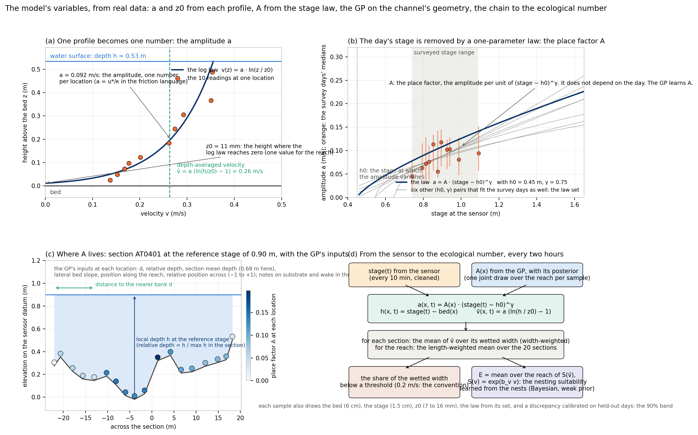
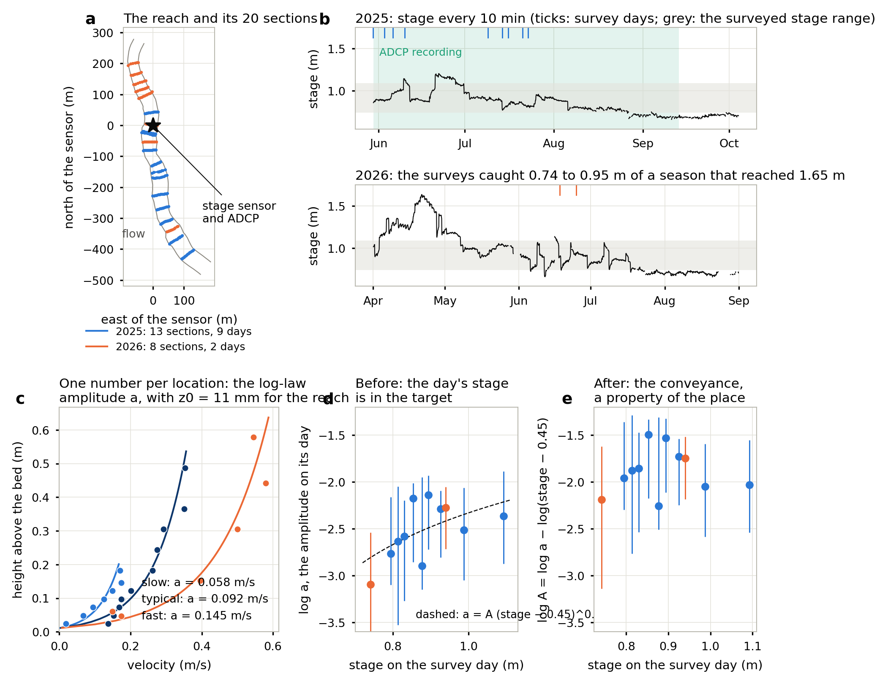
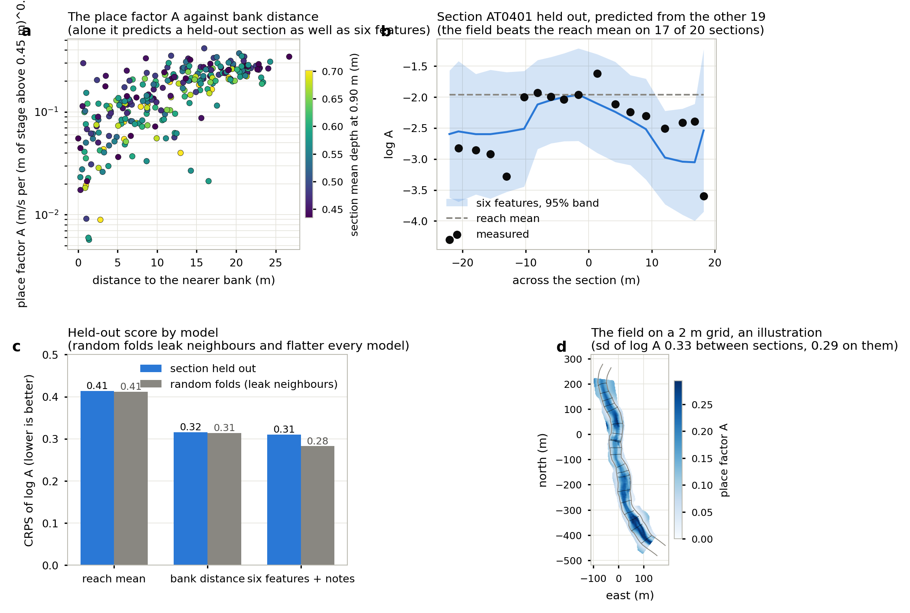
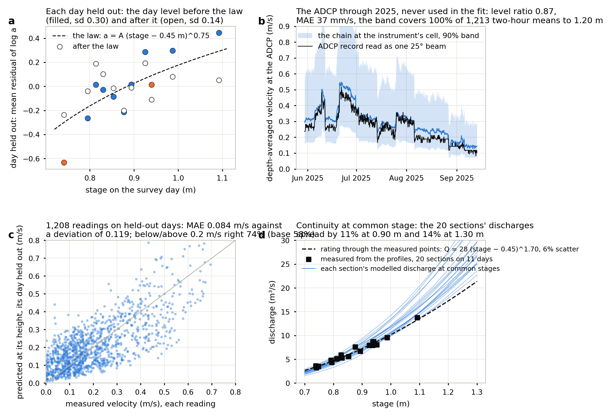
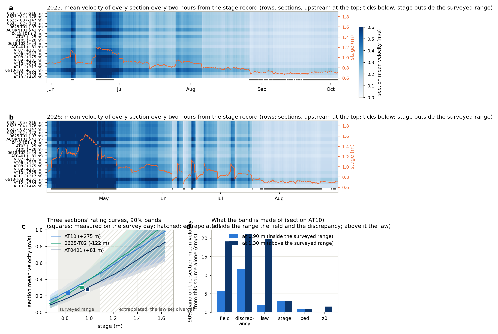
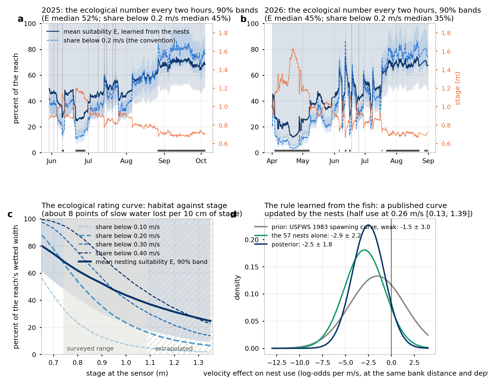
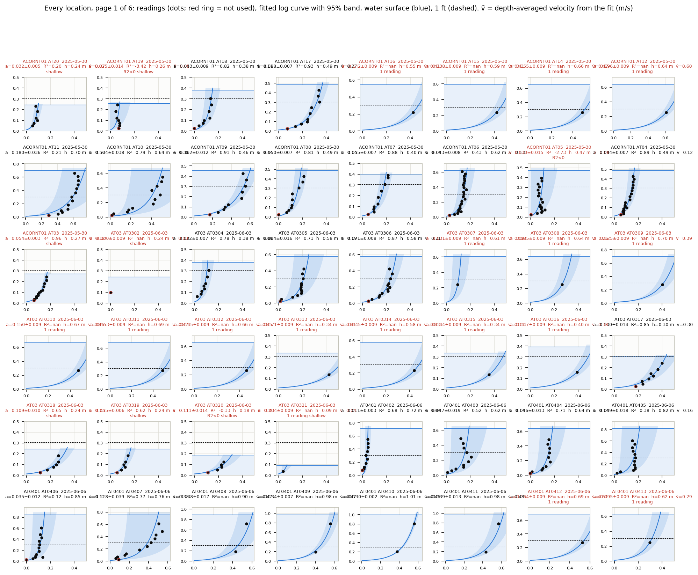
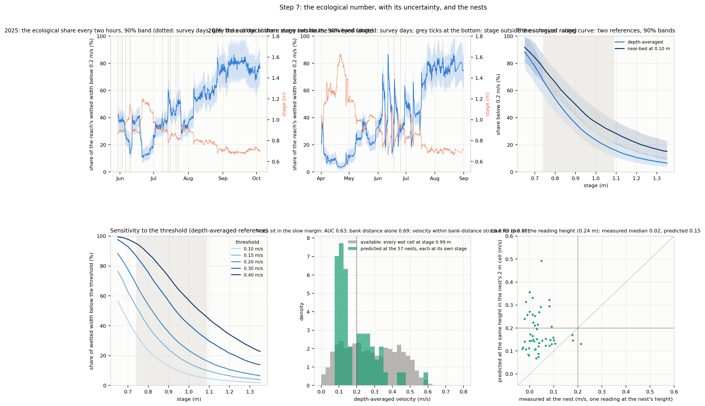

# A season-long velocity record for a river reach from one survey campaign, one stage sensor and one ADCP

*Methods, results and figure plan for the paper. Middle reach of the Huron River, Michigan. Prepared 22 September 2026 from the analysis in reach_velocity/, which reruns end to end in about ten minutes (RERUN.md) and reproduced every number below on a clean rerun. This is the guide for our meeting and the skeleton for the writing. The logbook (LOGBOOK.md, entries 0 to 24) has every intermediate decision and number, should a question go deeper than this document.*

## 1. The claim

In an era in which a stage sensor costs less than a day of field work and reports every ten minutes, velocity, the quantity on which habitat and most operating decisions actually depend, is still measured by hand on a handful of days a year. This raises the question: how far can one stage record and one survey campaign be pushed? On a 0.7 km reach we contend that they can be pushed to the depth-averaged velocity of every surveyed cross-section at every hour of two seasons, with a band that holds up when whole sections and whole days are held out (CRPS 0.31 against 0.41 for the reach mean, and 20 of 20 section means on held-out days inside the band), when a fixed acoustic instrument is compared through a season (level ratio 0.87, 37 mm/s), and when discharge is checked between sections (20 discharges on one rating, 6% scatter). From that record follows an ecological number, the reach's mean nesting suitability, with the rule learned from the fish rather than assumed and with its own band. The stage sensor is effectively turned into a velocity sensor for the whole reach.

## 2. Where this comes from, and why it looks different from the notebooks

The notebooks learned velocity directly, as a Gaussian process of stage and two channel coordinates, on every row of the survey sheets, and scored it by random cross-validation. Three things made that fragile. Rows of different kinds were mixed (single readings taken while walking, nest readings, transect profiles). The height column meant different things in the two years. Random folds let neighbouring readings leak, so the skill looked far higher than it turned out to be on a new day (R² 0.55 against 0.03). The rebuild keeps the idea, a GP over the reach driven by the stage record, and changes what the GP is asked to learn and how it is tested.

The physical reduction is the heart of it. Rather than learning velocity, we learn a property of the place. Each profile of three to five readings collapses to one number by the log law of the wall, the amplitude a (Section 4 and Figure M draw every variable). A one-parameter stage law then removes the day: A = a / (stage − h0). A does not depend on the day, which is why 257 locations are enough. In the language of the USGS index-velocity methods this is a separable model, a(x, t) = A(x) g(stage(t)): one static field, one time series, and a law between them. The GP learns only A, on measured channel geometry, and what it learns turns out to be mostly bank distance, that is, at-a-station hydraulic geometry.

Two further choices follow from the data rather than from taste. The exponent of the stage law is not pinned by eleven survey days: several (h0, γ) pairs fit equally well. As such, we keep the whole set and carry it into the uncertainty, and the band widens above the surveyed stage range where the laws diverge. And the ecological rule is learned rather than assumed: the nests are asked what they chose relative to what was available, with the published USFWS spawning curve as a weak prior, so the rule comes out with a band and travels through the same chain as the velocities.

Validation is the other departure. Sections are held out one at a time, days are held out one at a time, the readings on held-out days are predicted at their own heights, the section means on held-out days are checked against the band, the ADCP is compared through a whole season at its own cell, and discharge is checked for continuity between sections. Scores are MAE, CRPS and coverage in physical units. R² on a narrow test set is what misled the first pass, and random folds appear once, as the cautionary comparison.

## 3. The model, with its variables

Figure M is the one to have open when the questions start. It is drawn from the data: one real profile, the real survey days, one real section, and the chain as it runs.

*Figure M. The model's variables. (a) One profile becomes one number: the readings at heights z above the bed follow v(z) = a ln(z/z0), with z0 the height at which the law reaches zero (11 mm, one value for the reach) and a the amplitude (one number per location, a = u*/κ in the friction language); the depth-averaged velocity is v̄ = a (ln(h/z0) − 1). (b) The amplitude rises with the day's stage; a = A (stage − h0)^γ removes it, with h0 the stage at which the amplitude vanishes (0.45 m) and γ = 1 the adopted exponent; six other (h0, γ) pairs fit the survey days as well and form the law set. A, the place factor, is what the GP learns. (c) A across one section at the reference stage, with the GP's inputs. (d) From the sensor to the ecological number, every two hours.*

A glossary, for the same purpose:

| symbol | meaning | where it comes from |
|---|---|---|
| z | height above the bed of a reading | measured (0.05 to 0.6 m) |
| z0 | roughness scale: the height at which the log law reaches zero | 11 mm for the reach, fitted; drawn 7 to 16 mm in the chain |
| v(z) | velocity at height z | measured, 3 to 5 per location |
| a | the amplitude of the log law at a location, on its day | fitted per location, with its own error from the readings' spread |
| h | local water depth | stage minus bed, on the sensor datum |
| v̄ | depth-averaged velocity, a (ln(h/z0) − 1) | derived |
| stage | the sensor's water level, every 10 min | measured, cleaned |
| h0, γ | the stage law's offset and exponent | 0.45 m and 1.0 adopted; a set of seven pairs carried |
| A | the place factor, a / (stage − h0)^γ | the GP's target; one static field |
| d, x, ... | the GP's inputs: bank distance, along and across position, relative depth, section mean depth, lateral bed slope | measured geometry |
| S(v), E | relative nesting suitability exp(b_v v), and its reach mean | b_v learned from the nests with a weak prior |

### 3.1 From readings to the amplitude a

For each location the readings at heights z are fitted by v = a ln(z/z0), with one roughness scale for the reach, z0 = 11 mm, from a pooled grid search on the profiles with three or more readings (the fit is flat between 7 and 16 mm). The spread of the readings' implied amplitudes gives each location its own measurement error, which the GP uses as fixed noise. A transfer check, predicting the 1 ft reading of each profile from its other readings, gives 30 mm/s on 124 profiles. Simply put, every location becomes one physical number with an error bar.

### 3.2 The stage law and the place factor A

On each survey day the amplitudes rise with stage. Divided by (stage − 0.45 m)^0.75 they do not (Figure 1d, e). Each day held out and predicted from the others, the day's mean residual has sd 0.30 in log before the law and 0.14 after. The day-out score is flat across (h0, γ) pairs from (0.35, 1.25) to (0.65, 0.5) within optimiser noise, the measured discharges suggest γ near 0.75, and the ADCP 1.1 to 1.25. We adopt the best pair on the grid, (0.45, 0.75), as the primary law and carry all eight pairs within 0.01 of it in the chain.

### 3.3 The Gaussian process on A

The target is log A. The inputs are six measured features (position along and across the reach, distance to the nearer bank, relative depth in the section, section mean depth, lateral bed slope). The mean is a weighted least squares on the substrate classes and a wake flag from the field notes. The kernel is an ARD Matérn 3/2 with a white nugget, the per-point noise is fixed from the readings' spread, and the hyperparameters come from the marginal likelihood (stable across restarts). Bank distance alone predicts a held-out section better than all six features (CRPS 0.29 against 0.32, better on 14 of 20 sections, p = 0.03). The chain keeps the six because it was built on them, and the paper says what the field is.

### 3.4 The uncertainty chain

Each sample draws the whole reach at once. The GP posterior over every point of every section is one joint draw. A discrepancy term, split into a reach-level part (0.07 in log, the residual day level after the law) and a point-level part (0.30), is calibrated so that 95% of held-out points fall in the 95% band (inflation 1.159). The bed (6 cm per point), the stage (1.5 cm, one draw per time for the whole reach), the roughness scale (7 to 16 mm) and the law (drawn uniformly from its set) complete the sample. Shares are width-weighted within a section and length-weighted over the sections. Every number in the results carries a 90% band from this chain.

### 3.5 The deliverables

The first deliverable is the set of spatial rating curves: the section mean velocity of all 20 sections every two hours through 2025 and 2026 from the stage record, with bands. A 2 m map of the field, from a bed GP on the RTK sections and the bank points, is drawn once as illustration; every number comes from the sections. The second is the ecological number: the share of the wetted width below a velocity threshold, and its threshold-free form, the reach's mean nesting suitability E.

### 3.6 The nest model and the posterior update

Each nest is one 'used' 2 m cell, with the velocity, depth and bank distance the chain gives it on the day the nest was found, and 20 'available' cells are drawn from the wet channel at the same stage. A logistic model then asks what makes a cell used rather than available, each variable with the others held fixed. Bank distance is the strong selector (nests at 4.9 m from the bank against 12.3 m for the channel, partly where the crews searched). Velocity adds nothing until depth is in the model: near the bank the deeper cells are faster, and the nests take the deep-but-slow ones. With depth in, velocity leans against use (the 57 nests alone: -2.9 ± 2.2 log-odds per m/s) and depth for (+3.4 per m). In plain terms, the fish nest in deep water near the bank; with the bank lines at each nest's own stage (bank set C, logbook entry 30) the velocity effect is about 1.3 standard errors from zero, so its sign is suggested rather than shown.

The prior is the USFWS habitat suitability curve for smallmouth bass spawning (Edwards, Gebhart and Maughan 1983, curve 20110), digitised from the scanned report and fitted by an exponential (-1.5 per m/s), with its sd set so that the same report's steep adult utilisation curve sits two sd away (3.0). It is weak by design: it carries the sign and the order of magnitude and lets 59 nests move it. The posterior is -2.5 ± 1.8 per m/s, half use at 0.26 m/s [0.13, 1.39]. E is the width-weighted mean of the relative use exp(b_v v) over the reach: 1 if the whole reach were still water, 0 if all of it were too fast for a nest. Its band combines the curve's posterior with the velocity chain. The 0.2 m/s convention sits at the 61st percentile of the nests, so it was not far off. The difference is that the rule is now estimated, with a band, and can be updated as nests accumulate.

## 4. The data, and what was done to it before any model

The Middle reach: 20 cross-sections, 257 locations, 1,285 hand-held readings at three to five heights above the bed on 11 days over 2025 and 2026; one ultrasonic stage sensor every 10 minutes (MaxBotix), one bed-mounted SonTek ADCP through 2025, RTK elevations on every section (total station in 2025, Reach RS3 in 2026, NAVD88), and 63 nest sites held aside from day one. Each cleaning step is in the logbook with its evidence:

- **Row types.** Only rows of type 'Transect' enter. The 196 'Other' rows of 2025 were single readings taken while walking, at 0.3 m/s everywhere regardless of flow; they were 61% of the unique points in the old model and produced a false stage effect. Nests are kept aside and thalweg rows are out.
- **Heights above the bed.** In 2025 'Depth' is a rod reading and 'Actual depth' (0.4 × Depth) is the height above the bed; in 2026 'Depth' is the height. Using the right column moves 82 readings by a fifth to a third.
- **Labels and entries.** Three points labelled AT06 on 14 July 2025 sit on AT07's line and carry AT07's names (relabel confirmed by the crew). A leading space in ' AT11' was stripped. One entry error (3.6 ft/s at 0.08 ft) is removed by name.
- **The stage record.** The MaxBotix reads low in the afternoon by about 2 cm, a sensor effect rather than the river (it is tied to the hour and vanishes at night). We keep the night readings as truth, remove the daytime pattern with a monthly template built on dry days, drop implausible readings and spikes, and take a 3 h median. Stage is then read at each reading's own time rather than by calendar day, which matters on the days the river was rising.
- **The ADCP.** Smoothed the same way onto the same 10-minute grid, and never used in any fit.
- **The RTK tie.** The RTK water surface on each section, minus the sensor stage at the time, gives one offset per survey session and one water-surface slope for the reach (5 cm per 100 m, residual 1.3 cm). This puts every measured bed on the sensor's datum, and it is the check that one sensor describes the whole reach.
- **Units.** Everything is converted once at load; nothing downstream sees feet.

## 5. Results and the takeaways

Each result is one figure. The numbers are in Table 3, the parameters in Table 2, the ablations in Table 4.

*Figure 1. The site, the data and the target. (a) The 20 sections, the sensor and the ADCP. (b) The stage record in both seasons with the survey days. The surveys covered 0.74 to 1.09 m of a season that reached 1.65 m. (c) Three profiles reduced to one amplitude each. (d) The amplitude rises with stage on the survey days; (e) divided by the law it does not: the place factor A is what the model learns.*

Takeaway: one number per place, with its error, is the whole spatial problem. The stage sensor supplies the rest.

*Figure 2. What is learned. (a) A against bank distance for every location. (b) One section held out and predicted from the other nineteen, with its band. (c) The held-out score by model, sections held out against random folds. (d) The field on a 2 m grid, as illustration.*

Takeaway: the field beats the reach mean on 17 of 20 held-out sections (CRPS 0.31 against 0.41; the 95% band covers 93%), and it is mostly at-a-station geometry: bank distance alone does better. Random folds flatter every model, which is why the paper scores sections and days held out.

*Figure 3. One sensor carries the field through time. (a) Day levels before and after the law. (b) The ADCP through 2025, never used in the fit, read as a single 25° beam, against the chain at its own cell: level ratio 0.87, MAE 37 mm/s, the band covers every two-hour mean to 1.20 m of stage. (c) The 1,208 readings on held-out days predicted at their own height. (d) Continuity: every section's modelled discharge at common stages, the measured discharges on the survey days, and the rating through them.*

Takeaway: the day effect is stage. The readings on held-out days come back to 0.082 m/s against a deviation of 0.119, the section means on held-out days fall inside the band 20 of 20 times, the 20 measured discharges lie on one rating with 6% scatter, and the ADCP validates field and law continuously at one point (reading Vb as a beam, which the instrument's configuration has to confirm).

*Figure 4. Spatial rating curves. (a, b) The mean velocity of every section every two hours in 2025 and 2026. Ticks mark the hours outside the surveyed stage range. (c) Three sections' rating curves with bands, extrapolation hatched. (d) What the band is made of: inside the range the field and the day-to-day discrepancy, above it the law set.*

Takeaway: this is the deliverable. Bands are about ±28% inside the surveyed range and widen above it because the law is a ridge, which the figure shows and the discussion states once.

*Figure 5. The ecological number, learned from the nests. (a, b) The reach's mean nesting suitability E and the share below 0.2 m/s every two hours, both seasons, with bands. (c) The ecological rating curve: habitat against stage, E with its band and the share below four thresholds; the surveyed range is shaded and the extrapolation hatched. (d) The velocity effect: the published curve as a weak prior, the nests alone, and the posterior.*

Takeaway: the ecological rating curve is the number the sensor delivers. Every 10 cm of stage removes about 8 points of slow water from the reach inside the surveyed range, and E falls from about 60% at 0.65 m to 20% at 1.30 m. E has median 52% in 2025 and 45% in 2026 (the share below 0.2 m/s: 45% and 35%). The rule is estimated with a band rather than assumed; what the nests select on (deep, slow water near the bank) is in the supplementary figure 12.

### 5.1 Validation scores (Table 3)

| test | quantity | value |
|---|---|---|
| Section held out (20 folds, 257 points) | CRPS of log A: six features + notes / bank distance alone / reach mean | 0.311 / 0.316 / 0.414 |
|  | MAE of log A: six features + notes / reach mean | 0.425 / 0.567 |
|  | 95% band coverage, six features + notes | 0.93 |
|  | random ten-fold CRPS for the same three models (the cautionary comparison) | 0.283 / 0.314 / 0.412 |
| Day held out (11 folds, 257 points) | CRPS of log a: stage law (0.45, 0.75) / local depth^0.5 / no law | 0.321 / 0.328 / 0.373 |
|  | CRPS across the law set (8 pairs) | 0.321 to 0.325 |
|  | day level: sd of the held-out day means before / after the law (log) | 0.34 / 0.17 |
| Readings on held-out days (1,208 readings) | MAE / mean absolute deviation of the readings (m/s) | 0.084 / 0.119 |
|  | 95% band coverage | 0.85 |
|  | below or above 0.2 m/s called right / base rate | 74% / 58% |
| Sections on held-out days (20) | measured section mean velocity inside the 90% band | 100% (MAE 0.055 m/s, median relative error 24%) |
|  | measured share below 0.2 m/s inside the 90% band | 95% (MAE 12 points) |
| ADCP through 2025 (shape check, level fitted) | MAE of the law c (stage - 0.45)^0.75 against the 10-min record | 14 mm/s |
|  | sd of the log ratio over the season | 0.169 |
|  | its own exponent on (stage - 0.45) at the surveyed depth: point / column reading | 1.25 / 1.12 |
| Continuity (measured) | 20 section discharges from 11 days on one rating | Q = 28 (stage - 0.45)^1.70 m3/s, 6% scatter |
|  | same-day sections, max/min of the measured discharge | 1.10, 1.11, 1.01, 1.11, 1.10 |
| Continuity (modelled, common stage) | sd of log Q across the 20 sections at 0.70 / 0.90 / 1.30 m | 0.143 / 0.113 / 0.137 |
| Reach share below 0.2 m/s at 0.90 m | sections (width- and length-weighted) / map with margins to the bank line | 0.362 / 0.480 |
|  | 90% band half-width inside the surveyed range (points) | 7.7 |
| Season medians | 2025 record / hours inside the surveyed range | 45% / 39% (65% of hours) |
|  | 2026 record / hours inside the surveyed range | 35% / 35% (50% of hours) |
|  | May 2026 (extrapolated: 24% of its hours above the range) | 23% [18, 30] |
| Nests (59 in wet cells) | AUC of nests against the wet channel: field velocity / bank distance / place factor / depth | 0.63 / 0.69 / 0.66 / 0.45 |
|  | field velocity within bank-distance strata (+-2 m) | 0.45 (p = 0.00) |

### 5.2 Parameters and settings (Table 2)

| block | item | value | how set |
|---|---|---|---|
| Readings to one number | vertical profile | v(z) = a ln(z / z0); readings at z >= 3 cm and v > 5 mm/s | fixed form |
|  | roughness scale z0 | 11.2 mm for the reach (flat between 7 and 16 mm), from 160 profiles with three or more readings | fitted, pooled grid search |
|  | amplitude a per location | 257 locations with a > 0; per-location sd from the spread of the readings' implied a (median 0.09 relative) | fitted per location |
| Stage record | sensor | ultrasonic range every 10 min; daytime sensor pattern removed against the night line, median filtered; 2 h means for the series | processing |
|  | stage error in the chain | 1.5 cm, one draw per time shared by every section | assumed |
| Stage law | form | a = A (stage - h0)^gamma, one law for the reach | fixed form |
|  | primary pair | h0 = 0.45 m, gamma = 0.75 (best day-out CRPS) | chosen on a grid |
|  | law set drawn in the chain | every grid pair within 0.01 CRPS of the best with h0 below 0.66 m: (0.45, 0.75), (0.35, 1.0), (0.55, 0.5), (0.35, 0.75), (0.55, 0.75), (0.45, 1.0), (0.65, 0.5), (0.35, 1.25) | uniform over the set |
| Spatial model | target | log A, A = a / (stage - h0)^gamma |  |
|  | inputs | along the reach, relative position across, distance to the nearer bank, relative depth in the section, section mean depth, lateral bed slope | measured |
|  | mean | weighted least squares on an intercept, six substrate classes from the notes and a wake flag | fitted |
|  | kernel | ARD Matern 3/2 plus a white nugget; per-point noise fixed from the readings' spread | fitted by marginal likelihood, 2 to 3 restarts |
|  | fitted scales | amplitude sd 0.84, nugget sd 0.14 (log); length scales: along 197 m, relative across 2.1, bank distance 17 m, relative depth 0.40, section mean depth 0.17 m, lateral slope 1.54 | fitted |
| Uncertainty chain | field | one joint Gaussian process draw over every point of every section | posterior |
|  | discrepancy | inflation 1.159 from held-out days (95% coverage before inflation 0.911, n 257); total 0.312 in log, split into a reach-level part 0.070 (one draw per reach) and a point-level part 0.304 | calibrated |
|  | bed | RTK cross-sections on the sensor datum through per-session offsets (one water-surface slope of 5 cm per 100 m, residual 1.3 cm, 11 sessions); 6 cm per point in the chain | measured; error assumed |
|  | roughness | z0 drawn between 7 and 16 mm, one per draw; a rescaled through the readings' typical height (0.25 m) | assumed range |
|  | draws | 100 per two-hourly stage for the series (3,106 stages), 300 for the rating curves | setting |
| Map (illustration only) | bed between sections | Gaussian process on the RTK sections and bank points (scales 117 m along, 29 m across, nugget 5 cm); 2 m grid inside the mapped bank lines | fitted |
| Ecological number | definition | share of the wetted width below 0.2 m/s on the depth-averaged velocity (alternative: 0.10 m above the bed); width-weighted within a section, length-weighted over the 20 sections; wetted width ends at the outermost surveyed points | choice, to be tied to the ecology |

### 5.3 Ablations (Table 4)

| kind | variant | CRPS | sections_better_than_full | wilcoxon_p_vs_full |
|---|---|---|---|---|
| features | bank distance only | 0.291 | 14.000 | 0.027 |
| features | geometry only (rel_across, dist_bank, rel_depth) | 0.294 | 14.000 | 0.070 |
| features | full (6) | 0.320 | 0.000 |  |
| features | position only (along, across) | 0.325 | 10.000 | 1.000 |
| features | no section depth | 0.351 | 6.000 | 0.097 |
| features | position + rel_depth | 0.357 | 7.000 | 0.090 |
| features | reach mean | 0.436 | 2.000 | 0.000 |
| kernel | Matern 3/2, 1 restarts | 0.320 |  |  |
| kernel | Matern 3/2, 3 restarts | 0.320 |  |  |
| kernel | Matern 3/2, 6 restarts | 0.320 |  |  |
| kernel | Matern 5/2, 3 restarts | 0.332 |  |  |
| kernel | squared exponential, 3 restarts | 0.348 |  |  |

## 6. Supplementary information (candidates)

Figures in reach_velocity/figures/, one line each, with the logbook entry that made them in brackets.

- **00a_map.png, 00b_stage_discharge.png, 00c_adcp.png, 00d_profiles.png:** the data at a glance (entry 2)
- **00e_stage_diurnal.png, 00g_stage_night.png, 00h_stage_full.png, 00i_stage_steps.png, 00k_full_series.png:** the stage record: the daytime artefact, the night line, the correction, both seasons (entries 3 to 6)
- **00l_field_inputs.png, 00m_logprofile.png, 00o_amplitude_checks.png, figures/profiles/:** the profiles and the amplitude, every location (entries 7 and 9)
- **00q_rtk_datum.png:** the RTK tie to the sensor datum (entry 10)
- **00v_features.png:** the candidate features and how A responds to each (entry 13)
- **17_model_variables.png:** Figure M, the variables (this document)
- **02_step2_conveyance_gp.png, step2_feature_ablation.csv, step2_kernel_ablation.csv:** the GP, sections held out, the ablations (entries 15, 22)
- **03_step3_transfer.png, 03b_law_refine.png:** the day effect, the laws, the (h0, γ) grid (entries 16, 17)
- **04_step4_uncertainty.png:** the uncertainty chain: calibration and attribution at four stages on four sections (entry 17)
- **05_step5_map.png:** the bed GP, the grid, the map against the sections (entry 18)
- **06_step6_rating_curves.png:** the section series, continuity, the validation table (entry 19)
- **07_step7_ecology.png, 10_nest_habitat.png, 11_nest_bayes.png, 12_nest_selection_explained.png:** the ecological number, the nest-calibrated thresholds, the selection model explained, the Bayesian suitability (entries 20, 23)
- **09_adcp_single_beam.png, adcp_recheck.json:** the ADCP re-read and the single-beam test (entry 23)
- **reviews/, LOGBOOK.md entry 22:** the three reviewer reports and the responses
Two supplementary figures worth showing in full. The per-location profile pages (figures/profiles/page_01 to page_06 and profiles_all.pdf) draw every one of the 257 locations' readings with its fitted log law: the busy one, and the one that answers 'how did you get one number per location'. Page 1 is below; the other pages are in the folder.

*Supplementary figure: the log-law fit at every location, page 1 of 6 (figures/profiles/). Each small panel is one location on one day: its readings against height above the bed, the fitted curve v = a ln(z/z0) with the reach's z0, the amplitude a it yields, and the fit's R². The remaining pages cover the other locations.*

*Supplementary figure: the ecological number in full (figure 07): the share below 0.2 m/s every two hours in both seasons, the ecological rating curve for the depth-averaged and the near-bed reference and for five thresholds, and the nests against the available channel. Panel c of Figure 5 is drawn from the same tables.*

Data repository: data_raw/ (the raw sheets and sensor exports as used), data_clean/ (every derived table), the scripts, requirements_frozen.txt, run_all.sh and the logbook. The folder is self-contained and reruns in about ten minutes; the rerun of 22 September 2026 reproduced every number in this document.

## 7. Directions for writing the paper

- **Journal and reader.** Environmental Modelling and Software, or Water Resources Research on the methods side. The reader is a modeller or a practitioner with a stage sensor. The abstract states the question, the method, how it was evaluated and what carries over; STORY.md holds draft 4.
- **Figures.** Five figures, one message each, as above. Everything else is supplementary. Resist adding panels.
- **The claims, with their evidence.** (i) One profile becomes one physical number. (ii) A one-parameter law separates the day from the place. (iii) The place factor is learnable from geometry. (iv) One sensor carries it through two seasons, tested five ways. (v) The ecological rule is learned from the fish, with a band. Each claim has a figure and a table row.
- **The limits, stated once.** The law's exponent above the surveyed stage range is a ridge, and the band shows it. The wetted width stops at the outermost surveyed points, so the share is a lower bound at high stage. Day and place are confounded in the survey design, and the continuity of the measured discharges is the place-free evidence. The nests validate the margin rather than the field within it. Each of these is said once, in the discussion, and the paper moves on.
- **Pending from the field team.** Vb as a single beam (the instrument's configuration); the meter's make; a source for the 0.2 m/s convention, now only a comparison. Everything else is in hand.
- **Design lessons for the last section.** Interleave sections across days and repeat a few of them; put the sensor inside the surveyed stretch; know what the fixed instrument measures before it goes in. These come straight from what worked in the Middle and what did not in the other two reaches.
- **The other two reaches.** Their survey and sensor data are in the repository and the scripts exist. The work is paused because the Lower's record needs the Middle's cleaning and both sensors sit outside their surveyed stretches; entries 21 and 24 of the logbook and OPEN_QUESTIONS.md carry the instructions.

## 8. Rerunning and checking

RERUN.md in the folder gives the environment, the one command, the numbers to compare, and a prompt a Claude Code session can run to verify the work independently. To that end, everything the paper will say can be regenerated by anyone on the team in a few minutes.
